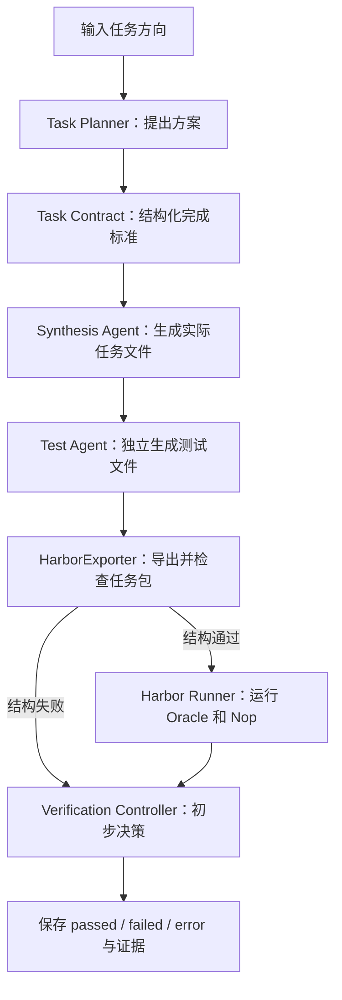

# 最小原型：自动生成任务并通过 Harbor 做基础检查

## 1. 本版目标与流程

用户输入一个任务方向，系统自动提出方案、明确完成标准、生成实际文件、独立生成测试、导出 Harbor 任务包，然后真实运行 Oracle 和 Nop，根据执行结果判断候选是否通过基础检查。



本版只实现这条单向链路，每次生成一个候选。暂不加入 Challenge、真实解题 Solver、难度分级、自动修复循环和数据集发布。

**第一版支持范围：** Linux 环境下的 Python CLI 和代码修复任务。每个任务只需要一个容器运行，测试和评分则在独立的 Verifier 容器中进行。暂时不考虑需要 GPU、多服务部署或浏览器交互的任务。

Planner 只生成符合这些条件的任务。如果用户提出的方向超出了当前支持范围，并且无法在不改变原始目标的情况下简化，系统会返回 `UNSUPPORTED_DIRECTION`，而不是擅自生成一个不同的任务。

**必须实际生成文件并执行 Harbor。** 下文 JSON 是接口示例。

## 2. 最小数据约定

用普通函数调用串联模块，用 JSON 保存结构化数据，用本地路径传递文件。

| 约定     | 规则                                                                                                    |
| -------- | ------------------------------------------------------------------------------------------------------- |
| 一次运行 | 一个 `run_id`，对应 `runs/<run_id>/`；重新生成时创建新目录                                          |
| 文件路径 | JSON 中的路径均相对于本次运行目录；容器内路径如 `/app` 单独注明                                       |
| 数据类型 | `*_path`、`*_dir` 为字符串，`requirements` 为数组，超时为正数，reward 为 `0`、`1` 或 `null` |
| 文件交付 | 返回文件路径前必须写入磁盘并确认存在；源码不塞进大段 JSON 字符串                                        |
| 结果来源 | Planner、Contract 由模型生成；运行分数和最终决策由程序读取真实证据得到                                  |
| 同一候选 | Exporter 导出后冻结 `task/`，Oracle 和 Nop 使用相同任务包，各自创建干净环境                           |
| 异常     | 保存失败阶段、错误信息和日志；缺失 reward 是错误，不自动补成 `0`                                      |

建议目录：

```text
runs/run_001/
├── request.json
├── plan.json
├── contract.json
├── synthesis.json
├── tests.json
├── export.json
├── run_result.json
├── decision.json
├── draft/                  # Agent 实际生成的文件
│   ├── instruction.md
│   ├── environment/
│   ├── solution/
│   └── tests/
├── task/                   # Exporter 输出的 Harbor 任务包
└── jobs/                   # Harbor 实际执行日志和结果
```

**设计理由：** 先让每一步都能读写和复查。一个运行目录就能关联方案、文件、评分和结论，无须先实现复杂的版本管理。

## 3. Task Planner：自动提出任务方案

**输入：** 用户方向及原型运行限制，保存为 `request.json`。`run_id` 和默认限制由程序填写，用户只需提供 `direction`。

```json
{
  "run_id": "run_001",
  "direction": "数据清洗与命令行工具修复",
  "constraints": {
    "environment": "linux-docker",
    "language": "python",
    "task_environment": "single_container",
    "allowed_categories": ["cli_repair", "code_repair"],
    "verifier_mode": "separate",
    "agent_timeout_sec": 300,
    "verifier_timeout_sec": 120
  }
}
```

**输出：** `plan.json`。下例表示一次可能的模型输出。

```json
{
  "title": "修复 JSONL 日志统计脚本",
  "category": "cli_repair",
  "goal": "修复已有脚本，使其能根据输入日志生成各级别的条数统计。",
  "skills": ["阅读代码", "定位数据处理错误", "命令行调试"],
  "scenario": "现有日志统计工具输出错误，需要恢复正确的数据汇总行为。",
  "initial_state": "提供有缺陷的脚本和示例输入文件。"
}
```

**设计理由：** Planner 负责把宽泛方向收敛成可构建的方案，暂不要求生成代码或承诺任务难度。更换输入方向后，应重新提出方案和生成文件。

## 4. Task Contract：生成结构化完成标准

**输入：** `request.json` 与 `plan.json`。

**输出：** `contract.json`，供 Synthesis、Test Agent 和 Exporter 共用。Contract 决定需要交付什么，Synthesis 决定怎样实现。

```json
{
  "objective": "让日志统计脚本正确统计指定文件中的日志级别。",
  "workspace": "/app",
  "command": "python /app/summarize.py <input.jsonl> <output.json>",
  "input_spec": "UTF-8 JSONL；每行一个 JSON 对象，level 为 INFO、WARN 或 ERROR；允许空文件；不包含空行或非法 JSON。",
  "output_spec": "UTF-8 JSON 对象，恰好包含 INFO、WARN、ERROR 三个键，值为对应条数的非负整数。",
  "deliverables": {
    "artifact_paths": ["/app/summarize.py"],
    "allowed_dependencies": "python-stdlib",
    "allow_additional_files": false
  },
  "requirements": [
    {"id": "R1", "description": "命令正常退出，输出指定文件；三种级别的计数与输入一致。"},
    {"id": "R2", "description": "对不同的合法输入均正确；空输入时三个计数均为 0。"},
    {"id": "R3", "description": "不得修改输入文件；允许修改 /app/summarize.py 内的实现，本例仅交付该文件，运行依赖限定为 Python 标准库。"}
  ],
  "limits": {
    "command_timeout_sec": 10,
    "max_input_lines": 1000
  }
}
```

Contract 中解题者需要知道的输入范围、命令、输出、限制和完成标准，都必须进入正式 Instruction。程序首先检查必需字段、要求 ID 唯一和限制值有效。

`deliverables.artifact_paths` 是解题容器内的绝对路径数组，是交付范围的唯一依据。本例限定为单文件和 Python 标准库；`allow_additional_files=false` 表示不得依赖清单以外新增的交付文件，不禁止运行时临时文件。Verifier 在镜像构建时安装约定的固定依赖，不继承解题容器里临时安装的软件。

允许新增模块时，由 Contract 声明目录级范围（如 `/app/src`）并设置 `allow_additional_files=true`，新增交付文件仍须位于该范围内。必要配置也要列入清单。第一版优先通过专用源码目录划分，排除测试、答案、缓存和日志，不直接传递整个混合工作区；不要只列参考解法恰好修改的文件。若确需目录内过滤，必须先在 Contract 明确排除规则并实现传输过滤，不能假定 Harbor 自动忽略这些文件。

**设计理由：** 用一份短清单约束生成和测试，避免两者各自理解目标。要求 ID 只用于测试覆盖和问题定位，不建立复杂需求管理系统。

## 5. Synthesis Agent：自动生成实际文件

**输入：** 任务方案、Contract、运行限制和可写的 `draft/` 目录。

**必须执行：** 通过文件工具或终端创建 `instruction.md`、`environment/Dockerfile`、初始项目及数据、`solution/solve.sh` 和解法需要的辅助文件。环境中保留待解决的问题，参考解法单独保存。开发时运行过解法的工作区不能当作初始环境交付。

**输出：** 实际文件，以及 `synthesis.json`。

```json
{
  "instruction_path": "draft/instruction.md",
  "environment_dir": "draft/environment",
  "dockerfile_path": "draft/environment/Dockerfile",
  "solution_dir": "draft/solution",
  "solution_entrypoint": "draft/solution/solve.sh"
}
```

目录内文件名和数量按任务生成，不固定为日志脚本或库存服务。Docker 构建上下文只能包含环境需要的内容，不能把参考解法或评分测试复制到初始镜像中。

Synthesis 按 `contract.json.deliverables` 创建项目与参考解法，不再另行声明或缩减交付清单。如果实现需要第二个文件，必须放在 Contract 已允许的目录范围内；否则报告约束冲突，不能自行扩展交付范围。Test Agent 和 Exporter 直接读取 Contract，不以 Synthesis 的实现选择决定需要验证哪些文件。

**设计理由：** JSON 只描述已经交付的文件，保证下游可以直接消费。Synthesis 交付的参考解法能否工作，由后续 Harbor Oracle 真实验证。

## 6. Test Agent：独立生成测试

**输入：** Contract（含交付范围）、Instruction、初始环境和单独可写的测试目录。

```json
{
  "contract_path": "contract.json",
  "instruction_path": "draft/instruction.md",
  "environment_dir": "draft/environment",
  "output_dir": "draft/tests"
}
```

Test Agent 使用独立上下文，只提供上述输入。运行工具的工作区也只放允许读取的文件，不能让它通过父目录访问 `solution/`。它不能修改 Contract、Instruction、初始环境或参考解法。

**输出：** 实际测试代码、独立 Verifier 的 `tests/Dockerfile` 和 `tests.json`。测试入口与结果处理使用统一模板，由 Exporter 安装，Test Agent 不自行编写评分异常处理。

```json
{
  "tests_dir": "draft/tests",
  "verifier_dockerfile_path": "draft/tests/Dockerfile",
  "entrypoint_template": "pytest-wrapper-v1",
  "coverage": [
    {"requirement_id": "R1", "test_names": ["test_counts"]},
    {"requirement_id": "R2", "test_names": ["test_other_input", "test_empty_input"]},
    {"requirement_id": "R3", "test_names": ["test_input_unchanged"]}
  ],
  "reward_policy": "pass_1_assertion_fail_0_error_null"
}
```

本版评分统一为二元值：所有必要断言通过写 `1`，正常执行但断言失败写 `0`。测试依赖缺失、测试收集失败、内部异常等必须报告错误，不能用一个兜底异常处理全部变成 `0`。测试只检查规定的结果与限制，不检查某一种补丁或实现方式。

`tests/Dockerfile` 在镜像构建时安装固定版本的 pytest 及任务运行依赖，将测试与统一包装器复制到 `/tests`，并预建接收制品的父目录。对本例至少创建 `/app`；例如制品为 `/workspace/src/tool.py`，则须预建 `/workspace/src`。Verifier 使用自己的测试输入夹具，不继承 Agent 容器的文件系统或进程。参见 [Separate verifier](https://docs.harborframework.com/tasks/separate-verifier)。

### 6.1 统一测试包装器

Exporter 提供固定的 `tests/test.sh` 和 `tests/run_tests.py`；前者只启动后者。包装器使用 pytest 的退出码与逐测试阶段报告共同判断，不直接把退出码写成 reward，也不将所有非零退出码映射为 `0`。pytest 区分测试失败、中断、内部错误、用法错误和未收集到测试等退出状态，参见 [pytest Exit codes](https://docs.pytest.org/en/stable/reference/exit-codes.html)。

| 执行结果                                                                | 包装器行为                                |
| ----------------------------------------------------------------------- | ----------------------------------------- |
| 退出码 0，必要测试全部执行并通过                                        | 写 `reward.txt=1`，包装器正常退出       |
| 退出码 1，只有按测试模板表达的任务行为断言失败（包括 fixture 初始化时） | 写 `reward.txt=0`，包装器正常退出       |
| 收集失败、测试框架或测试代码自身异常、评分依赖故障，或其他退出码        | 不生成 reward，写错误报告，包装器非零退出 |
| 零测试、必要测试被 skip/xfail、包装器超时或报告不完整                   | 标记执行错误，不能算通过                  |

**分类依据是失败原因，不是 pytest 阶段。** 统一测试模板要求：预期的任务行为失败转换为 `assert` 或 `pytest.fail`，测试框架自身异常保留为执行错误。fixture 在 setup 阶段执行待修工具时，若工具无法启动恰好违反 Contract，必须转成任务断言失败并得到 `reward=0`；不能因为发生在 setup 就标为基础设施故障。

模板优先让 fixture 准备输入、记录子进程结果，在测试主体断言退出状态、输出内容和命令时限；确需在 fixture 中断言任务行为时采用同一约定。包装器通过 pytest hooks 读取阶段与异常信息，识别模板约定的断言失败；意外测试代码异常、fixture 自身准备/清理故障、评分器超时仍为 `error`。若任务断言失败与评分系统异常同时出现，以 `error` 为准。不做兜底 `except Exception: pytest.fail(...)`，也不建立复杂的异常推断系统。

包装器启动时清除上次遗留的 reward 文件；运行后写 `/logs/verifier/execution.json`，格式如下（本系统附加报告，不是 Harbor 原生字段）：

```json
{
  "status": "completed",
  "pytest_exit_code": 1,
  "reward": 0,
  "error": null
}
```

异常时 `status=error`、`reward=null`，`error` 填失败阶段与原因；未取得退出码时 `pytest_exit_code=null`。Runner 同时检查此报告、Harbor trial 异常和 reward 是否一致；包装器未能写报告也视为错误。Harbor 的测试入口仍是 `tests/test.sh`，分数输出为 `/logs/verifier/reward.txt`。参见 [Harbor Verifier](https://docs.harborframework.com/tasks/verifier)。

**设计理由：** 保留最必要的独立性，让测试根据完成标准生成；覆盖表用于检查漏项。评分规则固定，Controller 就能用简单规则判定。

## 7. HarborExporter：转换并验证任务包结构

**输入：** `request.json`、`plan.json`、`contract.json`、`synthesis.json`、`tests.json` 及其引用的实际文件。

**执行：** 将生成文件复制到 Harbor 目录结构，安装统一测试包装器，按运行限制与交付清单生成 `task.toml`，调用 Harbor lint 并解析结果。它是普通程序模块，无须调用模型。

```text
task/
├── instruction.md
├── task.toml
├── environment/
│   ├── Dockerfile
│   └── ...                 # 实际初始项目、数据与依赖声明
├── solution/
│   ├── solve.sh
│   └── ...
└── tests/
    ├── Dockerfile          # 独立 Verifier 镜像及测试依赖
    ├── test.sh             # 固定入口模板
    ├── run_tests.py        # 统一 pytest 结果处理
    └── ...
```

该结构对应 [Harbor Task Overview](https://docs.harborframework.com/tasks/overview)。`task.toml` 应包含 Agent/Verifier 超时及必要环境设置，并使用安装版本支持的配置格式；Exporter 应调用该版本的配置解析器校验，而非仅判断 TOML 语法正确。参见 [Harbor Configuration](https://docs.harborframework.com/tasks/configuration)。

Harbor 框架支持 shared，但本版采用 **separate**，与当前 Terminal-Bench 贡献规范中的独立验证要求一致。参见 [Terminal-Bench 贡献指南](https://github.com/harbor-framework/terminal-bench/blob/main/CONTRIBUTING.md) 与 [独立验证检查规则](https://github.com/harbor-framework/terminal-bench/blob/main/docs/TASK_REVIEW_AUTOMATION.md#check-separate-verifier)。

日志统计示例的关键配置如下；完整 `task.toml` 仍需按固定 Harbor 版本补齐配置格式等字段：

```toml
artifacts = ["/app/summarize.py"]

[verifier]
environment_mode = "separate"
timeout_sec = 120

[agent]
timeout_sec = 300
```

`artifacts` 必须放在顶层、所有表头之前，直接由 `contract.json.deliverables.artifact_paths` 生成。Harbor 将解题后的制品恢复到 Verifier 中相同的容器路径；评分必须执行传入的候选代码，不能在 Verifier 镜像中预置修好后的实现。测试镜像应包含 `/tests` 下的代码和包装器，并确保接收路径的父目录存在。

Exporter 在本次运行目录调用：

```bash
harbor lint --json ./task
```

固定 Harbor 版本，保存原始 JSON、stderr 和退出码。复用其配置、缺失文件、shared Verifier、显式测试/答案泄漏等检查；本版要求默认启用规则无诊断，不由生成 Agent 添加忽略规则。lint 只能发现其规则覆盖的问题，不能证明绝无泄漏。参见 [Harbor Lint](https://docs.harborframework.com/tasks/lint)。

Exporter 只补充本项目特有的核对：要求 ID 覆盖完整；顶层 `artifacts` 与 Contract 交付清单一致且不为空；生成项目的布局、依赖声明及交付范围不与 Contract 冲突；`tests/Dockerfile`、统一包装器和父目录准备齐全；Linux 脚本换行与权限正确。源文件到容器路径的映射先检查，容器内实际交付是否完整、镜像构建和行为正确性由 Runner 验证，不重新实现一套通用静态扫描器。

**输出：** `export.json`。

```json
{
  "task_dir": "task",
  "structure_valid": true,
  "lint": {
    "status": "completed",
    "exit_code": 0,
    "report_path": "lint.json",
    "stderr_path": "lint.stderr.log"
  },
  "errors": []
}
```

失败时 `structure_valid=false`，`errors` 填入 `{ "path": "task/solution/solve.sh", "message": "缺少参考解法入口" }` 一类记录，停止提交 Harbor，由 Controller 输出初步失败结论。

lint 正常返回任务诊断属于结构失败；命令不可用、工具崩溃或 JSON 解析失败则令 `lint.status=error`、`structure_valid=null`，由 Controller 输出 `error`。不能把检查工具未运行成功误记成候选结构不合格。

**设计理由：** 用 Exporter 统一封装 Harbor 格式适配，避免每个生成 Agent 都承担配置和目录规范；结构正确与运行正确分开判断。

## 8. Harbor Runner：真实运行 Oracle 和 Nop

**输入：** 结构检查通过的 `export.json`，以及运行目录。Oracle 执行参考解法，Nop 不进行解题操作，两者分别在干净初始环境中接受同一套测试。

Harbor 提供 `oracle`、`nop` 两种 Agent；Oracle 使用 `solution/solve.sh`。参见 [内置 Agent](https://docs.harborframework.com/agents/pre-integrated-agents) 和 [Solution](https://docs.harborframework.com/tasks/solution)。

在本次运行目录执行的命令形如：

```bash
harbor run -p ./task -a oracle -k 1 -r 0 -o ./jobs --job-name oracle
harbor run -p ./task -a nop -k 1 -r 0 -o ./jobs --job-name nop
```

Runner 使用子进程实际调用命令，保存 stdout、stderr 和退出码，等待运行结束，再调用独立 Adapter `HarborResultParser` 解析结果。`-k 1` 设置一次尝试，`-r 0` 关闭自动重试；参数依据见 [Run a job](https://docs.harborframework.com/jobs/run-a-job)。实现时固定 Harbor 版本。

### 8.1 HarborResultParser：原生结果适配

这是 Runner 使用的普通程序组件，不增加一个 Agent 或流程阶段。Runner 负责执行，Parser 只负责读取与转换，Controller 负责判断候选是否通过。

**输入：** 当前 Agent 名称、任务路径、该次 job 目录、实际 Harbor 版本、子进程退出码与日志路径。Parser 按固定版本的结果结构定位唯一对应 trial，读取原生结果、错误记录、verifier reward 与统一包装器的 `execution.json`。

**转换规则：**

1. 提取 trial 运行状态、reward 和原生异常类型，不以控制台汇总文本代替 trial 结果。
2. 核对任务和 Agent 身份；没有结果、多于一个匹配 trial、未知版本/字段无法解析均返回 `error`，不随意取第一个结果。
3. 检查 `execution.json` 与原生 reward 一致、数值为合法二元值，且无 trial 执行异常。包装器与 Harbor 报告矛盾或缺失时返回 `error`、`reward=null`，不能补默认分数。
4. 返回下文 `oracle` 或 `nop` 的标准化对象；`error` 为 `null` 或包含 `type`、`message` 的对象，保留原生异常类型。Parser 自身发现的不一致用 `RESULT_MISMATCH`，解析失败用 `RESULT_PARSE_ERROR`。保留所有原始证据文件。

Runner 汇集两个对象并写入 `run_result.json`；即使 CLI 未启动成功，Parser 也应依据进程记录返回错误对象。Parser 不执行任务、不重试、不生成或修改 reward。实现时用成功、正常断言失败、fixture 中任务断言失败、工具故障和报告冲突样本验证适配；真实 Harbor 产出的样本仍须在首次集成运行时核对。

### 8.2 标准化输出

**输出：** `run_result.json`。下面是本系统归一化后的格式，**不是 Harbor 原生结果 Schema**；`trial_dir`、日志路径及运行状态由程序从真实输出获取，不能假定示例中的 trial 名就是 Harbor 实际生成的名字。

```json
{
  "run_id": "run_001",
  "task_dir": "task",
  "harbor_version": "实际安装版本",
  "oracle": {
    "status": "completed",
    "reward": 1,
    "process_exit_code": 0,
    "trial_dir": "jobs/oracle/actual_trial_id",
    "result_path": "jobs/oracle/actual_trial_id/result.json",
    "verifier_report_path": "jobs/oracle/actual_trial_id/verifier/execution.json",
    "log_path": "jobs/oracle-process.log",
    "error": null
  },
  "nop": {
    "status": "completed",
    "reward": 0,
    "process_exit_code": 0,
    "trial_dir": "jobs/nop/actual_trial_id",
    "result_path": "jobs/nop/actual_trial_id/result.json",
    "verifier_report_path": "jobs/nop/actual_trial_id/verifier/execution.json",
    "log_path": "jobs/nop-process.log",
    "error": null
  }
}
```

每项 `status` 只取 `completed`、`error` 或 `not_run`。`completed` 表示本次 trial 正常执行并取得合法二元 reward；任务没做对但评分正常仍然是 `completed`。镜像构建失败、解法执行异常、验证器内部故障、超时、缺失或非法 reward 都为 `error`，此时 `reward=null`，`error` 填真实原因。尚未生成的路径填 `null`，未启动的进程退出码也为 `null`。

HarborResultParser 必须同时检查 trial 异常、统一包装器的 `execution.json` 与 reward，不能只看 CLI 退出码或控制台中的汇总分数。它从 Harbor 收集的 verifier 日志中读取包装器报告，并保留其实际路径。两次 trial 各自创建初始解题环境和独立 Verifier，只传递 Contract 声明的 artifacts；Oracle 失败后，只要仍具备运行条件，也执行 Nop 以保留基础对照结果。制品传递失败属于运行错误；正确传入但尚未修好的代码导致断言失败，才是 Nop 的有效 `reward=0`。

**设计理由：** 把 Harbor 的原生输出适配为两个简短结果对象，Controller 无需理解 CLI 输出细节。原始结果和日志保留在磁盘，初步决策能追溯到真实执行。

## 9. Verification Controller：基于结果做初步决策

**Step 4 实现接口：** `decide(report)` 接收 `static_check`、`package`、`run_result` 以及可选 `critical_issues`、`evidence_paths`。Controller 使用确定性规则，保存决策后结束，不执行自动修复。详细字段与 CLI 见 [Step 4 使用说明](docs/step4-status.md)。

| 条件（从上到下匹配）                                      | `decision` | `reason_code`         |
| --------------------------------------------------------- | ------------ | ----------------------- |
| 必需报告无法读取或格式非法 | `error` | `INVALID_REPORT` |
| 静态检查明确失败 | `repair` | `STATIC_CHECK_FAILED` |
| 生成调用失败、运行器故障或取消 | `error` | `PIPELINE_ERROR` |
| Oracle 或 Nop 为 `error` / `not_run`                  | `error`    | `RUN_INCOMPLETE`      |
| lint 正常执行并报告结构问题 | `needs_review` | `INVALID_PACKAGE` |
| Oracle = 0，正常完成评分 | `needs_review` | `ORACLE_NOT_PASSING` |
| Nop = 1，正常完成评分 | `needs_review` | `NOP_PASSING` |
| 额外正确解法 = 0，正常完成评分 | `needs_review` | `KNOWN_CORRECT_NOT_PASSING` |
| 关键问题全部有明确证据且归因于同一模块 | `repair` | `CRITICAL_ISSUES` |
| 关键问题无法明确归因 | `needs_review` | `CRITICAL_ISSUES` |
| 完整检查通过且无未解决关键问题 | `accept` | `BASIC_CHECKS_PASSED` |
| 有意停在 inspect、generate 或 export | `not_evaluated` | `STAGE_ONLY` |

结构检查失败时 Runner 按设计被跳过，不算“缺失必需运行结果”。所有观察到的问题均保存在 `diagnostics` 中；Oracle=0、Nop=1 时同时记录两项异常。Oracle/Nop/额外正确解法异常只证明存在问题，不能直接证明责任模块。

静态检查失败的修复目标为 `synthesis`。其他无法明确归因的问题列出待调查模块，保留证据并标为 `needs_review`。lint 或统一包装器执行故障归入 `error`，不按正常的任务负例处理。Planner 方向拒绝不属于本版 Controller 输入。

**输出：** `decision.json`。

```json
{
  "decision": "accept",
  "action": "accept",
  "reason_code": "BASIC_CHECKS_PASSED",
  "reasons": [
    "任务包结构检查通过。",
    "Oracle 正常完成评分，reward=1。",
    "Nop 正常完成评分，reward=0。"
  ],
  "responsible_module": null,
  "investigate_modules": [],
  "diagnostics": [],
  "evidence_paths": ["static_check.json", "export/export.json", "run_result.json"],
  "task_dir": "export/task",
  "limitation": "Acceptance covers current basic checks only, not test sufficiency, difficulty or publication readiness."
}
```

`accept` 仅表示通过本版基础检查：参考解法能通过、什么都不做不能通过、所有提供的额外正确解法均通过，且无未解决关键问题。它不表示已证明难度足够、测试没有漏洞，或任务达到完整基准发布标准。本版保存结论后结束，失败时也保留生成文件及日志，供下一步排查。

**设计理由：** 将“候选未通过”和“本次没有拿到有效运行结果”分开。仅凭 Oracle 失败不能自动认定参考解法错误，也可能是测试或环境问题，所以本版只给初步结论。

## 10. 串联方式与本版验收

一个普通调度函数即可串联七步。以下为职责示意，具体文件读取和隔离由对应模块实现：

```python
def generate_and_check(request, run_dir):
    plan = planner.generate(request)
    contract = contract_agent.generate(request, plan)
    generated = synthesis.generate_files(plan, contract, run_dir)
    static_check = static_checker.check(generated)
    tests = test_agent.generate_files(
        contract=contract,
        instruction_path=generated.instruction_path,
        environment_dir=generated.environment_dir,
        output_dir=run_dir / "draft/tests",
    )
    exported = exporter.export(request, plan, contract, generated, tests, run_dir)
    results = runner.run_oracle_and_nop(exported, run_dir) if exported.structure_valid else None
    return controller.decide({"static_check": static_check, "package": exported, "run_result": results})
```

调度器在每步结束保存对应 JSON；异常时保存 `stage`、`message`、`log_path` 并交给 Controller 生成 `error` 决策。模型生成的字段先校验，确认文件落盘后再进入下一步。

本版完成的判断标准：

1. 只输入任务方向，无须人工提供任务源码、参考解法或测试。
2. Agent 自动创建包含实际内容的 Harbor 任务包，使用 separate Verifier、由 Contract 定义的顶层 artifacts 和包含测试的 `tests/Dockerfile`。
3. Test Agent 在没有参考解法访问权的情况下生成测试；统一包装器区分断言失败和执行错误，Exporter 保存真实 lint 结果。
4. 系统按 `-k 1 -r 0` 真实执行 Oracle 和 Nop，经 HarborResultParser 归一化结果，保存可读取的原始日志、结果及实际 Harbor 版本。
5. 根据有效 reward 输出 `passed` / `failed`；运行或解析异常输出 `error`，不伪造分数。
6. 在 Linux、Python、单容器任务环境、CLI/代码修复范围内，更换方向仍可走同一流程；范围外请求明确拒绝，不依赖预先写好的某一个示例任务。

**当前状态：** 本文定义实现接口与验收标准；示例可解析不等于原型已可运行。尚未在本地 Harbor 环境中实际构建任务、传输制品或执行 Oracle/Nop，以上验收项须由后续集成运行验证。
