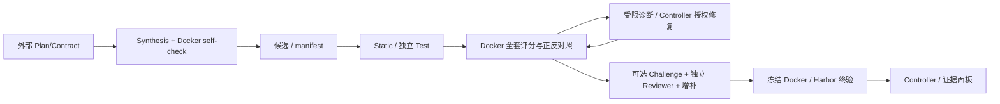

# Terminal-Bench Task Generation Agent


当前实现阶段为 `initial`；后续开发与提交继续使用 `agent-core-initial` 分支。

系统接收外部提供的 Plan 和 Contract，生成基于 Python 标准库的 CLI 修复任务，由独立的 Test Agent 编写测试，再通过 Docker/Harbor 执行验证。发现有充分证据支持的问题后，系统可以在 Controller 授权下进行修复。

目前包含四个模型角色：Synthesis、Independent Test、Challenge 和独立 Reviewer。Controller、Repair Dispatcher、Static Checker 和 Runner 则由确定性程序实现。**这一版本尚未包含自动 Planner、常规解题 Solver 或难度评估。** 候选任务生成、测试生成、基础执行通过和最终接受（`Accepted`）分别对应不同阶段。

## 架构和边界



默认的 `all` 流程包含测试修复和 Challenge。使用 `--repair` 时，则由独立的跨模块 Repair Dispatcher 处理修复，不能同时显式启用 Challenge。

各角色保持独立的信息边界：Test Agent 无法读取参考解法；Challenge Agent 只能编写替代 solution；Reviewer 使用全新对话。它们可以共享模型配置和调用预算，但不共享会话。

进一步了解：[架构说明](docs/ARCHITECTURE.md)、[实现说明](docs/IMPLEMENTATION.md)、[总体设计](docs/DESIGN.md)、[验证记录](docs/VALIDATION.md)。

## 安装和本地准备

核心代码需要 Python 3.11 或更高版本；Harbor 0.25.0 的验证环境需要 Python 3.12 或更高版本。无需调用模型，就可以运行默认离线测试并导出冻结示例。

```bash
python3 -m venv .venv
.venv/bin/python -m pip install -e . -r requirements-test.txt
.venv/bin/python scripts/check_core.py
.venv/bin/python -m unittest discover -s tests -v

# 需要真实Docker/Harbor时另建Python3.12+环境
python3.12 -m venv .harbor-venv
.harbor-venv/bin/python -m pip install -r requirements-verification.txt
# 需Linux Docker Engine；先准备基础镜像，再构建固定pytest镜像
# 首次构建需要网络，实际Docker执行工具使用network=none
docker pull python:3.11-slim
docker build -f docker/verifier.Dockerfile -t independent-verifier:pytest-9.2.0 .
```

核心代码本身没有第三方运行依赖，测试框架使用 Python 标准库的 `unittest`。部分离线宿主 wrapper 测试需要 `pytest`，对应依赖见 `requirements-test.txt`。当前依赖版本沿用历史验证环境，没有在本次整理中升级。

## 无需模型的最小示例

`examples/frozen-csv` 保存了一个历史真实生成的候选任务，以及独立生成的 14-node 测试，并保留了来源信息和文件 hash。它不是 mock 示例，但原测试仍存在已知漏检和异常处理问题，因此不能将示例运行成功视为完整的 `Accepted` 验收。

```bash
python3 scripts/run_frozen_example.py --output runs/example-export
# 可用Docker时：真实Oracle/Nop、独立Verifier，零API调用
python3 scripts/run_frozen_example.py --output runs/example-docker --docker
```

也可以使用正式 CLI 检查候选任务或导出测试：

```bash
python3 -m independent_verification --stage inspect \
  --candidate examples/frozen-csv/candidate --output runs/inspect
python3 -m independent_verification --stage export \
  --candidate examples/frozen-csv/candidate --tests examples/frozen-csv/test-agent \
  --output runs/export
```

每次运行都需要指定一个尚不存在的输出目录，程序不会覆盖已有结果。上面的 `export` 仅导出文件，尚未运行 lint 或实际测试；状态 `not_evaluated` 表示尚未评估。

## 使用真实模型生成与验证

将 `.env.example` 复制为 `.env` 并填入本地配置。CLI 从进程环境变量读取配置，不会自动加载 `.env`；示例文件也不包含 API Key。

```bash
set -a
source .env
set +a
python3 -m synthesis_agent --plan examples/csv-repair/plan.json \
  --contract examples/csv-repair/contract.json --config examples/config.json \
  --output runs/new-candidate

python3 -m independent_verification --candidate runs/new-candidate \
  --controls-manifest path/to/contract-reviewed-controls.json \
  --output runs/new-verification
```

第二条命令默认执行 `all` 流程，会调用 Test、Challenge 和 Reviewer，可能产生模型 API 费用。进行完整验收前，需要先准备与 Contract 对应、经过审查的正确和违规实现对照。这里的 `path/to/...` 是需要自行提供的文件路径，并非仓库中现成的文件。

对照清单应包含 `source`、`group`（`feedback`/`holdout`）、`role`（`correct`/`invalid`）、`implementation_digest`、`contract_digest`，以及 `review` 下的 `status`、`reviewer`、`method`、`rationale`、`requirement_ids` 和 `evidence_paths`；违规实现还需要 `counterexample`。格式可参考 `tests/panel_helpers.py` 和 `tests/test_test_agent_feedback_repair.py::reviewed_literal_controls`。后者使用的是明确标注为人工构造的测试对照。

`examples/config.json` 配置模型调用和诊断次数上限。遇到临时网络错误时最多重试一次，所有尝试都会计入调用次数。单候选 CLI 暂无统一的 token 总预算参数；Candidate Orchestrator 提供批次共享的 token 总预算。无法获取的 usage 不会按零计算。

如果已经有冻结测试，只希望执行评分、关闭模型修复和 Challenge，可以运行：

```bash
python3 -m independent_verification --stage run \
  --candidate examples/frozen-csv/candidate --tests examples/frozen-csv/test-agent \
  --no-repair-tests --no-challenge --output runs/final-basic
```

如果缺少经过确认的反馈对照或保留对照，即使 Oracle/Nop 的结果符合预期，Controller 仍可能返回 `needs_review`，CLI 退出码为 1。这是验收条件的一部分，不应为了让示例显示成功而放宽判断标准。

## 从 Plan 到 `Accepted` 的批次运行

Candidate Orchestrator 将 `SynthesisAgent.generate` 和 `pipeline.verify(all)` 串联起来，并统一管理模型、工具和 token 预算。只有原生 Controller 返回 `accept`，且 `independent_validation=true`，候选才会被接受；失败候选会标记为 `abandoned`。

如果连续两个候选因同一类原因失败，批次会暂停。排查原因后，可以通过 `--resume` 继续运行，同时保留已有历史和累计预算。具体机制见 [Candidate Orchestrator 使用说明](docs/guides/candidate-orchestrator.md)。

下面是需要真实模型调用的运行示例，**本次 README 整理时未重新执行**。运行前应准备模型配置、Docker 镜像、Harbor，以及与 Contract 对应的四组已审查对照。`verification-options` 示例中的路径只是模板，需要替换为实际文件。

```bash
python3 -m synthesis_agent.candidate_batch \
  --plan examples/csv-repair/plan.json --contract examples/csv-repair/contract.json \
  --config examples/batch-config.json --verification-options examples/verification-options.example.json \
  --output runs/new-batch --max-candidates 3 --max-total-tokens 600000
# 仅在明确paused_repeated_failure且检查原因后恢复：
python3 -m synthesis_agent.candidate_batch --output runs/new-batch --resume
```

要生成其他类型的任务，需要替换 Plan、Contract 和相应的已审查对照。`specs/controls` 中的六规范 recipe 目前仅用于测试和实验，编排器不会自动选择这些配置，也不会自动完成接受任务所需的独立审查。

主线已修复一个终验覆盖问题：已确认违规的 Challenge 实现曾被遗漏，未进入最终 Harbor 验证。修复后已通过离线回归检查相关调用路径。

相关记录：[实现说明](docs/IMPLEMENTATION.md)、[最近一次真实端到端运行摘要](reports/latest-real-e2e.md)、[验证与复现](docs/VALIDATION.md)。验证说明记录实际结果；大型运行产物与缓存不随源码保存。

## 核心集成测试

以下测试无需付费模型 API：它们不调用模型，或使用预先编写的 scripted client，但会执行真实的容器验证。请为每次运行使用新的 `runs` 输出目录。

```bash
SYNTHESIS_DOCKER_TESTS=1 python3 -m unittest tests.test_docker_integration -v
STEP3_DOCKER_REPAIR_TESTS=1 python3 -m unittest \
  tests.test_test_agent_feedback_repair.DockerRepairTests -v
CHALLENGE_DOCKER_TESTS=1 python3 -m unittest \
  tests.test_challenge_agent.RealDockerWitnessTests -v
REPAIR_DISPATCHER_INTEGRATION=1 HARBOR_PYTHON="$PWD/.harbor-venv/bin/python" \
  python3 -m unittest tests.test_repair_dispatcher.RealDispatcherTests -v
```

真实模型集成测试需要单独启用，默认跳过；使用 scripted client 的结果不能代表真实模型的表现。

通用 Challenge 端到端验收入口为 `scripts/challenge_agent/run_e2e.py --help`，运行时需要提供候选、测试、对照、历史 panel 和新的输出路径。最后三轮 terminal 验证阶段禁止再调用模型。历史 panel 中剩余的漏检情况，与原生 Controller 的接受结果分别记录，避免混为同一项指标。

## 已知限制

- **任务范围**：目前核心流程只支持基于 Python 标准库的 CLI 任务，尚不支持任意第三方依赖、多服务、浏览器或 GPU 任务。
- **测试覆盖**：Test Agent 生成测试后的 `collect-only` 只验证测试能否被发现和导入；实际评分由外层 Runner 完成。测试与 requirement 建立映射，也不代表语义上已经覆盖该要求。
- **自动修复**：普通测试修复所用的宿主 proof 仅支持有限的 Print-N/JSON 模板。对通用 CSV 语义，系统可能保留 `needs_review`；目前的 instruction 规则也无法保证任意文本要求的一致性。
- **独立审查**：Reviewer 虽然使用独立会话，但仍共享模型，可能误拒或误确认。Challenge 的搜索次数有限，不能排除所有未发现的漏洞。
- **网络隔离**：原生 Docker 执行使用 `network=none`，但**当前导出的 Harbor task/verifier 使用 public 网络**，因此尚未达到严格的 Harbor 无网络验收。此前 WSL2 缺少 `NFT_FIB_INET` 的问题也尚未解决。
- **证据与可追溯性**：trace 会脱敏并截断较长字符串。文件 hash 可以追踪产物，但不等于保留了完整模型消息，也不构成数字签名或形式化安全证明。如果移动文件，绝对路径形式的证据引用可能失效，影响离线复核。
- **仓库范围**：大规模历史实验、实现库和另一分支的六规范 Runner 没有纳入当前核心版本，主线已接入 Candidate Orchestrator。完整审计仍存放在原开发目录的 `reports` 中。旧提交与本仓库共享 Git 历史，因此当前版本未包含某些文件，不代表它们已从历史记录中清除。
