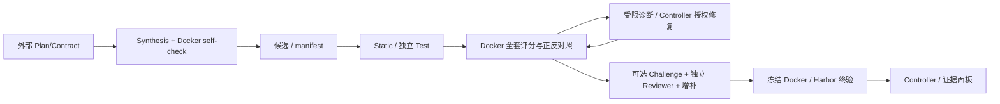

# Terminal-Bench Task Generation Agent — Initial Core

从研究开发仓库提炼的初步核心框架：根据外部提供的 Plan/Contract 构建 Python 标准库 CLI 修复任务，独立生成测试，在 Docker/Harbor 执行验证，并在有证据授权时修复。

当前角色是 Synthesis、Independent Test、Challenge 和独立 Reviewer；Controller、Repair Dispatcher、Static Checker、Runner 是确定性程序。**没有自动 Planner、普通解题 Solver 或难度评估。** 生成候选、生成测试、基础执行通过、完整接受是不同状态。

## 架构和边界



默认 `all` 是测试修复+Challenge 路径；`--repair` 使用独立的跨模块 Dispatcher，不能与显式 Challenge 组合。Test 不读参考解法；Challenge 只写替代 solution；Reviewer 使用新对话；共享模型配置和调用预算不等于共享会话。

详细机制见 [ARCHITECTURE](docs/ARCHITECTURE.md)，保留/排除与来源见 [CORE_SCOPE](docs/CORE_SCOPE.md)，本次实际验证见 [VALIDATION](docs/VALIDATION.md)。

## 安装和本地准备

核心Python要求3.11+，Harbor0.25.0验证环境要求3.12+。不需模型即可运行默认离线测试和冻结示例导出。

```bash
python3 -m venv .venv
.venv/bin/python -m pip install -e .
.venv/bin/python -m unittest discover -s tests -v

# 需要真实Docker/Harbor时另建Python3.12+环境
python3.12 -m venv .harbor-venv
.harbor-venv/bin/python -m pip install -r requirements-verification.txt
# 需Linux Docker Engine；先准备基础镜像，再构建固定pytest镜像
# 首次构建需要网络，实际Docker执行工具使用network=none
docker pull python:3.11-slim
docker build -f docker/verifier.Dockerfile -t independent-verifier:pytest-9.2.0 .
```

核心没有运行依赖，pytest只用于可信Verifier/部分wrapper测试；默认unittest是标准库。依赖版本与历史验证保持一致，未重新选择所谓最新版。

## 零模型最小示例

`examples/frozen-csv` 是真实历史生成候选和真实独立14-node测试，保留来源和文件hash；不是mock项目。该历史套件有已知漏检和异常边界，示例不宣称完整Accepted。

```bash
python3 scripts/run_frozen_example.py --output runs/example-export
# 可用Docker时：真实Oracle/Nop、独立Verifier，零API调用
python3 scripts/run_frozen_example.py --output runs/example-docker --docker
```

也可使用正式CLI检查/导出：

```bash
python3 -m independent_verification --stage inspect \
  --candidate examples/frozen-csv/candidate --output runs/inspect
python3 -m independent_verification --stage export \
  --candidate examples/frozen-csv/candidate --tests examples/frozen-csv/test-agent \
  --output runs/export
```

所有输出目录必须不存在；不原地覆盖。示例export尚未lint和执行，`not_evaluated`不代表验收通过。

## 真实模型生成与验证

复制 `.env.example` 为本地 `.env` 并自行填写配置。CLI读进程环境，不自动加载dotenv。示例不包含key。

```bash
set -a
source .env
set +a
python3 -m synthesis_agent --plan examples/csv-repair/plan.json \
  --contract examples/csv-repair/contract.json --config examples/config.json \
  --output runs/new-candidate

python3 -m independent_verification --candidate runs/new-candidate \
  --controls-manifest path/to/contract-reviewed-controls.json \
  --output runs/new-verification
```

后一条默认 `all` 会调用Test/Challenge/Reviewer，可能产生API费用；只有准备好真实已审查对照后才适合完整验收。`path/to/...` 是需提供的输入，不是仓库自带文件。正反对照清单包含source、group(feedback/holdout)、role(correct/invalid)、implementation_digest、contract_digest、review(status/reviewer/method/rationale/requirement_ids/evidence_paths；违规还需counterexample)。可参考 `tests/panel_helpers.py` 和 `tests/test_test_agent_feedback_repair.py::reviewed_literal_controls`，其中是明示人工构造的测试任务。

`examples/config.json`给出调用/诊断上限；真实网络临时错误最多重试一次，全部尝试计数。可选token总预算由Python调用者在共享budget传入，普通CLI没有统一token总额选项。未知usage不当0。

已有冻结测试只评分、关闭所有模型修复/挑战：

```bash
python3 -m independent_verification --stage run \
  --candidate examples/frozen-csv/candidate --tests examples/frozen-csv/test-agent \
  --no-repair-tests --no-challenge --output runs/final-basic
```

没有已确认反馈/保留正反面板时，即使Oracle/Nop符合预期，最终Controller仍可能 `needs_review`，CLI返回1。这是预期门槛，不要修改条件使演示变绿。

## 核心集成测试

以下均使用零模型或明确scripted client，实际容器执行，不调用付费API；输出在新runs目录。

```bash
SYNTHESIS_DOCKER_TESTS=1 python3 -m unittest tests.test_docker_integration -v
STEP3_DOCKER_REPAIR_TESTS=1 python3 -m unittest \
  tests.test_test_agent_feedback_repair.DockerRepairTests -v
CHALLENGE_DOCKER_TESTS=1 python3 -m unittest \
  tests.test_challenge_agent.RealDockerWitnessTests -v
REPAIR_DISPATCHER_INTEGRATION=1 HARBOR_PYTHON="$PWD/.harbor-venv/bin/python" \
  python3 -m unittest tests.test_repair_dispatcher.RealDispatcherTests -v
```

真实模型集成测试有独立opt-in，默认跳过；不要把离线模拟会话结果写成真实模型能力。通用真实Challenge验收入口是 `scripts/challenge_agent/run_e2e.py --help`，需要明确候选、测试、对照、历史panel和新的输出路径。三轮terminal阶段禁模型；adapter历史panel残余漏检口径与原生Controller接受口径分别记录。

## 已知限制

- 当前生产只支持Python标准库CLI，不支持任意依赖、多服务、浏览器或GPU任务。
- Test生成时的collect-only只检查发现和导入；实际评分由外层Runner完成。Requirement映射不证明语义覆盖。
- 自动普通测试修复的宿主proof只支持有限Print-N/JSON模板；通用CSV语义会保留needs_review。有限instruction规则不证明任意文本一致性。
- Reviewer共享模型，可能误拒/误确认；Challenge有限搜索不证明没有盲区。
- 原生Docker执行network=none，**当前Harbor task/verifier导出是public网络**，不是严格Harbor no-network验收；WSL2缺NFT_FIB_INET的历史问题没有通过降低门槛解决。
- trace脱敏且会截断长字符串；文件hash可追溯产物，不等于完整未截断模型消息、数字签名或形式安全证明。绝对证据路径搬迁后可能无法离线重判。
- 大规模历史实验、实现库和另分支batch入口不在此核心tip，完整审计在原开发目录reports；旧提交仍共享Git历史，排除文件不表示擦除历史数据。
