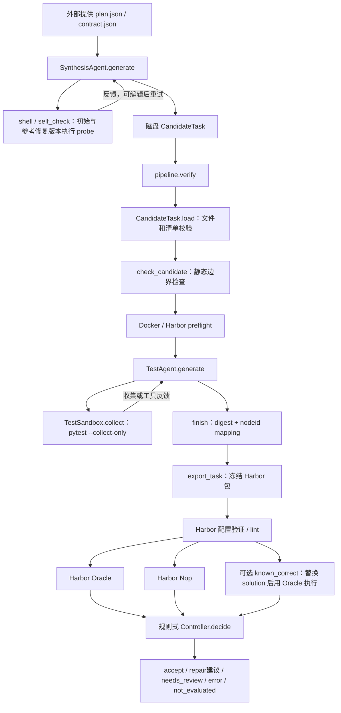

# Terminal-Bench 自动任务生成：架构与 Test Agent 审计

审计日期：2026-11-13。范围：当前工作区源码、配置、Prompt、测试，以及仓库内保存的真实运行证据。只新增本报告和审计结果文件；没有修改生产代码、原测试或实验记录，没有安装依赖、调用模型或重新执行 Docker/Harbor，也没有改变网络隔离。

**主要结论：当前 Test Agent 是具备文件编辑与收集反馈的测试生成器，尚不是具有测试执行、语义评价和反例修复闭环的验证 Agent。20 轮实验测量的是固定 Prompt、固定任务、固定 API 配置下的生成质量，随后进行外部面板评估；没有测量“独立 Test Agent + Challenge + Repair”的收益。优先补齐可信执行证据、合法替代实现检查及有限修复循环，再测 Challenge 的增量价值。不能由这些数据归因于模型能力，也不能估算 Challenge 的成本收益。**

证据层级：下文“静态”指当前可读源码；“历史真实执行”指保存在仓库的模型/Docker/Harbor 记录，并非本次重跑；“本次离线”指读取记录、计算哈希或运行已有离线测试；“建议”不代表已实现。Unknown 明确表示不能由现有证据确定。

## 1. Actual Architecture

### 1.1 当前真实调用图



图中没有从 Oracle/Nop/Controller 返回 Test Agent 的边。`verify()` 的阶段开关可在 inspect、generate、export 提前结束；已有测试可通过 `tests_output` 复用。Synthesis 与 Verification 是两个独立 CLI，磁盘候选由调用者串接；没有实现自动 Planner→Contract→Synthesis 的总调度器。依据：[`synthesis_agent.__main__.main`:12–28](</home/zyl/projects/agent_generate Terminal Bench task/synthesis_agent/__main__.py:12>)、[`verify`:50–147](</home/zyl/projects/agent_generate Terminal Bench task/independent_verification/pipeline.py:50>)、[`main`:16–41](</home/zyl/projects/agent_generate Terminal Bench task/independent_verification/__main__.py:16>)。真实跨阶段证据是历史候选 [Synthesis trace](</home/zyl/projects/agent_generate Terminal Bench task/runs/archive/candidates/acceptance-csv-01/trace.jsonl:36>) 和 [Harbor run_result](</home/zyl/projects/agent_generate Terminal Bench task/runs/archive/verification/step3-public-01/run_result.json:1>)；当前新增 Controller 的新真实 Harbor 执行证据 **Unknown**。

### 1.2 20 轮实验的实际调用图

```text
generate.py.main（4 个线程，20 个全新上下文）
  → 冻结源码 TestAgent.generate（固定候选的 Contract/Instruction/INITIAL）
  → 读文件 → 写/编辑测试 → collect 一次 → finish

evaluate.py.execute（独立外部评估）
  → 每轮 9 个合法实现 × 3 次 + 24 个违规实现 × 1 次
  → DockerSandbox + 冻结 wrapper，完整执行测试
  → stdout / execution.json / summary.json
  → 静态审查、findings、统计报告

评估结果没有返回上述生成上下文；未调用 pipeline.verify / Harbor / Controller。
```

依据：[`generate.main`:42–52](</home/zyl/projects/agent_generate Terminal Bench task/step3_test_1112/generate.py:42>)、[`evaluate.execute`:64–89](</home/zyl/projects/agent_generate Terminal Bench task/step3_test_1112/evaluate.py:64>)、[`evaluate.main`:97–113](</home/zyl/projects/agent_generate Terminal Bench task/step3_test_1112/evaluate.py:97>)。第 01 轮真实 trace 显示收集结果为“13 tests collected”，紧接着 finish；不是“13 tests passed”：[`trace`:26–32](</home/zyl/projects/agent_generate Terminal Bench task/step3_test_1112/rounds/01/generation/trace.jsonl:26>)。

### 1.3 实现状态，区分五类

|机制|当前实际状态|证据与运行边界|
|---|---|---|
|Synthesis Agent|① 已实现，有真实执行；有内部自检修复反馈|`self_check()` 在两个新容器中分别执行初始/修复 probe，并检查修改范围；工具反馈可继续编辑。源码 [`self_check`:157–217](</home/zyl/projects/agent_generate Terminal Bench task/synthesis_agent/agent.py:157>)、[`dispatch`:247–255](</home/zyl/projects/agent_generate Terminal Bench task/synthesis_agent/agent.py:247>)。历史 [`trace`:36–52](</home/zyl/projects/agent_generate Terminal Bench task/runs/archive/candidates/acceptance-csv-01/trace.jsonl:36>) 出现 self_check→shell→write_file→self_check→finish。它不是 Independent Verification；20 轮没有重新 Synthesis。|
|Task Contract|① 有输入校验及不可变投影；④ 自动起草模块缺失|输入来自 CLI JSON；`CandidateTask.test_input()` 只投影允许信息。源码 [`main`:12–28](</home/zyl/projects/agent_generate Terminal Bench task/synthesis_agent/__main__.py:12>)、[`test_input`:66–74](</home/zyl/projects/agent_generate Terminal Bench task/independent_verification/candidate.py:66>)。实验输入快照 [Contract](</home/zyl/projects/agent_generate Terminal Bench task/step3_test_1112/frozen/test-input.json:2>)。没有自动 Planner/Contract 构建运行证据。|
|Static Checker|① 已实现、历史真实运行；② 20 轮生成路径未调用 checker|检查 Dockerfile 模板、artifact 存在、路径泄漏和相同文件等，不判定测试语义。源码 [`check_candidate`:77–127](</home/zyl/projects/agent_generate Terminal Bench task/independent_verification/candidate.py:77>)；历史报告 [static_check](</home/zyl/projects/agent_generate Terminal Bench task/runs/archive/verification/step3-historical-inspection/static_check.json:1>)。实验脚本调用 `CandidateTask.load()`，未调用 `check_candidate()`，见 [`generate`:26–46](</home/zyl/projects/agent_generate Terminal Bench task/step3_test_1112/generate.py:26>)。|
|Independent Test Agent|① 独立生成与 collect 确有运行；⑤ 生成质量未达研究目标|真实 20 轮 trace 与 1020 次外部面板执行。实现边界 [`TOOLS`:16–25](</home/zyl/projects/agent_generate Terminal Bench task/independent_verification/agent.py:16>)、[`finish`:132–138](</home/zyl/projects/agent_generate Terminal Bench task/independent_verification/agent.py:132>)。不能将 tests_generated 解读为质量合格。|
|Oracle/Nop|① 完整执行适配器及历史真实运行；② 20 轮实验未调用；⑤ 基础验收不足以证明可靠性|源码 [`verify`:111–137](</home/zyl/projects/agent_generate Terminal Bench task/independent_verification/pipeline.py:111>)、[`Harbor.run`:110–119](</home/zyl/projects/agent_generate Terminal Bench task/independent_verification/harbor.py:110>)。历史 [Oracle=1/Nop=0](</home/zyl/projects/agent_generate Terminal Bench task/runs/archive/verification/step3-public-01/run_result.json:8>)；同一历史测试后来误拒合法序列化 [findings:5–14](</home/zyl/projects/agent_generate Terminal Bench task/runs/archive/audits/csv-overstrict-audit/findings.md:5>)。|
|合法替代实现|② 主流水线已实现可选入口，但本实验未通过该入口调用；① 外部实验有真实执行|源码 [`known_correct` 分支:114–128](</home/zyl/projects/agent_generate Terminal Bench task/independent_verification/pipeline.py:114>)，CLI [`--known-correct`:22](</home/zyl/projects/agent_generate Terminal Bench task/independent_verification/__main__.py:22>)。历史 Harbor `known_correct=[]`，见 [结果:28](</home/zyl/projects/agent_generate Terminal Bench task/runs/archive/verification/step3-public-01/run_result.json:28>)。实验由 evaluate.py 执行 9 种合法实现，未反馈模型。主线该分支的真实 Harbor 证据 **Unknown**，已有离线模拟测试不等于真运行。|
|违规实现面板|① 研究脚本已有真实执行；④ 生产质量门禁缺失|[`evaluate.execute`:64–89](</home/zyl/projects/agent_generate Terminal Bench task/step3_test_1112/evaluate.py:64>) 与 [strict_email 被接受](</home/zyl/projects/agent_generate Terminal Bench task/step3_test_1112/rounds/01/executions/strict_email/repeat-1/summary.json:1>)。`verify()` 没有违规实现输入或分支。|
|Verification Controller|① 当前规则实现与离线测试；② 不在冻结实验路径中|[`decide` / `_decide`:18–157](</home/zyl/projects/agent_generate Terminal Bench task/independent_verification/controller.py:18>)，`verify.finally` 接入 [`145–153`](</home/zyl/projects/agent_generate Terminal Bench task/independent_verification/pipeline.py:145>)。本次离线测试 [日志:17](</home/zyl/projects/agent_generate Terminal Bench task/docs/audit-2026-11-13/offline-tests.log:17>)。它只读取报告；新真实模型/Harbor 证据 **Unknown**。|
|Repair Dispatcher|④ 缺失；③ 只有 repair 决策和责任模块接口|Controller 返回 action/owner，不调用模块；[`_decide`:126–157](</home/zyl/projects/agent_generate Terminal Bench task/independent_verification/controller.py:126>)、[`verify.finally`:145–154](</home/zyl/projects/agent_generate Terminal Bench task/independent_verification/pipeline.py:145>)。文档也明确“不执行修改” [说明:3](</home/zyl/projects/agent_generate Terminal Bench task/docs/step4-status.md:3>)。没有修复执行日志。|
|Challenge / Solver|④ 生产实现和调用入口缺失；设计文档有职责说明|设计 [`Challenge/Solver`:122–150](</home/zyl/projects/agent_generate Terminal Bench task/agent 设计.md:122>)；实际可达 orchestration 只有 [`verify`:50–154](</home/zyl/projects/agent_generate Terminal Bench task/independent_verification/pipeline.py:50>)。固定人工面板不是自主 Challenge，Harbor Oracle 不是正常权限 Solver。真实运行证据 **Unknown**。|
|语义 validation 子系统|③ 测试/API 引用及历史证据残留，当前不能导入；不能判为完整实现|[`test_validation.py`:10–14](</home/zyl/projects/agent_generate Terminal Bench task/tests/test_validation.py:10>) 引用缺失源码；`validation/` 仅存 `__pycache__`。历史 [acceptance-summary](</home/zyl/projects/agent_generate Terminal Bench task/runs/archive/experiments/m0-m1-acceptance-20261112/acceptance-summary.json:1>) 声称 17 项集成通过；当前 [导入错误:95–103](</home/zyl/projects/agent_generate Terminal Bench task/docs/audit-2026-11-13/offline-tests.log:95>)。何时、为何丢失源码 **Unknown**。也无证据接入 20 轮或当前 verify。|

“完全缺失”限定于本次工作区可读实现及可达调用链，不对其他分支、外部服务或仅有字节码的历史功能作推断。原接口设计本来也明确第一版排除 Challenge、Solver 和自动修复，见 [接口设计:20](</home/zyl/projects/agent_generate Terminal Bench task/1. 模块数据接口设计.md:20>)；因此这是相对理想架构的缺口，不应全部称为违反第一版交付承诺。

## 2. Gap Analysis：Test Agent 专项

|审计问题|结论|代码与运行证据|
|---|---|---|
|是否执行测试、读取结果？|只执行 import/collection，不执行测试体。模型能读取 collection 的状态、nodeid、stdout/stderr。|`TOOLS` 无 run 工具；[`TestSandbox.collect`:35–59](</home/zyl/projects/agent_generate Terminal Bench task/independent_verification/sandbox.py:35>) 调 wrapper `--collect`；[`wrapper.main`:98–104](</home/zyl/projects/agent_generate Terminal Bench task/independent_verification/wrapper.py:98>) 使用 `--collect-only`；真实 [01 trace:27](</home/zyl/projects/agent_generate Terminal Bench task/step3_test_1112/rounds/01/generation/trace.jsonl:27>)。导入代码仍可产生副作用，不能把 collect 等同于完全不执行任何 Python。|
|能看到完整测试失败日志、异常类型、具体断言吗？|不能看到测试体的失败，因为没有运行工具，也没有外部结果回流。collection 普通输出在预算内完整传给模型。|[`generate`:174–183](</home/zyl/projects/agent_generate Terminal Bench task/independent_verification/agent.py:174>)；面板日志有具体回溯，如 [UnicodeDecodeError:13–17](</home/zyl/projects/agent_generate Terminal Bench task/step3_test_1112/rounds/01/executions/invalid_utf8_output/repeat-1/stdout.log:13>)，但 [`evaluate.execute`:78–89](</home/zyl/projects/agent_generate Terminal Bench task/step3_test_1112/evaluate.py:78>) 仅保存文件，不调用模型。|
|收到反馈可修改、再次执行吗？|可根据工具/collection 反馈重新编辑和 collect；没有根据测试执行或语义反例修复的入口。|编辑清空 collection、finish 检查 digest，见 [`dispatch`:118–138](</home/zyl/projects/agent_generate Terminal Bench task/independent_verification/agent.py:118>)。真实第17轮 [trace:23–27](</home/zyl/projects/agent_generate Terminal Bench task/step3_test_1112/rounds/17/generation/trace.jsonl:23>) 修复 JSONDecodeError，证明协议反馈有效；不是执行修复。|
|是否有重试/执行预算和停止条件？|有总模型40次、工具120次、单命令30秒、API90秒、completion8000及字节/资源预算；finish 即停，预算超限/部分异常直接终止。没有独立 repair 次数、总 wall-clock 或费用预算，没有外层质量重试。|[冻结配置:5–18](</home/zyl/projects/agent_generate Terminal Bench task/step3_test_1112/frozen/config.json:5>)；[`generate`:149–191](</home/zyl/projects/agent_generate Terminal Bench task/independent_verification/agent.py:149>)；`SandboxError/BudgetExceeded` 不作为可修复 observation 继续。真实20轮实际调用4–8次，未耗尽40次。|
|4–8次调用在做什么？|读初始源文件、列目录、写测试/fixture、collect、finish；部分轮次先编辑再 collect；第17轮额外修复 finish JSON。|详见下一张逐轮表与 [离线复算 JSON](</home/zyl/projects/agent_generate Terminal Bench task/docs/audit-2026-11-13/recomputed-evidence.json>)。第11轮删写发生在 collect 之前，[trace:28–35](</home/zyl/projects/agent_generate Terminal Bench task/step3_test_1112/rounds/11/generation/trace.jsonl:28>)。|
|一次 collect 是否足以证明没有修复循环？|仅次数本身不够；结合工具白名单、调用顺序和无回流源码，能确认这20轮没有测试体执行—语义修复循环。不能因此说模型从未编辑过测试。|[`TOOLS`:16–25](</home/zyl/projects/agent_generate Terminal Bench task/independent_verification/agent.py:16>)、[`evaluate.execute`:64–89](</home/zyl/projects/agent_generate Terminal Bench task/step3_test_1112/evaluate.py:64>)、上述真实 trace。|
|每轮上下文完整吗？|每轮新建 messages；同轮不断追加 assistant/tool，客户端完整发送。没有主动摘要或滑动窗口；超字节预算失败。trace 长字符串摘要不等于发送给模型的摘要。|[`generate`:146–183](</home/zyl/projects/agent_generate Terminal Bench task/independent_verification/agent.py:146>)、[`client.complete`:56–84](</home/zyl/projects/agent_generate Terminal Bench task/synthesis_agent/client.py:56>)、[`trace.summarize`:31–39](</home/zyl/projects/agent_generate Terminal Bench task/synthesis_agent/trace.py:31>)。真实 trace 有摘要对象 [11轮:31](</home/zyl/projects/agent_generate Terminal Bench task/step3_test_1112/rounds/11/generation/trace.jsonl:31>)。服务端内部上下文处理 **Unknown**；未保存原始HTTP请求/usage/finish_reason，不能逐字重放所有历史请求。|
|是否可能迎合 Oracle？|当前20轮没有 Oracle 反馈，因此没有证据表明发生 Oracle 迎合。未来仅按 Oracle 分数修测试会产生此风险；当前禁止额外要求主要靠 Prompt。|[`PROMPT`:28–50](</home/zyl/projects/agent_generate Terminal Bench task/independent_verification/agent.py:28>)；[`generate.main`:42–47](</home/zyl/projects/agent_generate Terminal Bench task/step3_test_1112/generate.py:42>)。现有 Oracle=1/Nop=0 仍误拒其他合法解法 [历史审查:7–14](</home/zyl/projects/agent_generate Terminal Bench task/runs/archive/audits/csv-overstrict-audit/findings.md:7>)。|
|Requirement-to-Test Mapping 是否语义验证？|不是。只校验 requirement ID 集合、nodeid 存在与唯一性；允许所有 requirement 都指向同一个弱测试，也不要求每个 collected test 都出现在 mapping。所有 collected tests 仍参与最终评分。|[`validate_coverage`:30–51](</home/zyl/projects/agent_generate Terminal Bench task/independent_verification/common.py:30>)、[`wrapper.classify`:13–48](</home/zyl/projects/agent_generate Terminal Bench task/independent_verification/wrapper.py:13>)。离线 fixture 用 `assert True` 映射所有要求，见 [`script`:53–56](</home/zyl/projects/agent_generate Terminal Bench task/tests/test_independent_verification.py:53>)。真实第12轮 [测试:189–200](</home/zyl/projects/agent_generate Terminal Bench task/step3_test_1112/rounds/12/generation/tests/test_clean.py:189>) 映射完成仍有过约束。|
|是否检查已知合法替代实现？|主线仅可选、默认空；本实验事后检查了9种，未用于生成质量门禁或修复。|[`verify`:114–128](</home/zyl/projects/agent_generate Terminal Bench task/independent_verification/pipeline.py:114>)、[历史空列表:28](</home/zyl/projects/agent_generate Terminal Bench task/runs/archive/verification/step3-public-01/run_result.json:28>)、[面板认证](</home/zyl/projects/agent_generate Terminal Bench task/step3_test_1112/panel/final-certification-summary.json:1>)。|
|是否检查已知违规实现？|本实验事后执行24种；生产 verify 没有对应质量门禁。|[`evaluate.main`:108–110](</home/zyl/projects/agent_generate Terminal Bench task/step3_test_1112/evaluate.py:108>)、真实 [strict_email完整通过](</home/zyl/projects/agent_generate Terminal Bench task/step3_test_1112/rounds/01/executions/strict_email/repeat-1/summary.json:1>)。|
|模型能识别隐藏要求、硬编码、非法输入假设吗？|Prompt 要求避免这些错误；没有机械保证、专用语义审查或被证明有效的自评。当前实例显示没有稳定做到，不能推出模型在更好反馈下也不能做到。|[`PROMPT`:33–49](</home/zyl/projects/agent_generate Terminal Bench task/independent_verification/agent.py:33>)；[第16轮错误500条断言](</home/zyl/projects/agent_generate Terminal Bench task/step3_test_1112/rounds/16/generation/tests/test_clean.py:235>) 及 [真实失败日志](</home/zyl/projects/agent_generate Terminal Bench task/step3_test_1112/rounds/16/executions/valid_dictreader/repeat-1/stdout.log:3>)。|

逐轮调用用途如下。`R`=list/read，`W`=write，`D`=delete，`C`=collect，`F`=finish；括号分隔模型调用，同括号表示一个 response 中多个工具，宿主依序执行。这不是思维过程推测。

|轮次|模型/工具调用|实际工具顺序|
|---|---:|---|
|01|5/10|(RR)(R)(W)(WWWWC)(F)|
|02|6/7|(RR)(R)(W)(W)(C)(F)|
|03|5/6|(RR)(R)(W)(C)(F)|
|04|4/5|(RR)(W)(C)(F)|
|05|4/11|(RR)(WWWWWW)(WC)(F)|
|06|5/7|(RR)(RR)(W)(C)(F)|
|07|5/8|(RR)(R)(WWW)(C)(F)|
|08|6/10|(RR)(R)(WWWW)(W)(C)(F)|
|09|7/9|(RR)(R)(W)(WW)(W)(C)(F)|
|10|5/6|(RR)(R)(W)(C)(F)|
|11|8/11|(RR)(R)(W)(W)(WW)(D)(WC)(F)|
|12|5/6|(RR)(R)(W)(C)(F)|
|13|5/9|(RR)(R)(WWWW)(C)(F)|
|14|6/7|(RR)(R)(W)(W)(C)(F)|
|15|5/7|(RR)(R)(WW)(C)(F)|
|16|5/6|(RR)(R)(W)(C)(F)|
|17|6/7|(RR)(R)(W)(C)(F错误)(F成功)|
|18|6/11|(RR)(R)(WW)(WWWW)(C)(F)|
|19|5/6|(RR)(R)(W)(C)(F)|
|20|5/10|(RRR)(WWWW)(W)(C)(F)|

每项对应原 trace 的行号保存在 [recomputed-evidence.json 的 rounds](</home/zyl/projects/agent_generate Terminal Bench task/docs/audit-2026-11-13/recomputed-evidence.json:13>)。没有一次收集后写回测试；第17轮只有 finish 参数重试。

## 3. Root Cause Analysis

### 3.1 数据完整性和统计含义

本次读取并重新计算：冻结清单 **46/46**、实验 evidence 清单 **5950/5950** 哈希匹配；20轮各有一份生成 trace 和51条面板执行 summary，共1020条。当前源码与冻结源码相比，`pipeline.py`、`__main__.py`、`__init__.py` 不同，当前另有 `controller.py`；Test Agent、client、sandbox、wrapper 均与冻结版本相同。详见 [本次复算](</home/zyl/projects/agent_generate Terminal Bench task/docs/audit-2026-11-13/recomputed-evidence.json:1>)。哈希匹配证明与保存清单一致，不证明历史日志来源不可伪造或语义标签绝对正确。

|实现标签|完整执行 reward=1|完整执行 reward=0|error/null|总数|
|---|---:|---:|---:|---:|
|合法|240|300|0|540|
|违规|50|397|33|480|

该表按执行次数计数，包含合法实现的三次重复，**不能替代按轮 presence 的15/20误拒、10/20误接、19/20鲁棒性缺陷**。按轮计数与原 [报告:23–32](</home/zyl/projects/agent_generate Terminal Bench task/step3_test_1112/实验报告.md:23>) 一致。鲁棒性19轮与 error/null33次不是同一分母。被错误测试拒绝的违规实现不能证明测试有有效辨别力。

20轮都是同一CSV候选、同一配置；面板经过有限输入认证与源码审查，但不是预注册随机样本，部分定向探针事后添加；审查者也不是独立人工复核。原 [protocol:7–19](</home/zyl/projects/agent_generate Terminal Bench task/step3_test_1112/protocol.md:7>) 明确这些限制。不能外推所有任务/模型，不能把三次容器重复当成新的独立模型样本。

### 3.2 可直接定位的错误

|问题|源码中的直接原因|真实运行证据|判断|
|---|---|---|---|
|合法CSV被误拒|第12轮 `test_r2_name_needs_csv_escaping_in_output()` 已比较字段，又在200行强制原始行等于最小引号形式。|[测试:189–200](</home/zyl/projects/agent_generate Terminal Bench task/step3_test_1112/rounds/12/generation/tests/test_clean.py:189>)；[合法全引号输出失败:18–26](</home/zyl/projects/agent_generate Terminal Bench task/step3_test_1112/rounds/12/executions/valid_quote_all_body/repeat-1/stdout.log:18>)。Contract只要求CSV语义/转义，[输入快照:6–7](</home/zyl/projects/agent_generate Terminal Bench task/step3_test_1112/frozen/test-input.json:6>)。|确认过约束；不是被测实现错误。|
|错误预期和fixture算术|第16轮偶数项只改成相同索引邮箱的大写，没有增加重复，却断言只剩500条。|[`test_max_size_input_within_timeout`:238–244](</home/zyl/projects/agent_generate Terminal Bench task/step3_test_1112/rounds/16/generation/tests/test_clean.py:238>)；[日志:8–18](</home/zyl/projects/agent_generate Terminal Bench task/step3_test_1112/rounds/16/executions/valid_dictreader/repeat-1/stdout.log:8>) 显示1000条正确结果被拒。|确认测试自相矛盾；collect无法发现。|
|把依赖检查变成实现方式约束|第02轮 `test_clean_py_is_stdlib_only()` 将sys.path压成单个stdlib目录，丢掉lib-dynload，并要求模块可被import。|[测试:8–21](</home/zyl/projects/agent_generate Terminal Bench task/step3_test_1112/rounds/02/generation/tests/test_stdlib.py:8>)；[该轮真实执行与复核:63–70](</home/zyl/projects/agent_generate Terminal Bench task/step3_test_1112/rounds/02/evidence.md:63>)。|确认错误依赖环境假设；CLI接口未要求import安全。|
|域外输入被当合法边界|1143/1500/1001/1002条等样例，或strip后空邮箱、不符合CSV引用规则，却断言必须成功。|[原报告具体轮次:64–77](</home/zyl/projects/agent_generate Terminal Bench task/step3_test_1112/实验报告.md:64>)，每条链接对应测试及执行回溯；Contract上限1000条且邮箱非空 [快照:6](</home/zyl/projects/agent_generate Terminal Bench task/step3_test_1112/frozen/test-input.json:6>)。|多个真实反例支持；不要把日志里的CLI ValueError一概归为基础设施故障。|
|漏检合法域中的值|strict_email实现丢弃不含@的ASCII非空邮箱；Contract没有要求是有效地址。|[实现:9–14](</home/zyl/projects/agent_generate Terminal Bench task/step3_test_1112/panel/implementations/strict_email.py:9>)、[Contract:6](</home/zyl/projects/agent_generate Terminal Bench task/step3_test_1112/frozen/test-input.json:6>)、[第01轮完整接受:6–9](</home/zyl/projects/agent_generate Terminal Bench task/step3_test_1112/rounds/01/executions/strict_email/repeat-1/summary.json:6>)；最终面板标签认证见 [final-certification](</home/zyl/projects/agent_generate Terminal Bench task/step3_test_1112/panel/final-certification-summary.json:1>)。|确认错误接受；其他漏项包括空姓名、Unicode姓名、内部空格与截断边界，分布见 [metrics](</home/zyl/projects/agent_generate Terminal Bench task/step3_test_1112/metrics.json:1>)。|

这些是可观察的近端原因；“为何模型写出它们”仍需受控实验，不能用日志反推模型内部推理。

### 3.3 执行与评分鲁棒性

**没有发现当前 wrapper 将 collect 成功当成测试通过的代码路径。** collect 返回 nodeid，不写reward；`tests_generated` 仍声明 `independent_validation=False`；pipeline的generate阶段结束后 Controller 为not_evaluated。依据 [`wrapper.main`:98–114](</home/zyl/projects/agent_generate Terminal Bench task/independent_verification/wrapper.py:98>)、[`TestAgent.generate`:91–94](</home/zyl/projects/agent_generate Terminal Bench task/independent_verification/agent.py:91>)、[`Controller`:140–157](</home/zyl/projects/agent_generate Terminal Bench task/independent_verification/controller.py:140>)。真实生成 [01 trace:27–32](</home/zyl/projects/agent_generate Terminal Bench task/step3_test_1112/rounds/01/generation/trace.jsonl:27>) 与真实评分 [strict_email summary](</home/zyl/projects/agent_generate Terminal Bench task/step3_test_1112/rounds/01/executions/strict_email/repeat-1/summary.json:1>) 分开存储。生成成功率20/20反映收集与协议成功，若把它称为测试正确率则是指标解读错误。

wrapper 对 setup/call 的 AssertionError 或 pytest.fail 计reward=0，其余异常、skip、xfail、收集异常、nodeid不一致、阶段缺失等计error/null；存在任意 verifier error 时，不因其他断言失败仍给0分。源码 [`classify`:13–48](</home/zyl/projects/agent_generate Terminal Bench task/independent_verification/wrapper.py:13>)、[`Recorder.pytest_runtest_makereport`:82–89](</home/zyl/projects/agent_generate Terminal Bench task/independent_verification/wrapper.py:82>)。这是一种异常类型分类，不是断言真伪或责任归因验证：错误fixture的assert也会得到“有效0分”。

33次error/null分布为：非法UTF-8输出19次、缺失输出13次、空文件缺表头1次。来自全部执行summary的本次聚合 [recomputed-evidence](</home/zyl/projects/agent_generate Terminal Bench task/docs/audit-2026-11-13/recomputed-evidence.json:1>)。代表性原始证据：

- 非法UTF-8：测试直接 `.decode('utf-8')`，没有将预期的任务格式违规转成断言，[01轮stdout:13–17](</home/zyl/projects/agent_generate Terminal Bench task/step3_test_1112/rounds/01/executions/invalid_utf8_output/repeat-1/stdout.log:13>)。
- 缺失文件：部分测试未先assert exists，[03轮stdout:278](</home/zyl/projects/agent_generate Terminal Bench task/step3_test_1112/rounds/03/executions/missing_output/repeat-1/stdout.log:278>) 出现FileNotFoundError；wrapper明确返回 [error/null:1–9](</home/zyl/projects/agent_generate Terminal Bench task/step3_test_1112/rounds/03/executions/missing_output/repeat-1/execution.json:1>)。第10轮还有None.splitlines，[stdout:32](</home/zyl/projects/agent_generate Terminal Bench task/step3_test_1112/rounds/10/executions/missing_output/repeat-1/stdout.log:32>)。
- 空输出：直接访问rows[0]触发IndexError，[09轮stdout:11–17](</home/zyl/projects/agent_generate Terminal Bench task/step3_test_1112/rounds/09/executions/empty_no_header/repeat-1/stdout.log:11>)，对应 [execution.json:1–8](</home/zyl/projects/agent_generate Terminal Bench task/step3_test_1112/rounds/09/executions/empty_no_header/repeat-1/execution.json:1>)。

因此，现有证据支持“生成测试没有一致遵守异常处理要求”，不支持“19轮容器失败”。1020条保存记录无harness_error；不等于基础设施绝对可靠。真实超时违规实现未进入该面板，timeout处理主要是静态风险，不能计为本次已确认超时故障，见 [protocol:14](</home/zyl/projects/agent_generate Terminal Bench task/step3_test_1112/protocol.md:14>)。

Harbor适配器对非零进程退出、超时、原生exception、Oracle solve非零、report缺失、reward不一致等fail closed，不把null转换成0/1。源码 [`execute`:18–61](</home/zyl/projects/agent_generate Terminal Bench task/independent_verification/harbor.py:18>)、[`parse_result`:122–172](</home/zyl/projects/agent_generate Terminal Bench task/independent_verification/harbor.py:122>)。离线 [parse_result测试:227–245](</home/zyl/projects/agent_generate Terminal Bench task/tests/test_independent_verification.py:227>) 与本次 [测试日志:48](</home/zyl/projects/agent_generate Terminal Bench task/docs/audit-2026-11-13/offline-tests.log:48>) 支持控制流；本次没有重新做真实超时/Harbor异常注入。

DockerSandbox在命令超时/输出超限时抛SandboxError；Test Agent会结束，模型无法读取此轮部分stdout并继续修复。底层 [`run_bounded`:24–76](</home/zyl/projects/agent_generate Terminal Bench task/synthesis_agent/sandbox.py:24>)、[`generate`:175–191](</home/zyl/projects/agent_generate Terminal Bench task/independent_verification/agent.py:175>)。Harbor `execute` 保存durable日志，而Docker `run_bounded` 超时异常不携带已捕获输出，这个诊断能力差异属于静态确认。没有可重试的基础设施分类/调度器。

环境因素逐项判断：

|因素|已实现措施 / 已知问题|证据与Unknown|
|---|---|---|
|临时文件、数据状态|collect及面板每次全新容器，/tmp中安装完整测试；合法实现3次重复没有发现状态/reward/逐node阶段差异。|[`container`:205–222](</home/zyl/projects/agent_generate Terminal Bench task/synthesis_agent/sandbox.py:205>)、[`evaluate`:74–80](</home/zyl/projects/agent_generate Terminal Bench task/step3_test_1112/evaluate.py:74>)、[原报告:19](</home/zyl/projects/agent_generate Terminal Bench task/step3_test_1112/实验报告.md:19>)。同一suite内的测试共享容器，顺序依赖仍可能，未做全面乱序实验。|
|工作目录、权限|Docker执行cwd=/app、uid65532、只读根、tmpfs；wrapper改cwd为测试目录。Harbor独立verifier Dockerfile未显式设非root，且只有deliverables进入/app，环境并非完全等价。|[`create_args`:188–203](</home/zyl/projects/agent_generate Terminal Bench task/synthesis_agent/sandbox.py:188>)、[`execute`:224–225](</home/zyl/projects/agent_generate Terminal Bench task/synthesis_agent/sandbox.py:224>)、[`wrapper`:91](</home/zyl/projects/agent_generate Terminal Bench task/independent_verification/wrapper.py:91>)、[`export_task`:40–52](</home/zyl/projects/agent_generate Terminal Bench task/independent_verification/exporter.py:40>)。原始20轮是无网络非root Docker证据，不能称为20轮Harbor证据。|
|进程清理|Docker finally rm --force；Harbor宿主进程组TERM/KILL；Docker有900秒watchdog。|[`container`:215–222](</home/zyl/projects/agent_generate Terminal Bench task/synthesis_agent/sandbox.py:215>)、[`execute`:48–59](</home/zyl/projects/agent_generate Terminal Bench task/independent_verification/harbor.py:48>)。清理失败会抛异常；当前模型无恢复循环。未发现20轮实际遗留进程证据。|
|端口|当前任务是无服务CLI，未见端口需求或端口错误记录。|[Contract命令:5](</home/zyl/projects/agent_generate Terminal Bench task/step3_test_1112/frozen/test-input.json:5>)。推广服务任务的端口隔离能力 **Unknown**，超出已支持范围。|
|网络隔离|20轮Docker明确network=none。历史Harbor no-network探针失败；后一次历史验收及当前exporter配置为public，当前preflight条件会跳过no-network探针。|[历史preflight:21–36](</home/zyl/projects/agent_generate Terminal Bench task/runs/archive/diagnostics/step3-live-run-01/preflight.json:21>)、[探针输出](</home/zyl/projects/agent_generate Terminal Bench task/runs/archive/diagnostics/step3-live-run-01/harbor-network.stdout.log:1>)、[`HARBOR_NETWORK_MODE`:14](</home/zyl/projects/agent_generate Terminal Bench task/independent_verification/exporter.py:14>)、[`task.toml生成`:48–52](</home/zyl/projects/agent_generate Terminal Bench task/independent_verification/exporter.py:48>)、[`preflight`:33–45](</home/zyl/projects/agent_generate Terminal Bench task/independent_verification/pipeline.py:33>)。不能以public运行证明隔离条件已满足；本次未改变配置或绕过检查。|
|依赖与资源|TestSandbox检查固定pytest9.2.0；Docker镜像按ID执行；Harbor verifier基于可变python:3.11-slim标签，资源/总timeout与面板不同。|[`prepare`:27–33](</home/zyl/projects/agent_generate Terminal Bench task/independent_verification/sandbox.py:27>)、[`DockerSandbox.prepare`:175–184](</home/zyl/projects/agent_generate Terminal Bench task/synthesis_agent/sandbox.py:175>)、[`base_dockerfile`:17–20](</home/zyl/projects/agent_generate Terminal Bench task/independent_verification/sandbox.py:17>)、[`evaluate`:15–16](</home/zyl/projects/agent_generate Terminal Bench task/step3_test_1112/evaluate.py:15>)。面板180秒/2MB，Harbor verifier120秒/512MB，不能直接视为同一环境。|

Docker/Harbor当前现场是否满足no-network所需内核能力：**Unknown**，本次仅审阅历史探针；历史只证实当时探针返回unsupported。修复应使所需隔离可用，或明确报告阻塞，不能通过关闭隔离得到“通过”。

### 3.4 H1–H6 证据评估

|假设|判定|支持与限制|
|---|---|---|
|H1 DeepSeek Flash模型能力不足|**Plausible but unverified**|确认该配置生成很多错误，但没有同Prompt/同反馈/同预算的模型对照。第17轮能修JSON错误，说明至少协议反馈不是完全无效。4–8次调用远低于40上限，不能证明“模型用尽推理预算仍无能为力”。证据：上述trace表、[冻结配置](</home/zyl/projects/agent_generate Terminal Bench task/step3_test_1112/frozen/config.json:5>)、[17轮协议修复](</home/zyl/projects/agent_generate Terminal Bench task/step3_test_1112/rounds/17/generation/trace.jsonl:23>)。|
|H2 Prompt要求不足|**Plausible but unverified**，需拆分|“完全没有要求测试正确/不加隐藏条件/异常转断言”被原Prompt **Contradicted by evidence**，见 [`PROMPT`:33–49](</home/zyl/projects/agent_generate Terminal Bench task/independent_verification/agent.py:33>)。但缺少CSV语义等价示例、fixture合法域自检、统一helper和可操作执行修复步骤是合理改进方向。没有Prompt A/B实验，不能确定因果或收益。|
|H3 API/上下文/预算问题|**Plausible but unverified**，部分子命题可排除|客户端对DeepSeek显式thinking disabled，required tools，max_tokens8000，未设seed/temperature、无API重试/usage记录，[`complete`:56–84](</home/zyl/projects/agent_generate Terminal Bench task/synthesis_agent/client.py:56>)。其能力/成本影响未对照；本地“主动截断上下文/工具结果摘要后发模型”被源码反证。早期401由凭据加载错误造成，修复后20轮成功，[protocol:6](</home/zyl/projects/agent_generate Terminal Bench task/step3_test_1112/protocol.md:6>)，不能解释主样本语义错误。服务端行为及实际token成本 **Unknown**。|
|H4 缺少语义验证和执行反馈闭环|**Supported by evidence**|工具与finish只覆盖collection，外部面板只保存文件，没有失败→修复→重执行边。真实collect后直接finish和事后反例共同支持。见 [`agent`:128–138](</home/zyl/projects/agent_generate Terminal Bench task/independent_verification/agent.py:128>)、[`evaluate`:78–89](</home/zyl/projects/agent_generate Terminal Bench task/step3_test_1112/evaluate.py:78>)、[01 trace](</home/zyl/projects/agent_generate Terminal Bench task/step3_test_1112/rounds/01/generation/trace.jsonl:26>)。这是确认存在的结构缺口；补齐后的质量提升幅度仍未知。|
|H5 Oracle/Nop、Challenge、合法替代实现未有效接入|**Supported by evidence，限当前实验/反馈**|20轮未用Oracle/Nop/Controller，合法/违规面板不回流，Challenge缺失。全项目“根本没有Oracle/Nop执行”则被历史 [public run_result](</home/zyl/projects/agent_generate Terminal Bench task/runs/archive/verification/step3-public-01/run_result.json:8>) 反证。optional known_correct存在，不能写成完全未实现。|
|H6 执行评分基础设施系统性错误|**Insufficient information** 作为主因；有局部确认问题|错误边界和环境差异确有问题；历史Harbor网络阻塞、当前validation源码缺失得到确认。但1020条结果中null保持null、没有harness_error，代表性误拒可直接定位错误断言；没有证据证明统一评分器把所有结果系统性算错。wrapper只按异常类型分类的限制静态成立。真实超时/OOM/权限故障矩阵未做，不能全面排除。|

## 4. Missing Feedback Loops

目标链路 **Test Generation → Execution → Semantic Evaluation → Failure Classification → Repair → Re-execution** 在当前主线只实现生成、外部执行、粗分类和建议；连接不完整。

|反馈路径|断点与当前接收的信息|影响 / 证据|
|---|---|---|
|Test generation→测试体执行→模型|TestAgent只收到collect，无执行工具；测试体日志留在外部面板/Harbor。|不能自检错误expected、非法fixture、隐藏断言；[`TOOLS`](</home/zyl/projects/agent_generate Terminal Bench task/independent_verification/agent.py:16>)、[`evaluate.execute`](</home/zyl/projects/agent_generate Terminal Bench task/step3_test_1112/evaluate.py:64>)、[真实错误500条断言](</home/zyl/projects/agent_generate Terminal Bench task/step3_test_1112/rounds/16/executions/valid_dictreader/repeat-1/stdout.log:14>)。|
|Oracle/Nop→语义评估|外层有reward，不能单凭Oracle0判断测试错或解法错；Oracle1/Nop0也不能证明测试可靠。|Controller保守needs_review是合理设计；[`_decide`:113–119](</home/zyl/projects/agent_generate Terminal Bench task/independent_verification/controller.py:113>)。历史已通过套件仍误拒quoted_body，[审查:7–14](</home/zyl/projects/agent_generate Terminal Bench task/runs/archive/audits/csv-overstrict-audit/findings.md:7>)。|
|合法/违规反例→Test Agent|known_correct可选且只写结果；研究面板执行结果没有反馈。|没有已知合法解法保持通过的硬门禁，没有基于违规见证补测；[`verify`:114–128](</home/zyl/projects/agent_generate Terminal Bench task/independent_verification/pipeline.py:114>)、[`evaluate`:86–89](</home/zyl/projects/agent_generate Terminal Bench task/step3_test_1112/evaluate.py:86>)。|
|执行→具体失败证据→Controller|Controller接收trial状态/reward/error和报告路径；不主动读取execution.json的断言回溯，也不语义审查Contract。wrapper报告只存nodeid/phase/outcome/task_assertion/xfail。|有定位链接但缺具体assertion、exception type/message和实际输入输出的结构化证据包；[`Recorder`:82–89](</home/zyl/projects/agent_generate Terminal Bench task/independent_verification/wrapper.py:82>)、[`Controller`:99–119](</home/zyl/projects/agent_generate Terminal Bench task/independent_verification/controller.py:99>)。完整stdout存在磁盘，不等于Controller已消费。|
|failure classification→repair dispatch|只有action和owner，critical_issues归因必须外部提供，引用路径不核实。|没有Dispatcher，没有自动调用TestAgent或Synthesis；[`_decide`:121–157](</home/zyl/projects/agent_generate Terminal Bench task/independent_verification/controller.py:121>)、[`verify.finally`](</home/zyl/projects/agent_generate Terminal Bench task/independent_verification/pipeline.py:141>)。没有真实修复日志，**Unknown**。|
|repair→全量重验证|没有版本化repair attempt循环。|没有修复后重跑Oracle/Nop/合法替代/必要违规实现的实现证据；`verify()`只执行一次阶段链，[源码:82–137](</home/zyl/projects/agent_generate Terminal Bench task/independent_verification/pipeline.py:82>)。|

版本绑定并非完全缺失：候选manifest、Test Agent input_manifest、测试manifest/digest、collection digest、export包manifest、frozen nodeids、Harbor执行前后manifest检查都存在。源码 [`CandidateTask.load`:39–58](</home/zyl/projects/agent_generate Terminal Bench task/independent_verification/candidate.py:39>)、[`finish`:133–135](</home/zyl/projects/agent_generate Terminal Bench task/independent_verification/agent.py:133>)、[`export_task`:23–33](</home/zyl/projects/agent_generate Terminal Bench task/independent_verification/exporter.py:23>)、[`Harbor.run`:110–118](</home/zyl/projects/agent_generate Terminal Bench task/independent_verification/harbor.py:110>)。实验还有全目录哈希且本次匹配。

缺口是端到端“报告/decision属于哪个测试版本”的强校验：`execution.json`只有nodeids，没有测试内容/Contract/package digest；Controller历史重判只校验报告形状与状态，不重算文件哈希，不验证证据引用内容。源码 [`wrapper.classify`:46–48](</home/zyl/projects/agent_generate Terminal Bench task/independent_verification/wrapper.py:46>)、[`load_report`:168–194](</home/zyl/projects/agent_generate Terminal Bench task/independent_verification/controller.py:168>)。因此现有机制能检测正常导出后的文件篡改，但不是完整的修复版本链或可信历史证据验证器。历史错配实例 **Unknown**，这里是静态风险，不能声称实验已遭错配。

## 5. Priority Fixes

以下为建议，未实施；成本为相对工程量，不是工时报价。以“先保证实验能解释，再增加Agent”为原则，避免把所有理想模块一次实现。

|优先级/顺序|最小修复|影响与依据|相对成本|
|---|---|---|---|
|P0-1|恢复validation可读源码并确认来源/提交，或明确将其标为不可用并移除“当前已具备”的验收声明；已有核心测试独立保持可运行。|当前全套导入失败，不能用历史17项通过证明现状。[本次日志:95–103](</home/zyl/projects/agent_generate Terminal Bench task/docs/audit-2026-11-13/offline-tests.log:95>)。不要求先扩建该子系统。|小至中，取决于源码能否恢复|
|P0-2|固定评估证据格式：completed/0、completed/1、test_error、infra_error、timeout分别统计；保存原始日志、nodeid、失败异常/断言位置、测试/Contract/实现/环境hash。|当前没有null误转评分，但结构化失败信息不足、报告内容绑定不完整。保留现有fail-closed规则。[wrapper:82](</home/zyl/projects/agent_generate Terminal Bench task/independent_verification/wrapper.py:82>)、[parse_result:122](</home/zyl/projects/agent_generate Terminal Bench task/independent_verification/harbor.py:122>)。|小至中|
|P0-3|明确生成成功≠质量通过；主评估设合法替代实现门禁，并冻结面板标签/预期与评估环境。|15/20误拒最直接影响评分可信度；Oracle单例不能保护合法变体。[quoted_body历史反例](</home/zyl/projects/agent_generate Terminal Bench task/runs/archive/audits/csv-overstrict-audit/findings.md:7>)、[1020面板协议](</home/zyl/projects/agent_generate Terminal Bench task/step3_test_1112/protocol.md:7>)。|中；现有面板可复用|
|P0-4|若后续研究使用Harbor隔离条件，先恢复所需no-network能力或报告阻塞；统一/记录面板与Harbor verifier的权限、镜像、timeout、资源差异。|public验收不能作隔离验收；避免研究组间环境混淆。[exporter:14/48](</home/zyl/projects/agent_generate Terminal Bench task/independent_verification/exporter.py:14>)、[历史探针](</home/zyl/projects/agent_generate Terminal Bench task/runs/archive/diagnostics/step3-live-run-01/preflight.json:21>)。不以关闭隔离绕过。|环境相关，中且不确定|
|P1-1|提供受限suite execution能力和结构化feedback读取；保留首次生成的信息隔离，执行器选择实现而非让模型读取参考solution。|补齐核心断边，[TestAgent工具列表](</home/zyl/projects/agent_generate Terminal Bench task/independent_verification/agent.py:16>)。仅加Prompt或加调用上限不能创造执行观察。|中|
|P1-2|增加小型test repair入口和有限Dispatcher；每次修改产生新digest，重收集、执行、回归。仅明确归因tests才自动修；歧义needs_review。|Controller现有repair只建议，[decide:151](</home/zyl/projects/agent_generate Terminal Bench task/independent_verification/controller.py:151>)。|中|
|P1-3|提供可信CLI/CSV比较辅助函数：检查退出码/文件/编码/表头/列数后再做字段语义断言；预期任务异常转断言，fixture/测试异常保留error。|针对33次error/null和序列化误拒的直接原因，[01 UTF8日志](</home/zyl/projects/agent_generate Terminal Bench task/step3_test_1112/rounds/01/executions/invalid_utf8_output/repeat-1/stdout.log:13>)。禁止catch-all吞异常。|小至中|
|P1-4|Prompt补充“域内fixture证明、CSV语义相等、断言来源、边界计数”及反例修复要求；预算停止原因和实际token用量入日志。|原Prompt已有原则但没有执行修复协议，[PROMPT:33–50](</home/zyl/projects/agent_generate Terminal Bench task/independent_verification/agent.py:33>)、[client:79–84](</home/zyl/projects/agent_generate Terminal Bench task/synthesis_agent/client.py:79>)。效果需A/B，不能预先宣称。|小|
|P2-1|先接固定、已认证违规面板，再做有预算的Challenge MVP；必须提供Contract违规见证及整套通过证据。|固定面板已能找50次误接，先测廉价基线。[复算数据](</home/zyl/projects/agent_generate Terminal Bench task/docs/audit-2026-11-13/recomputed-evidence.json:1>)。|中|
|P2-2|Challenge修复后全量合法回归；另设不向任何Agent暴露的留出合法/违规实现。|防止补洞制造新误拒、只对已知mutant特化；当前缺此循环，[verify:111–137](</home/zyl/projects/agent_generate Terminal Bench task/independent_verification/pipeline.py:111>)。|中|
|P2-3|需要研究可解性/难度时，再接正常权限Solver；与可靠性实验分开报告。|Solver职责在设计，[设计:128–132](</home/zyl/projects/agent_generate Terminal Bench task/agent 设计.md:128>)，当前无实现。当前研究不必先完成它。|较大|
|P3|通用Planner、复杂多模块路由、完整Reject策略、证据UI、通用多题型扩展、性能缓存及并发优化。|当前输入/能力限于stdlib CLI；不应先于可信质量门禁与闭环。[CLI](</home/zyl/projects/agent_generate Terminal Bench task/synthesis_agent/__main__.py:12>)、[接口范围](</home/zyl/projects/agent_generate Terminal Bench task/1. 模块数据接口设计.md:20>)。必要成本日志已列P1，不应推迟。|可按需求拆分|

**开始Challenge之前必须先有：可信的完整suite执行、可解释的error/null分类、至少一种以上风格的合法对照、带版本绑定的失败证据和有限修复后的全量回归。** 完整通用语义证明器、自动Planner、多模型Solver和通用Dispatcher不必先做。否则Challenge更易发现或利用测试自身异常，而无法证明最终评分更可靠；也不能判断额外模型费用换来了什么。

## 6. Minimal Implementation Plan

本节是下一阶段最小方案，不是本次代码修改。

1. **固化单一CSV评估内核和可信标签。** 复用已有wrapper和固定面板，统一Docker/Harbor可比较配置；保持隔离要求。把Contract输入域转换成少量显式验证规则（记录数、列数、ASCII非空邮箱），校验测试fixture与手写expected。自由文本语义不能可靠解析时用人工确认的有限cases；歧义Unknown，不伪造全自动语义证明。基础是现有 [Contract快照](</home/zyl/projects/agent_generate Terminal Bench task/step3_test_1112/frozen/test-input.json:2>)、[面板认证](</home/zyl/projects/agent_generate Terminal Bench task/step3_test_1112/panel/final-certification-summary.json:1>)；不需要先恢复整个历史validation架构才能实现小切片。

2. **引入一个执行证据对象。** 最小字段为 `attempt_id / parent_digest / contract_hash / tests_digest / implementation_hash / environment_id / command / status / reward / process_exit / pytest_exit / nodeid / phase / exception_type / message / assertion_source / stdout_path / stderr_path / input_output_artifact_paths`。日志可分块读取；结构化摘要必须链接完整原件。沿用当前fail-closed和expected-nodeid规则，不将全局基础设施超时自动算任务0分。针对输出缺失、编码异常和测试自身异常做有意义的离线边界测试，避免实现镜像式测试。

3. **在初次freeze后增加一个外部quality gate。** 依次运行Oracle、Nop、少量多样合法实现和高价值违规实现；第一次生成仍不见参考solution。合法实现失败需要Contract+fixture+断言证据复核；只有明确测试缺陷才发tests repair。仅Oracle不通过时先保留歧义，不能为了让Oracle过而删断言。已有 [`known_correct` 分支](</home/zyl/projects/agent_generate Terminal Bench task/independent_verification/pipeline.py:114>) 可复用，新增违规实现执行不必引入新模型。

4. **只实现tests修复切片。** `repair_tests(contract, instruction, initial, current_tests, evidence)` 接收明确反例与违规/合法依据，继续编辑测试；不读取参考solution。建议首版最多2次修复、明确wall/model/tool预算，出现无版本变化、重复同一错误、基础设施持续失败或预算耗尽就停止并保留needs_review/error。其他模块先返回人工复核，不做通用自动路由。每次修复都产生新版本、重新collect、重跑Oracle/Nop/全部合法对照及必要违规回归；旧报告不能覆盖新版本，旧版本也不被静默替换。

5. **再加Challenge单一接口。** 输入Contract/Instruction/初始环境/当前冻结测试；输出 `candidate implementation + violated requirement + valid witness input + expected/actual + full-suite evidence + version hashes`。由独立runner确认“确实违反Contract”且 `completed/reward=1`；error/null既不是骗过，也不是成功杀死。确认后才送tests repair。Challenge不能自行修改测试、wrapper、reward或环境；首版不必接受可攻击评分器的任意代码能力，当前wrapper明确不是抗恶意verifier边界，见 [wrapper说明:1–5](</home/zyl/projects/agent_generate Terminal Bench task/independent_verification/wrapper.py:1>)。

6. **定义验收终点。** 在当前研究范围内，全部已认证合法对照通过；Oracle/Nop符合预期；已知违规实现结果有完整状态和可复核证据；没有未经归因的测试/基础设施error；修复前后对比使用同一留出集及明确成本。通过这些只代表有限面板证据，不是普遍充分性或发布资格。

## 7. Controlled Experiments

### 7.1 先把研究问题拆开

现有20轮只支持“独立生成器在这一CSV候选上的基线质量较差”。要回答独立性带来的收益，需要Synthesis自带测试与独立Test Agent对照；要回答Challenge增益，需要先固定执行反馈/修复能力。当前没有这两类比较，因此“收益值得额外成本”是 **Unknown**。设计文档本来也提出三组比较，[研究问题:222–232](</home/zyl/projects/agent_generate Terminal Bench task/agent 设计.md:222>)。

建议分阶段，不一次做昂贵全因子：

|阶段|实验组|固定项与可解释结论|
|---|---|---|
|A：零新增模型费的诊断|对现有20套冻结测试重新做静态归因/面板留出分析；必要时仅安全隔离执行|不改测试、不改标签以迎合结果；确认错误集中在哪些类。当前1020条和本次复算可作起点；不能作为新Prompt/新模型效果。|
|B：Prompt与反馈2×2|原Prompt/改Prompt × 仅collect/完整执行反馈与有限修复|固定同模型、API模式、任务、runner、对照实现、资源与总预算。明确区分额外调用预算和反馈信息；给无执行反馈组相同调用上限/自审机会，避免把更多计算误当反馈效应。交互项可判断Prompt是否依赖工具。|
|C：API模式|保持模型与内容固定，比较当前非thinking工具模式与服务端实际支持的另一模式|先验证工具协议兼容；不要把unsupported required-tool组合当模型质量差。固定其他参数，记录原始usage/finish_reason/请求配置；任何模式同时改变预算时单独报告。当前disabled行为来自 [`client.complete`:60–63](</home/zyl/projects/agent_generate Terminal Bench task/synthesis_agent/client.py:60>)。|
|D：模型能力|固定最佳已验证Prompt/执行反馈/预算，替换模型|等调用预算与等费用预算分别比较；模型版本不可固定时记录时间并交错随机分配。此阶段才能对H1提供更有辨别力证据；不预设换模型。|
|E：独立性与Challenge增益|Synthesis自带测试；独立Test Agent+同样quality gate；独立Test Agent+固定违规面板修复；独立Test Agent+Challenge修复|先做前两组检验独立性，再以固定mutant基线比较Challenge独有收益。每组执行/修复和总成本规则一致；Challenge额外费用全部计入。可采用预算匹配对照与现实追加预算对照两种口径。|

### 7.2 防止实验混淆

- 以任务/生成轮次为主要单位，包含多种CSV候选，随后再推广JSONL/manifest等题型；同轮多个实现和容器重复是簇内样本。随机交错组别运行，记录共享服务时段和并发；服务端seed/权重不可固定时明确局限。当前20轮单任务4并发，[protocol:3–5](</home/zyl/projects/agent_generate Terminal Bench task/step3_test_1112/protocol.md:3>)。
- 预注册合法/违规标签、域内见证和主要指标；生成器与修复器可见的训练反例和最终留出面板分开。新增探针单列探索结果。保留带争议的Contract解释，不让自动统计替代裁决；当前认证曾有换行读取错误，见 [protocol:19](</home/zyl/projects/agent_generate Terminal Bench task/step3_test_1112/protocol.md:19>)，说明评估器自身也需验证。
- 所有组使用同一冻结Contract/Instruction/初始环境、wrapper、镜像ID、权限、工作目录、network隔离、timeout和资源限制。合法结果比较优先语义；Contract明确要求字节一致时才比较字节。
- 修复实验保留首次生成与每次修复版本，使用同一面板评估before/after；统计新增误拒、已修复误接和回归，不只报告最终通过者，失败/超时/预算耗尽轮次不能剔除。

### 7.3 指标与成本判据

主要指标：按轮至少一次合法误拒；按轮/按违规类别的完整错误接受；测试error/null与infra_error分别比例；最终同时满足合法通过及违规辨别的套件比例。另报node级原因、收集/生成失败、修复成功率和三次重复一致性。把“发现更多测试失败”与“评分更可靠”分开。

成本：实际input/output/cache/reasoning tokens（接口能提供时）、调用数、Docker执行/容器数、wall time、失败重试费用与人工裁决量。当前client丢弃usage、trace无token，不能由4–8次调用估算准确费用；CPU/内存未知要保留null，不能写0。源码依据 [`client.complete`:78–84](</home/zyl/projects/agent_generate Terminal Bench task/synthesis_agent/client.py:78>)。

Challenge价值优先看：相对固定违规面板，留出集上的错误接受降低多少、是否提高合法误拒、每额外修复一个经确认漏洞的成本，以及新增漏洞类别。预先设定可接受误拒/错误率与成本阈值，按任务簇做配对差异及区间；不以小样本显著性或“Challenge找到了反例”单独宣称收益。预算允许时采用先小样本排除无效组、再扩样的方案，样本量由目标最小效应和基线方差决定。

## 8. 本次检查结果与未确定事项

已有离线测试执行命令：`PYTHONDONTWRITEBYTECODE=1 .venv/bin/python -m unittest discover -s tests -v`；所有真实模型、Docker、Harbor启用环境开关均未启用。结果：83个条目，**74通过、8跳过、1导入错误**，退出码1。完整 [本次离线日志](</home/zyl/projects/agent_generate Terminal Bench task/docs/audit-2026-11-13/offline-tests.log:1>)。通过的Controller/ScriptedClient/Runner测试证明对应协议和控制流，不代表新真实模型或Harbor验收。

保存的20轮主要实验日志是齐全的；并非缺少所有原始运行记录。但仍缺：原始完整HTTP请求/响应与token usage、模型服务端权重/采样控制、部分被trace摘要覆盖的中间编辑全文、这些20套测试的Oracle/Nop实际执行、任何Challenge/Solver真实运行、修复后重执行数据、当前Controller参与真实Harbor的新增证据、历史validation可读源码，以及当前现场隔离能力复测。以上均为 **Unknown**，不据此推测具体分数或因果。

审计输出：[报告](</home/zyl/projects/agent_generate Terminal Bench task/docs/audit-2026-11-13/report.md>)、[离线复算与逐轮trace索引](</home/zyl/projects/agent_generate Terminal Bench task/docs/audit-2026-11-13/recomputed-evidence.json>)、[已有离线测试日志](</home/zyl/projects/agent_generate Terminal Bench task/docs/audit-2026-11-13/offline-tests.log>)。本报告中的改进、实验和验收条件均为后续建议，本次没有实施。
