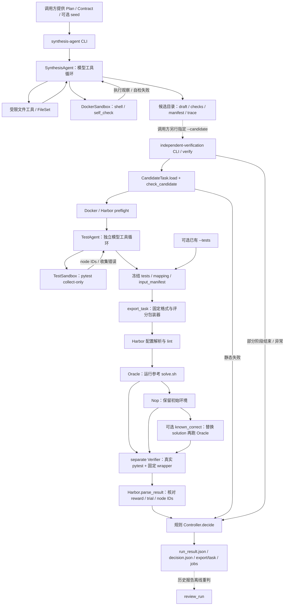
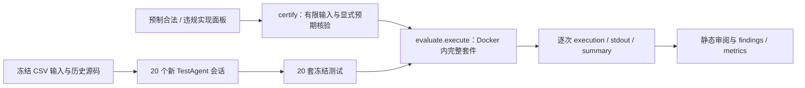

# Implementation & Architecture Audit

> 历史审计快照：结论对应审计时点，后续实现可能已变化。当前操作入口见 [项目 README](../../README.md)。

审计日期：2026-11-14。设计基准：[agent 设计.md](../design/agent%20%E8%AE%BE%E8%AE%A1.md)，重点核对第 2、3、4 节。补充参考接口设计、源码、配置、测试、CLI、`runs/` 和 `step3_test_1112/` 的现存记录。

审计对象是**当前工作区**，包括 Git 忽略的本地实验文件；不把文档中的示例代码视作实现。下文路径相对项目根目录，函数名用于定位；“未验证”表示本次没有足够证据确认。未读取 `.env` 内容，未调用模型、启动 Docker 容器或重跑 Harbor，仅运行离线测试及只读证据核验。唯一新增文件是本报告。

## 1. Executive Summary

当前项目已经实现了一个**包含两个局部自主工具循环、由固定阶段串联的任务生成与基础验证原型**：

- `SynthesisAgent` 根据外部提供的 Plan、Contract 和可选 seed，生成 Python 标准库 CLI 修复任务；能执行容器命令、观察自检结果并修改候选。
- 独立 `TestAgent` 在不接触参考解法和生成探针的会话中编写 pytest 测试；能根据收集错误修改测试，但只能调用 `collect`，没有完整测试执行工具。
- 独立验证 Pipeline 已接入候选完整性检查、静态规则、测试生成、Harbor 导出、配置解析/lint、真实 Oracle/Nop、可选正确替代解法，以及规则式 Controller。
- 历史 CSV 候选确实完成过 public 网络下 Oracle=1、Nop=0。本次核对原生 reward、wrapper 报告并重新分类，结果一致；这只证明该候选的基础执行链路曾跑通。

**尚未实现设计要求的完整生成—验证—反馈—修复闭环。** 无自动 Planner/Contract 生成，无 Challenge/Solver，无 Controller 到 Agent 的修复调用、修复预算和全量回归循环，也无正式的合格任务数据集管理。生成与验证是两个独立入口，需要调用方传递候选目录。

当前独立语义验证子系统存在明显交付缺口：`docs/validation-m0-m1.md`、测试和历史证据存在，但 `independent_verification/validation/` 仅有 `__pycache__/*.pyc`，缺失可读实现及正常包入口。本次离线发现测试共 83 个条目：**74 通过、8 跳过、1 导入错误，退出码 1**，不能宣称完整测试套件通过。

测试质量尚不能由基础验收保证：历史已验收的 15 测试套件存在 CSV 序列化过严反例；另一项固定单 CSV 任务的 20 轮实验中，15 轮误拒合法实现、10 轮放过至少一个违规实现。该实验使用固定面板和历史冻结代码，未将发现反馈给 Test Agent，不能视为 Challenge 或自动修复已经落地。

## 2. Design vs Implementation Matrix

状态含义：**已实现**为该项限定职责有实际代码；**部分实现**为只覆盖设计的一部分；**仅有接口/占位**为存在数据契约或调用约定而缺少可工作的主体；**未实现**为当前源码未找到对应执行机制。状态不等于验收通过；运行与集成情况另列。

|设计项与职责|状态|代码与具体证据|独立运行及端到端集成情况|
|---|---|---|---|
|Task Planner：从方向、能力、资料和已有记录提出任务|未实现|`synthesis_agent/__main__.py::main` 强制 `--plan`、`--contract`；`examples/*/plan.json` 是输入样例。接口文档 §3 的 Planner 未找到对应类或函数|不能仅输入任务方向完成生成；需要外部准备 Plan|
|Task Contract：自动形成完成标准|部分实现|`synthesis_agent/inputs.py::validate_inputs` 校验字段、要求 ID、路径、依赖和 limits；无 Contract 生成 Agent|消费外部 JSON 已接入两 Agent；自动起草、协商及修改同步未实现|
|Contract 要求对解题者可见|已实现（追加机制）|`inputs.py::instruction_appendix`；`SynthesisAgent.generate` 内 `dispatch(write_file)` 自动追加完整 Contract|接入生成说明；不证明正文与 Contract 没有语义冲突|
|Synthesis 自主构建候选及工具反馈修订|已实现（受限范围）|`synthesis_agent/agent.py::SynthesisAgent.generate`、`TOOLS`、`dispatch`；工具观察写回 `messages`|有 CLI、真实模型 CSV 历史制品；在生成阶段内部已闭环|
|生成环境、安装依赖、终端调试|部分实现|`DockerSandbox.prepare/create_args/shell`；模型写 app 文本，Python 写可信 Dockerfile；`validate_inputs` 限制 `python-stdlib`|可执行命令；不支持设计中的一般依赖安装、联网构建、多服务或任意运行环境|
|初始故障环境与参考解法分离|已实现|`agent.py::snapshot(include_solution)`、内部 `self_check`；初始容器仅 app，修复容器另加载 `/solution`|在生成自检和导出中使用；“故障符合预期考察点”无独立语义判定|
|参考解法在干净副本执行并核对修改范围|已实现|`agent.py` 内 `self_check`，`DockerSandbox.snapshot/probe`；要求初始至少一项 fail、修复后全部 pass|生成门禁已接入；probe 由同一生成模型编写，不是独立测试|
|Static Checker：文件、配置、明显泄漏|已实现（有限规则）|`CandidateTask.load`、`candidate.py::check_candidate`；校验 manifest、必需文件、Dockerfile 模板、保留目录及与解法文件完全相同的内容|`verify` 首阶段和独立 inspect 可用；不证明无变形答案泄漏或业务逻辑一致|
|独立 Test Agent 首版不看解法|已实现|`CandidateTask.test_input` 只投影 Contract、Instruction、初始环境；`agent.py::validate_test_input/TestAgent.generate` 限制输入键及读写路径|已接入 verify；有真实模型测试生成记录；独立性是会话与输入隔离，未要求不同模型|
|要求到测试的覆盖映射|已实现（结构映射）|`common.py::validate_coverage`、Test Agent `finish` 核对全部 requirement ID 与真实 node ID|完成门禁和导出均核验；并不分析断言是否实际覆盖语义|
|Test Agent 完整执行测试并据失败修复|部分实现|`TestSandbox.collect` 仅调用 wrapper `--collect`；`TOOLS` 没有 execute-suite/读取 trial 反馈工具|收集错误可回传并修改；Oracle/Nop 在模型生成结束后执行，结果不返回 Test Agent|
|参考解法通过、未修复版本不通过|已实现（基础验证）|`pipeline.py::verify` 执行 `('oracle','nop')`；`Harbor.run/parse_result`|真实 CSV 历史已完成；生成自检与独立 Oracle/Nop 是两套不同检查|
|Harbor 格式、separate verifier 与 artifacts|已实现|`exporter.py::export_task` 生成 `task.toml`、`tests/Dockerfile`、固定 wrapper；`Harbor.validate` 实际解析/lint|export 可离线；all/run 继续 lint 和 trial；当前网络配置是 public|
|不同正确实现不得被错误拒绝|部分实现|`verify(..., known_correct=())`、CLI `--known-correct`，替换 solution 后重新运行 Oracle；全部通过才满足 basic pass|可选分支已集成且有模拟测试；历史 `step3-public-01` 未提供替代解法；本次未验证真实多解法 Harbor 执行|
|Challenge 主动生成错误实现并证明骗过测试|未实现|生产 `verify` 无 Challenge 分支；`step3_test_1112/evaluate.py::execute/certify` 是固定面板执行器|面板有真实运行证据，但不自主发现或生成攻击，不触发补测|
|Solver 仅凭 Instruction 和初始环境正常解题|未实现|生产源码无 Solver 模型会话、轨迹或调度；Harbor 只指定 oracle/nop|Oracle 使用参考解法，Nop 不解题，均不能替代 Solver；可解性/难度测量未验证|
|Controller 汇总并判定|部分实现|`controller.py::decide/_decide`、`review_run`；`verify` 的 finally 自动调用并写 decision|真实集成到验证入口；规则判定，无模型。支持 accept/repair/needs_review/error/not_evaluated；无设计中的 reject|
|Controller 定向修复、重试、最终完整复验|未实现|`_decide` 只返回 action/owner；`verify` 末尾仅写文件，不调用 Agent|没有 Dispatcher、修复 attempt、跨阶段回边或候选级预算耗尽/Reject 流程|
|独立语义验证与反例证据层|部分实现（历史有证据，当前不可用）|`docs/validation-m0-m1.md`、`tests/test_validation.py` 约定 ValidationRequest/validate/DeclaredIOChecker；实际 `validation/` 缺 `.py`|历史 M0/M1 结果留存；当前导入失败，`pyproject.toml` 也无文档声称的 `test-validation` 入口；未接入 verify/Controller|
|Validated Task Dataset：任务、来源、条件、修复历史与版本|部分实现|`synthesis.json`、trace/self_check；export 清单、run_result/decision 和 jobs 保存散落产物|有制品归档；accept 不触发专门 dataset 写入，无数据集索引、修复版本链或 Solver 轨迹管理|
|预算、成本与复现记录|部分实现|`Config`、两个 generate 的调用/字节预算；`Harbor.execute` 超时/日志上限；镜像/manifest/trace|单阶段预算有效；无完整 workflow 总预算，client 不保留 API usage，token 成本未采集|
|对照实验：独立测试、Challenge 收益、Controller 修复与难度|部分实现|`step3_test_1112/generate.py/evaluate.py/static_review.py`、协议及 20 轮记录|仅固定单 CSV 的独立测试基线；无三组消融、自动修复对照或 Solver 难度校准|

## 3. Current Architecture

### 3.1 实际执行架构

实线表示源码中的执行/数据依赖；虚线表示调用方手动串联或离线证据流。图中不把缺失的 Planner、Challenge、Solver 画成已存在节点。



`verify` 可在 inspect、generate、export 提前结束，图表示完整 all/run 主链；任何失败不必继续全部节点。Oracle/Nop 是顺序执行；Oracle 正常返回失败评分时仍继续 Nop，若适配器抛出未处理异常，则进入外层错误路径。

独立实验支路：



该支路没有回到 TestAgent 的边；使用 `frozen/source`，不是当前生产编排器中的质量门禁。独立语义验证层因当前缺源码而未画为可执行节点。

### 3.2 Agent 与普通模块的边界

|组件|实际类型|决策、模型与协作方式|
|---|---|---|
|SynthesisAgent|有边界的自主工具 Agent|模型选择读写、shell、自检、完成顺序；观察后可修改 app、solution 或 probe；Python 控制安全与完成门禁|
|TestAgent|能力更窄的自主工具 Agent|模型选择测试内容和收集/修改顺序；只能观察收集，无法自主运行 Oracle、测试实现面板或主导验证修复|
|OpenAICompatibleClient|普通模型客户端|stdlib HTTP Chat Completions；`complete(messages, tools)` 返回 assistant message；工具必选。默认两 Agent 可使用同一配置，彼此不共享 messages|
|verify|固定阶段 Pipeline|顺序执行与阶段短路由 Python 决定；没有让模型制定跨模块执行计划|
|Controller|确定性规则决策器|根据报告形状、状态、reward 和外部 critical_issues 输出建议；不调用模型、工具或修复模块|
|Static Checker / Exporter / Harbor adapter / wrapper|规则与执行工具|分别负责结构检查、打包、外部程序调度/结果交叉核验、pytest 记录与评分，不具有自主规划能力|
|Oracle / Nop|Harbor 执行模式|本项目调用名为 agent 的 Harbor 模式；Oracle 执行已给定解法，Nop 无修复行为，不能据名称认定是自主模型 Agent|
|实验面板脚本|离线评估工具|运行预先给定实现并统计结果；不等于 Challenge Agent 或独立 Solver|

`OpenAICompatibleClient.complete` 使用 `/chat/completions`、工具 schema 和 `tool_choice=required`；DeepSeek 域名分支关闭 thinking、改用 `max_tokens`。这些是实际代码行为；本次没有联网验证服务端兼容性。模型 HTTP 错误、超时、截断被转成 `SynthesisError`，没有通用自动 API 重试策略。

### 3.3 与原设计比较

原设计为 Planner → Contract → Synthesis → 独立验证（Static/Test/Challenge/Solver）→ Controller → Accept/Repair/Reject → 数据集。当前保留了中间的 **Synthesis → Static/Test → Oracle/Nop → Controller**，但两端和回边不完整：

- 输入端由人工/外部程序供给 Plan/Contract，`generate_and_check(request, run_dir)` 仅出现在接口设计文档，不是项目执行函数。
- 验证端缺 Challenge、正常权限 Solver 及自动语义审查；正确替代解法是可选调用参数。
- Controller 接入了结果产出，没有接入执行调度；accept 写判定，repair 写建议，没有 reject 或回到 Planner/Agent 的路径。
- 输出是一次运行的任务包和证据目录，尚未形成设计中的受管数据集。

因此不能称为完整自主 Multi-Agent System。较准确的描述是：**两个工具型 LLM Agent 加固定验证 Pipeline，含局部反馈循环和规则式终端判定**。

## 4. Execution Flow

### 4.1 实际入口与运行边界

`pyproject.toml` 只注册 `synthesis-agent` 和 `independent-verification` 两个入口。调用关系等价于：

```text
外部 Plan + Contract + seed
  → python -m synthesis_agent ... --output <candidate>
  → 调用方检查 synthesis.json.status
  → python -m independent_verification --candidate <candidate> --output <verification>
  → task 包、运行证据、Controller 判定
```

这展示已有接口，不是本次执行命令。从候选目录到基础评分可在一次 `verify(stage='all')` 中完成；从自然语言方向到最终任务没有统一已实现入口，也没有生成器自动调用验证器。

### 4.2 阶段输入、输出、依赖和错误处理

|阶段|输入 → 输出及调用关系|依赖与失败行为|
|---|---|---|
|1. 输入与预算校验|CLI 读取 JSON → `validate_inputs` → 冻结 Plan/Contract；读取 seed 文本|Python 3.11+；固定 `/app`、Python CLI、stdlib；拒绝链接、特殊文件、路径冲突和大小超限。已有输出目录不覆盖；目录创建前失败不产生日志|
|2. 准备生成环境|`DockerSandbox.prepare` 检查 Linux Engine、已有镜像 → 固定 image ID/reference；写可信 Dockerfile|不自动 pull/build；Docker 不可用则在调用模型前失败，无宿主执行回退|
|3. 模型构建与探索|Plan/Contract/参考路径 → client.complete → `dispatch` → FileSet 或容器结果 → tool message|文件编辑在内存快照持久化；shell 每次新容器，shell 修改丢弃。一般工具参数/任务错误作为 observation 回模型；预算超限终止；未预期异常导致 error|
|4. 参考自检与完成|两份干净快照 → 初始 probe、运行 solve.sh、修复 probe → `self_check.json` → finish|检查修复路径、必要 artifact、probe 是否改 app、原始环境 hash；初始至少一个断言 fail、修复全部 pass。异常不是合格失败。finish 必须匹配当前完整文件 digest，修改后须再自检|
|5. 导出候选|FileSet → `draft/`、`checks/probe.py`、plan/contract、synthesis/self_check/trace/build_log|落盘后再核对各文件 hash；失败也可能保留部分制品，只能依据 `candidate_generated` 识别生成成功，`independent_validation` 保持 false|
|6. 候选加载与静态检查|`CandidateTask.load` → metadata/contract/environment/solution；`check_candidate` → static_check.json|校验 candidate 状态、固定布局、manifest、draft 额外文件、Dockerfile 和明显泄漏；inspect 到此结束。未将自检通过当成独立验证|
|7. 验证预检|`preflight` → Docker/Harbor 版本及网络能力报告|非 export 阶段先预检再付费调用；generate 不要求 Harbor 可用，但仍要求 Docker。Harbor 锁定 0.25.0；当前 public 配置不执行 no-network 内核探测|
|8. 独立生成测试|`candidate.test_input()` → TestAgent 新会话 → tests、collection.json、tests.json 和 coverage|固定本地 verifier 镜像须包含 pytest 9.2.0；输入只读。collect 在新 Docker 容器导入和收集测试，修改即清空旧 collection；finish 要求当前 digest 收集成功且所有要求映射到有效 node ID|
|9. 导出 Harbor 包|候选 + 冻结 tests 输出 → `export_task` → export/task、package.json|校验 input_manifest 与当前候选一致、tests manifest/digest 及 coverage；不复用生成 probe 评分。显式传入 `--tests` 可跳过模型生成；export/run 要求已有 tests|
|10. 配置与 lint|Harbor `TaskConfig.model_validate_toml`、`lint --json` → export.json/lint.json|离线 export 不执行这一步，structure_valid=null；解析执行失败为 error，正常 lint findings 为结构不合格|
|11. Oracle/Nop 与可选替代解法|Harbor `run -a oracle/nop -k 1 -r 0 --env docker` → jobs/trial/verifier 结果|任务包固定；separate Verifier 仅接收声明 artifacts。known_correct 分支替换 solution、不替换测试，使用相同评分策略。进程日志/时间/大小有上限，错误分数为 null|
|12. 解析与 Controller|`parse_result` → completed/reward 或 error；`decide` → decision.json 与 run_result.json|交叉核对 trial 身份、完成状态、separate 模式、原生 reward、reward 文件、wrapper 再分类、冻结 node IDs；执行前后任务 manifest 核对。阶段正常提前结束为 not_evaluated；没有后续修复执行|

生成容器采用无网络、非 root、只读根目录、cap-drop、CPU/内存/PID/tmpfs 限制，见 `synthesis_agent/sandbox.py::create_args/container`。TestSandbox 复用该后端。**Harbor 导出配置另行采用 public 网络**，任务环境和 verifier 均如此，不能把生成沙箱的无网络条件扩展为整个系统的统一隔离保证。Verifier 构建使用 `python:3.11-slim` 和固定 pytest 版本，但基础镜像 tag 及 pip 构建不构成全部依赖的字节级锁定。

### 4.3 实际数据与信息隔离

- Synthesis 持有 Plan/Contract、seed、初始程序、参考解法和自己生成的 probe；其自检可能存在共同理解错误。
- `CandidateTask` 普通 Python 对象可持有 solution，但 `test_input()` 仅深拷贝 Contract、Instruction、initial_environment。TestAgent 工具白名单不提供 solution、probe 或历史 trace；隔离发生在模型输入与工具层，非“整个 Python 进程无法访问”。
- 输入快照 → Test Agent `input_manifest` → tests manifest/digest → expected node IDs → 导出 manifest → Harbor 执行前后 hash 有明确绑定。Contract 本身不在 Synthesis 文件 manifest 中，但测试绑定的 input_manifest 包含其内容；不能宣称所有元数据均被原始候选摘要覆盖。
- 验证结果保存在磁盘，不自动转成任一生成 Agent 的新消息。Controller 的 `critical_issues` 可由外部调用方提供；它检查归因字段及证据路径的形状，不读取路径内容或自行完成语义归因。

## 5. Verification & Feedback

### 5.1 各验证层分别能证明什么

|层级|是否真的执行|可以支持的结论|不能支持的结论及反馈情况|
|---|---|---|---|
|输入/静态规则|已在主流程执行；本次只读加载历史 candidate 并重新 check，6 个 manifest 文件匹配、static passed|文件布局/摘要及已编码规则通过|不能判断业务要求、测试充分性、难度或所有泄漏；static 错误进入 Controller，不返回 Synthesis|
|Synthesis probe|代码会在容器执行真实 CLI；CSV 历史有 self_check/trace 记录|同一模型自检下，初始失败且参考解法通过|不能代替独立验证；结果确实返回 Synthesis，可修改并重新 self_check|
|pytest collect-only|TestSandbox 实际调用 wrapper `--collect`，历史有 node IDs 和收集记录|模块可导入，测试可发现，映射引用存在|不执行正常测试函数体/断言；导入期可能执行代码，故仍置于容器。收集反馈回 TestAgent，但不证明要求得到正确评分|
|真实 pytest 套件|Harbor verifier 执行 wrapper 的非 collect 分支；实验 evaluate 也执行完整套件；本次离线测试还实际执行了可信手写 wrapper 用例|特定实现、特定环境上测试运行与结果|测试通过不等于实现符合 Contract，更不等于测试正确。Harbor/面板结果不回 TestAgent|
|Harbor 配置解析/lint|`validate` 真实调用解析器和 CLI；历史导出报告通过|Harbor 结构/配置检查通过|lint 不等于运行、语义正确或 Oracle 通过；结果供 Pipeline/Controller|
|Oracle/Nop|已接入 all/run；历史原生 trial、execution、reward 存在|参考解法能过当前测试，未修复版本不能全过|不能检出所有漏测、过严、硬编码或替代解法误拒，也不能测正常 Solver 难度|
|known_correct|生产可选分支已集成，模拟集成测试通过|提供的替代解法也须通过，否则不能 basic pass，Controller needs_review|未提供时没有覆盖；其“正确”标签来自调用方，Controller 不自行证明正确性；历史主验收此列表为空|
|独立语义验证|历史文档/产物存在，当前导入失败|只能确认过去保留了有限见证、三态判定与证据记录|当前不能运行，未接主流程；不能将文档所述 PASS 当成项目全局合格|
|固定实现面板|历史 20 轮、1020 次 execution 文件存在且与 summary 状态/reward 一致|固定任务与面板上的评分错误/有限重复稳定性|不是自主 Challenge；没有测试修复、生产质量门禁或普适正确性证明|

wrapper `classify` 的实际策略为：全套完成且通过 → reward=1；setup/call 中被识别的 AssertionError/pytest.fail → reward=0；收集缺失、node 不匹配、skip/xfail、未预期异常、teardown 异常或退出码冲突 → error/reward=null。空收集不能得分，旧 reward 文件先删除。**异常类型是评分协议分类，不是实现违规的语义证明。** 它也明确不承诺抵御恶意 verifier 代码。

### 5.2 反馈与修复边界

|反馈边|现状|修复是否发生|
|---|---|---|
|shell / probe → Synthesis messages|已实现|模型可继续编辑候选、自检、完成；受调用预算约束|
|collect / mapping 错误 → TestAgent messages|已实现|模型可修改测试并重新收集|
|Oracle/Nop / known_correct → Controller|已实现|仅分类、保存诊断和证据链接|
|Oracle/Nop / 语义反例 → TestAgent 或 Synthesis|未实现|无修复 API、dispatcher 或恢复既有会话|
|Challenge / Solver → 验证系统|未实现|无对应 Agent 产物或生产执行分支|
|Controller repair → 相应 Agent → 全量重验|未实现|没有自动修复、版本化尝试、回归、预算耗尽后 Reject|

Controller 对 Oracle=0、Nop=1 或替代解法失败输出 `needs_review`，保留可能负责的 solution/tests/environment/contract 等模块，而不直接认定责任。静态失败或外部已明确归因的 critical_issues 可输出 repair，但“建议 tests 修复”不等于调用了 TestAgent。`tests/test_controller.py::test_pipeline_full_run_and_critical_issue_do_not_repair` 明确覆盖此边界。

`pipeline.verify` 的 `independent_validation/end_to_end_validated` 布尔值由基础评分计算；Controller 还会考虑额外关键问题。因此不能只读取这两个布尔值忽略 `controller_decision`，更不能把字段名理解成原设计全链路已经实现。

### 5.3 本次核验与历史证据

**本次实际执行的低成本检查：**

```bash
env -u SYNTHESIS_DOCKER_TESTS -u SYNTHESIS_MODEL_TESTS \
    -u STEP3_HARBOR_TESTS -u STEP3_MODEL_TESTS \
    PYTHONDONTWRITEBYTECODE=1 .venv/bin/python -m unittest discover -s tests -v
```

结果：83 个发现条目，74 通过、8 跳过、1 导入错误，3.302 秒，退出码 1。跳过项为 5 个真实 Docker 测试、1 个三题型真实模型验收、1 个 Harbor 集成、1 个独立模型/Harbor 验收。`test_validation` 在导入阶段即失败，不能由这 83 个条目推断它原本的用例均已执行。

错误为 `tests/test_validation.py:10` 无法从 `independent_verification.validation` 导入 `ContractAssessment`。文件树显示该目录仅有 6 个 `__pycache__/*.pyc`，无 `__init__.py`、engine/backend/checkers/models 或 `__main__.py` 源码。没有将缓存反编译或推断为可部署实现；当前独立语义层不能正常运行是已核实事实，其历史源码为何缺失为**未验证**。

本次通过的 `test_real_wrapper_with_trusted_handwritten_tests` 确实在临时目录启动 Python/pytest，验证通过、断言失败、ValueError、skip 四种情况。其他 ScriptedClient/FakeSandbox/模拟 Harbor 测试主要证明协议和控制流，不能证明真实模型表现、Docker 隔离或新 Harbor 验收。

|历史证据|本次核对内容|结论与边界|
|---|---|---|
|`runs/archive/candidates/acceptance-csv-01/synthesis.json`、`trace.jsonl`、`self_check.json`|当前 loader 可读取成功候选，manifest 6 文件匹配，静态通过；metadata 记录 OpenAICompatibleClient、12 次模型/14 次工具调用|存在真实模型生成历史证据；本次未重新生成，不代表现版本三题型全部验收|
|`runs/archive/verification/step3-public-01/run_result.json`、`export/export.json`、`jobs/*/*/result.json`、`verifier/execution.json`|原生 Oracle reward=1、Nop reward=0，wrapper 分别 pytest exit=0/1，15 个 node；使用当前 classify 重新分类一致，lint 无错误|单 CSV 候选的 public 基础运行已核实；本次当前 Controller 对该历史 report 只读重判为 accept，未重新执行 Harbor|
|`runs/archive/audits/csv-overstrict-audit/findings.md` 及同目录执行记录|保存的两种 CLI 只改数据行 quoting；minimal 为 15/15，quoted body 为 14/15；`test_stdlib.py` 直接比较文本行|已有合规 CSV 表达被过严测试拒绝的具体反例，说明历史 Oracle/Nop 通过不足以保证评分正确|
|`step3_test_1112/frozen/manifest.json`、generation-summary、execution-summary、逐次 execution|冻结 manifest 的 46 文件 hash 全部匹配；20 次生成成功；1020 份 execution 状态/reward 与 summary 全部一致|有完整套件执行证据，不能仅当成 collect。有限面板为 9 种合法×3 次 + 24 种违规×1 次，每轮 51 次|
|`runs/archive/experiments/m0-m1-acceptance-20261112/acceptance-summary.json`、`runs/archive/experiments/m0-m1-cli-smoke-20261112/validation-result.json`|历史摘要记录 17 用例通过、531 证据文件核验；CLI 结果留有 PASS|属历史记录，不等于本次复跑或现存源码可用；本次未逐一重验该层 531 产物|

本次从 execution-summary 重新汇总，且逐份核对 1020 个 execution 的状态/reward：

|面板类别|completed / reward=1|completed / reward=0|error / reward=null|
|---|---:|---:|---:|
|已标注合法实现|240|300|0|
|已标注违规实现|50|397|33|

300 次合法失败覆盖 15/20 轮；50 次违规通过覆盖 10/20 轮，33 次 error 不计作成功拒绝。合法重复使同一错误可能出现多次，不能将 execution 数当独立任务样本。标签认证为有限 cases + 源码审查，本次未重跑 Docker 或重新证明全部标签；比例仅描述保存的单任务基线，不外推其他任务或当前模型版本。

协议与 `generate.py` 明确每轮新会话、无 Oracle/面板反馈；`evaluate.py` 是完整 suite 的固定实现替换执行。`static_review.py` 含人工编写的 NOTES，AST 只导出断言清单，不能称为自动自然语言语义验证器。实验没有展示“发现问题后模型修复，随后质量改善”的数据。

## 6. Missing Components & Integration Gaps

以下按对评分可靠性和设计完整性的影响排序，描述当前缺口，不在本次实施重构。

|顺序|关键缺口|实际影响与证据|
|---|---|---|
|1|测试执行结果、合法反例和违规见证未进入生成反馈|TestAgent 完成门禁只依赖 collect/mapping；已知存在误拒与漏检。Oracle/Nop 和实验 findings 只写盘，无测试修复回路。见 TestAgent TOOLS、pipeline.verify、固定面板记录|
|2|当前独立语义验证实现缺失，完整离线套件失败|不能运行文档中的 validate/DeclaredIOChecker，不能将历史 M0/M1 能力算作当前可用；本次导入错误已复现。即使恢复，其有限声明见证也不等于自动理解所有 Contract|
|3|Controller 后续调度与完整重验缺失|repair 只产生字符串建议，没有修复入口、版本链、受影响部分重验、最终全量门禁、循环预算或 Reject；无法形成设计的跨模块闭环|
|4|Challenge 未实现，替代正确实现验证非默认|Oracle/Nop 仅检一对实现，无法系统排除过弱与过严测试；known_correct 已有接入但需调用方提供，不可将固定实验面板当成生产主动挑战|
|5|Solver 与可解性/难度验证缺失|不能通过正常权限尝试区分任务太难、说明缺失和环境故障；参考解法成功只证明给定解法能通过测试|
|6|缺自动 Planner/Contract 与统一任务方向入口|当前必须准备结构化输入并手动串联生成/验证，不能满足设计从方向自动选题、完成标准制定和目标重设|
|7|独立语义/一致性与故障意图核验不足|正文可与追加 Contract 冲突；probe 可与 solution 同错；coverage 是声明映射。静态检查不能证明初始故障正是考察点、测试只约束任务语义或任务价值/真实难度|
|8|候选与验证证据的完整生命周期未形成|有多处 hash 绑定，但 Controller 历史 review 只检查报告，不重算任务与测试内容摘要或核实引用；无修复版本索引、Accept 后专门数据集写入、来源审核与后续抽检机制|
|9|支持范围与环境复现仍窄|仅单容器 Python stdlib CLI，未实现设计示例库存 HTTP 服务的一般构建。Harbor 使用 public 网络；verifier 基础镜像 tag/安装过程不完全锁定。Synthesis 内部 `in_scope` 在 allow_additional_files=true 时对所有声明路径允许后代，与 prompt“文件精确匹配”有差异|
|10|真实验收覆盖与成本测量不完整|当前三题型真实模型验收默认跳过；本次未验证新鲜全链路或当前 Docker/Harbor 可用性。模型 client 丢弃 usage、trace token=null；缺总 workflow 预算、修复/Challenge 增益对照与难度校准证据|

补充交付边界：`.gitignore` 忽略 `runs/`、`step3_test_1112/`、examples 及部分文档/测试；当前本地可审计不代表全新 checkout 同样具备这些材料。本报告不把本地历史目录当作已发布数据集，也不假定换机器可直接复现实验。部分旧状态文档仍写“没有 Test Agent/Controller”或较早测试数，应按本文当前源码与本次测试结果解读，不能混用不同阶段结论。

## 7. Overall Assessment

**已经能实际工作的核心是：**受限任务输入校验、具执行反馈的候选构建、干净副本参考自检、独立测试生成与收集、绑定候选/测试的 Harbor 打包、Oracle/Nop 基础评测、保守规则判定，以及完整度较高的本地日志与面板实验记录。它已超出“只有接口或静态文本生成”的阶段。

对“端到端”应分三种口径：

|口径|判断|
|---|---|
|已有候选 → 独立测试 → Harbor Oracle/Nop → 基础判定|**已有代码并有单 CSV 历史成功证据**；当前 Controller 可对该历史证据重判 accept|
|外部 Plan/Contract → 生成候选 → 基础验证|**模块可由调用方串联**，缺统一编排入口；本次未执行当前版本新鲜全链路，完整多题型运行能力未验证|
|用户方向 → 自动规划/Contract → 生成 → 全面验证 → 自动定向修复/回归 → 数据集|**未实现**；关键 Agent、调度回边、语义层及数据集生命周期缺失|

系统整体是**带局部 Agent 反馈循环的分阶段 Workflow 原型**：生成器内部能执行、观察、修改；测试生成器内部能收集、观察、修改；系统层仍是单向 Pipeline，以 Controller 报告结束。它尚不具备原设计所要求的自主多 Agent 规划协作，也尚未形成完整生成—验证—反馈—修复闭环。历史基础成功和大量真实 pytest 执行证据应予认可，但不能据此宣称任务评分可靠、难度经过验证或已达到最终基准发布标准。
