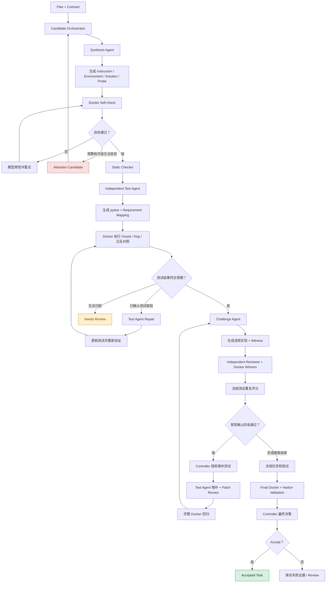

# Terminal-Bench Task Generation Agent：第一版实现与实验进展

## 1. 第一版的目标

第一版主要想先实现一个可以实际运行的 Terminal-Bench 任务生成流程，验证 LLM 能否自主构建任务，并通过独立测试、执行反馈和修复逐步提高生成任务的质量。

目前将任务范围限制在 Linux Docker 环境下、只依赖 Python 标准库的 CLI 数据处理代码修复任务，包括 CSV 清洗、JSONL 聚合和目录 manifest 生成。

输入是预先定义的 Plan 和 Contract。Plan 描述任务目标、场景和需要考察的技能，Contract 定义输入输出格式、功能要求、允许修改的文件等。Agent 根据这些信息生成完整的任务包：

- **Instruction**：给解题 Agent 的任务说明。
- **Environment**：包含待修复代码的初始环境。
- **Reference Solution**：可以修复初始环境的参考解法。
- **Tests**：独立生成的 pytest 测试。
- **Harbor 配置**：使任务能够在 Terminal-Bench 的评测环境中运行。

第一版重点验证三个问题：

1. Synthesis Agent 能否从 Plan/Contract 出发，自主生成一个初始版本有错误、参考解法可以修复的任务。
2. Independent Test Agent 能否在不读取参考解法的情况下生成测试，并根据实际执行结果发现和修复测试问题。
3. Challenge Agent 能否主动找到现有测试遗漏的错误实现，再通过补测使它无法通过。

希望最终形成一个从任务生成到独立验收的端到端流程，并保存完整的实验和执行记录。

## 2. 第一版的架构与实现

目前主要使用 Python 实现 Agent 的工具调用、流程控制和验证逻辑。LLM 负责生成任务、测试、挑战实现和分析问题；Controller 和执行工具由 Python 程序实现。




### 2.1 Synthesis Agent：生成任务并自检

Synthesis Agent 接收 Plan、Contract 和可选的初始代码，通过模型工具调用循环生成 Instruction、Environment、Reference Solution 和自检 Probe。

目前提供的工具包括文件读写、文件列表、Docker Shell、自检和结束生成。

模型可以多次修改文件并执行命令，观察实际运行结果。为了避免直接影响宿主环境，执行操作放在临时 Docker 容器中，文件修改则通过受控的写入工具保存。

生成完成前必须运行 Self-check：

1. 在初始环境中运行 Probe，确认至少有一个要求未满足。
2. 安装 Reference Solution。
3. 再次运行 Probe，确认所有要求通过。
4. 检查参考解法是否修改了 Contract 允许范围以外的文件。

Self-check 结果与当前文件的 hash 绑定，之后如果模型修改文件，需要重新检查才能完成生成。

这部分已经实现了模型自主写代码、执行、观察反馈和修改的基本循环。

### 2.2 Independent Test Agent：独立生成测试

Synthesis 的自检由生成者自己编写，可能存在解法和测试共同理解错误的问题，因此增加了独立的 Test Agent。

Test Agent 只能读取 Contract、Instruction 和初始环境，不能读取 Reference Solution 或 Synthesis Probe。

它生成 pytest 测试和 fixtures，并建立 Requirement-to-Test Mapping，将 Contract 中的每条要求关联到实际测试节点。

最早只运行 `pytest --collect-only`，检查测试能否被正常收集（用于搭建大框架）。后来增加真实执行反馈：

- **Oracle**：安装参考解法，检查测试是否通过。
- **Nop**：不执行任何修复，检查测试能否发现初始问题。
- **Known Correct**：使用其他已确认正确的实现，检查是否误拒合法答案。
- **Known Invalid**：使用已确认违规的实现，检查是否漏掉错误。

每个实现都在新的 Docker 环境中运行。任务代码执行完成后，只将需要评分的文件转交给独立 Verifier，再执行 pytest。

测试结果会记录通过、正常断言失败、执行异常等信息。Test Agent 可以根据反馈提出修复方案，修复后重新运行全部相关对照，默认最多两轮。

### 2.3 Controller 与 Repair

Controller 目前是基于规则的 Python 程序，根据静态检查、执行结果、对照测试和最终验证报告判断下一步。

例如：

- 文件缺失或任务结构有问题，交回 Synthesis。
- 测试存在已确认的问题，允许 Test Agent 修改。
- 错误来源不明确时，保留问题供进一步审查。
- 完成全部要求后，给出 `accept`。

同时实现了 Repair Dispatcher，用于保存每次修改前后的版本、失败证据、修改范围和预算，并在修改后重新验证。

这一部分主要解决模型不能只凭自身判断随意修改测试的问题。当前普通 Test Repair 能自动处理的情况还比较有限，主要包括简单文本输出和部分 JSON 语义问题。

### 2.4 Challenge Agent：主动寻找评分漏洞

Challenge Agent 可以读取已经冻结的测试，尝试生成违反 Contract、但能通过现有测试的错误实现。

例如 CSV 清洗要求按首次出现顺序输出，但测试可能只覆盖了本来就有序的数据。这时一个错误地排序输出的程序也可能通过所有测试。

Challenge 的流程是：

1. 模型生成错误实现，并提供一个能说明其违规行为的 Witness。
2. 独立 Reviewer 检查 Witness 是否符合 Contract 的要求。
3. 在 Docker 中实际运行 Witness，确认错误实现失败、正确实现通过。
4. 将错误实现交给原本冻结的评分测试，连续运行两次。
5. 如果两次都通过，Controller 确认发现了评分漏洞，允许 Test Agent 增补测试。
6. 增补后重新测试，保证正确实现仍能通过，已确认的错误实现被拒绝。

Challenge 只能修改自己的 Solution，不能直接修改原测试。Test Agent 在收到确认的漏洞后负责增补测试，并由另一轮独立审查检查补丁。

### 2.5 最终验证与批次运行

验证阶段将任务导出成 Harbor 格式，分别使用 Docker Runner 和 Harbor 执行 Oracle、Nop、正确与错误对照，并比较两个后端的评分结果。

此外，最近增加了 Candidate Orchestrator，用来自动处理候选任务失败后的重试。

每次失败会保留记录并标记 `abandoned`，然后在预算允许时重新生成候选。如果连续两个候选因同类问题失败，会暂停自动重试，避免重复消耗模型调用。也支持保存进度后显式 Resume。

至此，从 Plan/Contract 输入，到候选生成、独立测试、Challenge、修复和最终验证，已经有一条可以运行的完整流程。

## 3. 实现过程中遇到的主要问题

### 3.1 独立 Test Agent 生成的测试质量不稳定

最初认为只要 Test Agent 与 Synthesis 独立，就能减少生成和评分共享错误的问题。但实验发现，即使 Test Agent 不知道参考解法，也经常生成错误的测试。

最明显的例子是 CSV 序列化。Contract 只要求输出合法 CSV，没有指定必须使用哪种引号或换行方式，但模型可能直接比较输出字符串。

例如下面两种输出在 CSV 语义上相同：

```csv
a@b.c,x
```

```csv
"a@b.c","x"
```

如果测试固定要求第一种，就会错误拒绝第二种合法实现。

还有测试生成了超出 Contract 允许范围的输入、错误计算预期结果、漏掉重要边界条件等情况。

因此后来加入了真实执行反馈、正确与错误对照、Contract 一致性检查，以及受限的测试修复。

### 3.2 执行失败后，Agent 不容易正确判断该修改什么

最初的反馈修复实验中，模型曾将错误的 Oracle 误判为测试缺陷，尝试修改原本正确的测试。

同样，Oracle 执行失败，也可能是测试输入不合法、测试预期错误，或者参考解法本身存在缺陷。

现在将问题分析和修改权限分开。Test Agent 可以提出诊断，但需要 Controller 和宿主检查确认后才能修改。

对于当前无法可靠判断的问题，流程会停止自动修复并保存执行证据。

这样减少了错误修复，但也暴露出一个主要不足：目前的自动归因规则还比较窄，尤其是 CSV 等结构化数据的语义错误，很多仍需要人工判断。

### 3.3 Synthesis 自己的 Probe 也可能错误

之前一轮全新候选端到端实验中，Synthesis 连续自检失败，共发出了 22 次真实模型请求，使用 230,262 tokens，最终因为预算检查停止，没有进入 Independent Test。

后来检查发现，主要问题来自 Probe：

- 将 CSV 字段内容中的双引号误认为序列化引号，要求删除 Contract 没有要求删除的字符。
- 对已经使用 CRLF 的 CSV 输出重复转换换行，产生额外空记录。

模型反复修改 Solution，却没有定位到 Probe 本身的问题。

针对这个问题，尝试增加了更详细的 Self-check 反馈、错误定位和受限 Probe 修复，并使用冻结样本进行回归。

这使我意识到 Synthesis 的自检也需要区分 Solution 错误、Probe 错误、测试输入错误和规范理解错误。

目前尤其希望提高这一部分的通用性，让模型依靠一般执行反馈和自检机制解决问题，而不是不断增加针对 CSV 的专用修复规则。

### 3.4 Harbor 与本地环境兼容性

本地使用 Windows WSL2 和 Docker Desktop。Harbor 0.25.0 的严格 no-network 模式需要内核支持 `CONFIG_NFT_FIB_INET`，当前 WSL2 内核不满足这一要求。

因此当前 Harbor 测试使用 public 网络模式，而原生 Docker 的任务执行仍使用 `--network=none`。

目前可以完成 Harbor 任务导出、独立 Verifier 和评分验证，但严格无网络验收需要更合适的 Linux 环境。

### 3.5 完整流程的验证问题

完成各个模块后，曾出现局部测试通过、但整条流程无法 Accepted 的情况。

一方面是生成、测试、Challenge 任何一步出错都会阻止最终验收；另一方面，完整流程还需要保证最终验证确实覆盖了此前发现的错误实现。

最近的一次真实运行中，在线 Controller 已返回 `accept`，但离线复审发现最终 Harbor 没有执行 Challenge 确认的错误实现。

之后修复了这一遗漏，保留原来的候选、测试和 Challenge 记录，在新目录重新运行最终 Docker/Harbor 验证，才得到完整的 Accepted 结果。

## 4. 已进行的实验及结果

### 4.1 任务生成与独立测试的早期实验

最早使用 CSV、JSONL 和 manifest 三类任务验证 Synthesis。三类任务均有真实模型生成并通过基本 Smoke Test 的记录，证明受限任务生成和自检机制可以运行。

之后针对 CSV 任务，使用 DeepSeek Flash 进行了 20 轮独立 Test Agent 测试生成实验。

每一轮都生成一套测试，再使用 9 个合法实现、24 个违规实现执行评分，其中合法实现重复运行三次，总共进行了 1020 次 Docker 执行。

结果如下：

| 指标 | 结果 |
|---|---|
| 测试生成并成功收集 | 20/20 |
| 至少误拒一个合法实现 | 15/20 |
| 至少漏掉一个已确认违规实现 | 10/20 |
| 存在测试健壮性问题 | 19/20 |

这一实验说明只靠独立生成和 collect-only，测试质量仍然很不可靠，也是后来加入执行反馈和修复循环的主要原因。

### 4.2 执行反馈与修复实验

针对过严 JSON 输出检查、遗漏断言、测试语法错误等情况，使用真实模型进行过受控修复实验。

实验中确认模型能够根据 pytest 的实际失败信息修改测试，随后重新执行 Docker 对照。

同时也出现过错误归因：模型尝试通过修改正确测试来适应有缺陷的 Oracle。之后增加了 Oracle-only failure 的限制，以及由宿主验证的修复授权。

Repair Dispatcher 也完成过使用 ScriptedClient 和真实 Docker/Harbor 的执行实验，验证版本保存、修复调用、回归和最终决策可以连接起来。

### 4.3 Challenge Agent 实验

在 CSV 任务中，Challenge Agent 找到了一个实际评分漏洞：错误实现会读取相邻的 `.bak` 文件替换当前输入，输出旧数据，同时破坏原始输入。

该实现违反 Contract，但连续两次通过冻结的原有测试。

独立 Witness 验证了错误行为，Oracle 和正确实现通过 Witness。Controller 随后授权 Test Agent 增补测试，一轮修复后，Docker 回归能够拒绝这个错误实现。

这一实验验证了 Challenge 主动发现遗漏并驱动测试增补的可行性。

### 4.4 固定正确/错误实现面板

另一次冻结的 CSV 测试评估包含 14 个 pytest 节点、9 个合法实现和 24 个违规实现。

结果为：

| 样本 | 通过 | 正常拒绝 | 执行错误 |
|---|---:|---:|---:|
| 9 个合法实现 | 9 | 0 | 0 |
| 24 个违规实现 | 5 | 17 | 2 |

五个漏检对应姓名内部空白处理、非 ASCII 姓名限制、过严邮箱校验、输出排序和邮箱前导零处理等错误行为。

这说明即使测试覆盖了 Contract 的全部 Requirement ID，实际行为覆盖也仍然存在明显缺口。

### 4.5 最新一次真实端到端实验

[agent_generate-Terminal-Bench-task/reports/task at agent-core-initial · Arendengdeng/agent_generate-Terminal-Bench-task](https://github.com/Arendengdeng/agent_generate-Terminal-Bench-task/tree/agent-core-initial/reports/task)

使用 Candidate Orchestrator 进行了一次真实模型 CSV Batch 实验，最多允许生成 3 个候选，模型调用预算为 90 次、600,000 tokens。

实际生成了两个候选。第一个候选在 Synthesis Self-check 阶段失败，程序自动将其放弃并生成第二个候选。

第二个候选成功通过 Synthesis Self-check 和 Independent Test。随后 Challenge Agent 发现一个 R2 相关的评分漏洞：某个违反 Contract 的实现能够通过原有测试。经过独立 Witness 验证和冻结测试重复评分，Controller 授权 Test Agent 增补测试。经过一轮修复，正确实现仍然通过，已确认的错误实现被拒绝。

整个 Batch 由程序自动编排，累计使用 54 次模型调用、428,694 tokens。运行期间我没有修改候选任务、测试或参考解法，也没有手动执行 Agent 的工具调用。

初次在线 Controller 返回了 `accept`，但之后的离线复审发现，最终 Harbor 验证遗漏了 Challenge 已确认的错误实现，导致离线复审返回 `error`。

我随后修复了验证编排代码中的这一问题，并使用 `revalidate_frozen.py` 对相同的 Candidate、冻结 Tests 和 Challenge 记录重新执行最终验证。Docker 和 Harbor 各运行了 7 个对象，正确实现均通过，Nop 和违规实现均被正常拒绝。

补跑后，原生 Controller 返回 `accept`、`independent_validation=true`，离线复审也返回 `accept`。补跑过程没有重新生成候选或测试，也没有增加模型调用。

这次实验验证了候选生成、自动重试、独立测试、Challenge 漏洞发现和自动补测能够连接起来，并最终得到一个通过独立验收的任务。

## 5. 参考的相关工作

第一版主要参考了原设计中几项工作的思路：

**CLI-Universe**：参考它对 CLI Agent 能力与任务场景的组织方式。原设计计划据此进行任务分类和自动选题，但第一版尚未实现 Planner。

**Meta-Task**：主要参考模型在真实环境中构建任务、执行工具、观察结果并迭代修改的过程。目前 Synthesis 的工具调用和 Docker Self-check 与这一方向比较接近。

**FACET**：参考其对任务说明、实现、测试之间一致性的关注，以及根据失败信息进行定向修复的思想。目前 Contract 一致性检查、执行反馈分析和 Repair 机制属于这部分探索。

**Terminal-Bench / Harbor**：使用其任务组织方式和容器评分接口，生成可以实际运行和验证的任务包。

第一版主要是在上述思路的基础上完成工程实现，并通过实验研究生成测试的可靠性、错误归因和反馈修复。

## 6. 与原先总体设计的差距

目前已经完成了原设计中的一部分核心执行与验证功能。

| 模块 | 目前状态 |
|---|---|
| Planner（自主选题） | 未实现，仍依赖外部 Plan/Contract |
| Synthesis Agent | 已实现，支持工具调用、Docker 执行和 Self-check |
| Independent Test Agent | 已实现独立生成、执行反馈和有限修复 |
| Controller | 已实现规则判断和验收 |
| Repair Dispatcher | 已实现版本管理和有限修复调度 |
| Challenge Agent | 已实现，并有真实模型发现和修复漏洞的实验 |
| Independent Reviewer | 已实现，使用独立模型会话 |
| Final Validator | 已有完整 Docker/Harbor 验证路径 |
| Solver Agent | 未实现 |
| 难度评估与校准 | 未实现 |
| 多样性筛选、任务去重 | 未实现 |
| Validated Dataset | 已能导出任务包，但没有正式数据集管理流程 |

从架构实现来看，第一版已经完成了任务生成、独立测试、Challenge、有限 Repair 和最终验证的基本模块，并通过真实模型实验验证了主要模块之间的自动协作。

目前最需要进一步验证的是完整流程的稳定性。已有实验中，Agent 自动完成了任务生成和测试修复，但最终验证暴露了编排程序自身的遗漏，需要在实验结束后修复框架代码并补跑。因此，还需要在修复后的固定代码版本上，从全新候选开始重新运行整个流程，检查是否能够不经过工程排错直接获得 Accepted。

此外，当前框架仍主要支持 Python CLI 数据处理任务，部分问题归因与修复使用较具体的规则。Planner、Solver、难度校准和多样性筛选也尚未实现。

## 7. 下一步计划

我准备先继续完善已有流程，再扩展新的模块。

**第一步：验证完整流程的自动化和稳定性。**

首先固定修复后的代码版本、模型配置和实验预算，从新的 Plan/Contract 输入开始运行 Candidate Orchestrator，观察能否自动完成 Synthesis、Independent Test、Challenge、Repair 和最终验证，并直接获得原生 Controller 的 `accept`。

如果成功，再对冻结的任务和测试进行三轮独立环境复验，检查评分结果是否一致。

同时记录每个阶段的模型调用、Token 消耗、失败原因和修复次数，分析整个流程的主要成本与失败来源。

之后再重点研究 Self-check、Test Repair 和 Challenge 的通用性，并扩展到 JSONL、manifest 等其他任务。

**第二步：提高 Self-check 与 Repair 的通用性。**

这是我目前最想重点研究的部分。

计划加强执行反馈的结构化记录，使 Agent 能够看到具体失败输入、错误位置、实际输出及关联的 Contract 要求，帮助它判断应该修改 Solution、Probe 还是 Tests。

随后在 CSV、JSONL 和 manifest 任务上分别实验，观察通用反馈机制能否处理不同语义问题，并尽量减少任务专用的归因和修复规则。

同时保留执行验证和正确/错误对照，避免模型通过削弱测试来获得通过结果。

**第三步：重新评估 Independent Test 和 Challenge 的实际效果。**

使用与原来 20 轮基线相同的协议评估新版 Test Agent，比较误拒、漏检、异常比例和模型调用成本。

对于 Challenge，继续统计真实发现了多少原测试遗漏、补测后能否解决、是否引入新的误拒，以及独立 Reviewer 的判断是否准确。

另外准备新的未参与修复反馈的保留样本，检查在已知回归样本之外的表现。

**第四步：扩展到更多任务，并逐步接入 Planner 和 Solver。**

当当前生成与验证流程在多任务上足够稳定后，再增加自动生成 Plan/Contract 的 Planner，并加入真正执行任务的 Solver Agent，用于任务难度和价值评估。

最终将通过验证的任务保存为可复现、可筛选的数据集。

## 8. 希望进一步确认的问题

目前我主要有几个还需要确定的方向：

1. **第一版的研究重点是否应该放在生成与独立验证的可靠性上？** 现在已经有一条完整流程，继续增加 Planner、Solver 等模块会扩大系统规模。我倾向于先分析现有测试生成、Probe 和 Repair 的失败原因，研究如何通过执行反馈提高可靠性。
2. **通用 Repair 应该做到什么程度？** 目前自动修复只覆盖部分可以由程序确认的问题。我希望探索让模型自主分析失败和修改，但还需要确定修复授权与独立验证如何平衡。
3. **后续实验应该以什么作为核心评价指标？** 我考虑使用端到端 Accepted 比例、合法实现误拒率、违规实现漏检率、Challenge 新发现漏洞数量、修复成功率及模型调用成本，并与原始基线比较。

另外，需要明确后续扩展任务范围和使用的评估环境，特别是是否需要在严格 no-network 的 Linux 环境下完成 Harbor 验证。

## 9. 当前实验的范围

目前已有一个真实模型生成、经过独立 Test 和 Challenge 并最终获得原生 Controller `accept` 的 CSV 候选。

这次实验的任务生成、候选重试、Challenge 和增补测试均由程序自动执行，没有人工修改生成内容。但最终 Accepted 是在修复验证编排代码、单独补跑冻结终验后获得的，因此还不能作为固定代码版本下一条命令无干预完成全流程的证据。

冻结终验补跑没有新增模型调用，整个 Batch 的 428,694 tokens 均来自此前的真实模型执行。三轮稳定性复验和新版测试质量对比实验仍未完成。

当前 Harbor 使用 public 网络模式；严格无网络验证需要支持相应功能的 Linux 环境。