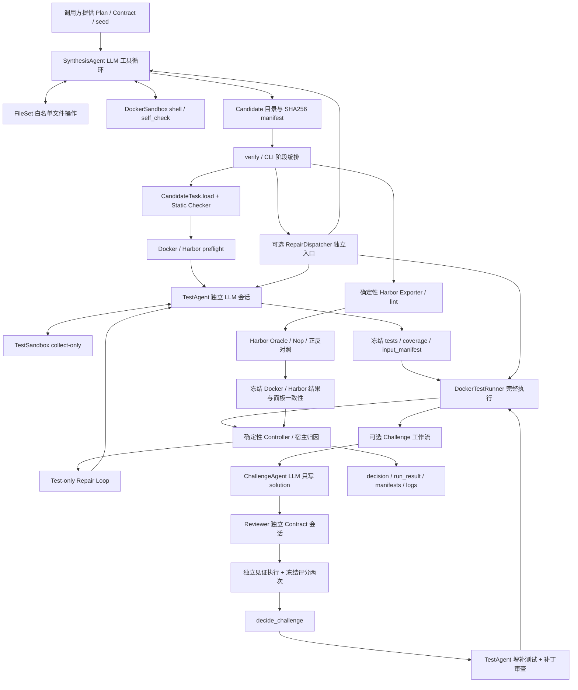
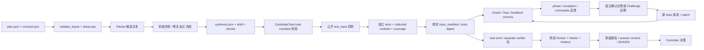
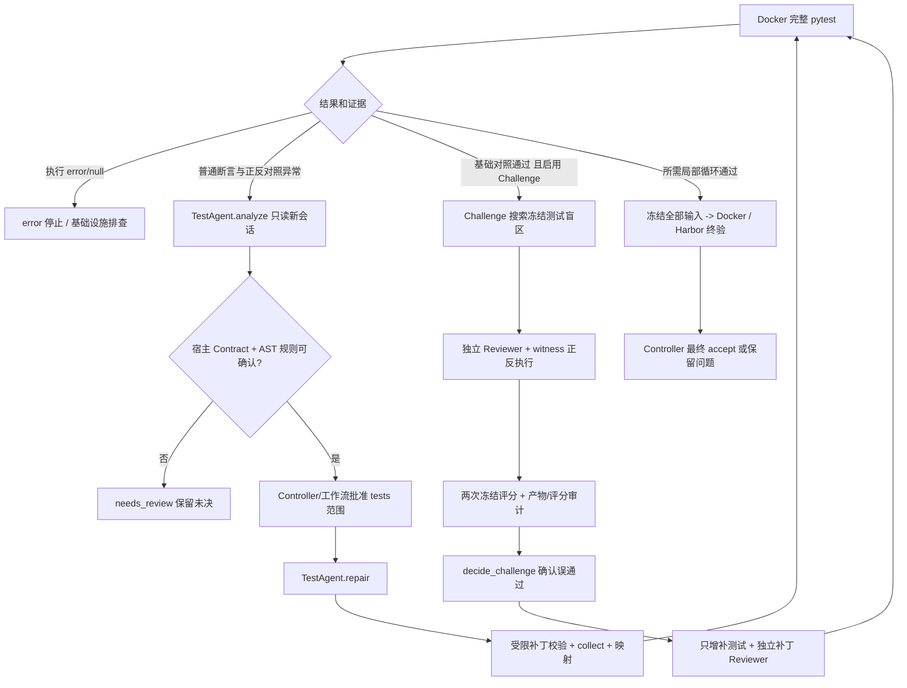
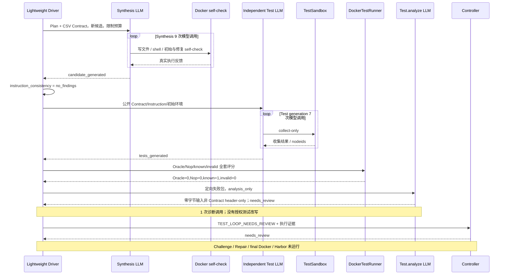

# Terminal-Bench Task Generation Agent
## Initial Architecture, Implementation, and Engineering Findings

> 审计基准：原工作区 `master`，HEAD `c8be56d`（2026-11-15），**包含审计开始时尚未提交的核心修改**。日期以 Git/记录内时间为准；目录名的日期不能替代实际开始/结束时间。报告用中文说明实现，保留接口原名。本文的“当前”均指本次审计快照，而非最初 README 或某份历史验收的版本。
>
> 方法：实际读取两个生产包、测试、CLI、提示词、设计文档、历史审计、实验脚本、Git 全分支和 stash，以及运行目录的机器可读记录和关键原始执行报告；重新执行离线回归，并在核心 worktree 进行可行验证。未读取 `.env`，不运行新的付费大规模实验。完整证据入口：[证据索引](architecture-evidence-index.md)、[实验索引](experiment-inventory.md)、[初始工作区与文件哈希](../runs/archive/audits/workspace-architecture-20261116/initial-workspace.json)。

> 2026-11-16 证据更新：第 1–12 节保留原审计快照及当时的验证结果；后续真实 E2E 尝试、独立分支的 Probe 可靠性改进和主工作区任务无关性复审统一见 [第 13 节](#13-2026-11-16-证据更新与能力边界)。其中的付费调用属于已有历史实验，本次文档补充没有调用模型、运行容器或修改生产代码。不同分支的功能与结果分别归属，不能合并为主线已实现或一次完整成功运行。

> 最新补充：Candidate Orchestrator 的实现修复与真实 CSV Batch 成功证据见 [第 14 节](#14-candidate-orchestrator-真实批次与首个成功候选)。本轮实际生成 2 个新候选，第 2 个候选经真实 Test、Challenge、修复及最终双后端验证后获得原生 accept；终验遗漏修复后的新目录离线复审也为 accept。第 1–13 节“尚无完整成功记录”等结论保留为当时的历史判断，不能用来否定本次新增证据；本次单例成功也不能回溯升级其他实验，或替代三轮稳定性复验。

## 1. Executive Summary

本项目已形成一个**外部 Plan/Contract 驱动、多个隔离模型会话负责构建与审查、确定性宿主程序负责执行和授权的 Python CLI 修复任务生成原型**。它能生成故障初始项目、说明、参考解法和自检探针，独立生成 pytest 测试，使用干净 Docker 任务容器和独立 Verifier 实际评分；对有限、可证明的测试缺陷执行有界修复；另一路径能主动构造违规实现，独立审查其行为见证，将确认的误通过转为增补测试要求，再执行回归与 Harbor 终验。

这不是通用自动出题器，也不是一个由单一“大 Agent”自由调用所有文件的流程。已实现的 LLM 角色是 Synthesis、Test（含分析/修复会话）、Challenge 和独立见证/补丁 Reviewer；Controller、Dispatcher、Static Checker、Docker/Harbor Runner、摘要校验、评分器都是确定性程序。任务范围刻意限制为 Linux、Python 标准库 CLI 数据处理修复；Plan/Contract 由调用方预先提供。自动 Planner、常规 Solver、难度校准、跨任务多样性去重和正式发布数据集未实现。

最值得关注的机制是：

1. **按信息与权限投影分离生成和判断**：Test 看不到参考解法；Challenge 可看冻结测试但只能写替代 solution；Reviewer 的独立对话只拿 Contract 与待审见证或补丁。宿主掌握完整候选，模型只拿所需投影。
2. **把生成状态与验收状态拆开**：`candidate_generated` 只需生成者自己的 current-digest self-check；`tests_generated` 只需收集和结构映射；真正 accept 需要完整执行、已审查正反反馈/保留对照和后端一致性。
3. **证据先于修复授权**：Oracle 失败不能直接推出测试有错。当前普通测试修复要求宿主 Contract/AST 规则确认诊断和受限补丁；不支持的语义返回 `needs_review`。
4. **任务容器销毁后再执行测试**：Docker Runner 只把 Contract 声明产物转交 Verifier，不带 solution、初始私有数据或进程；Harbor 使用 separate verifier，检查原生 reward 与 wrapper phase 报告。
5. **主动误通过与普通违规分开**：Challenge 候选先违反独立见证，再连续两次通过冻结评分，Controller 才批准补测；一个已经被评分拒绝的错误候选不算评分漏洞。

证据显示这些机制各自有实际运行支持，但整体可靠性仍未建立。20 轮 V1 CSV 测试生成全部成功，仍有 15/20 轮确认误拒、10/20 轮确认整套漏检、19/20 轮确认健壮性问题。后续有限 JSON/数值场景的真实反馈修复与 Docker/Harbor 对照曾成功；Dispatcher 的完整真实容器演示使用 scripted 模型。最新 CSV 记录已发现真实误通过并完成一次增补和 Docker 回归，但本次读取时缺少完整三轮终验与最终 acceptance。Lightweight 最近三次均未 Accepted。**不能将不同版本、不同任务、局部成功拼接成稳定的端到端成功率。**

后续记录进一步表明：从全新候选开始的真实模型运行也可能在 Synthesis 自检阶段停止。11 月 16 日的一次尝试实际发出 22 次模型请求、消耗 230,262 tokens，因自身 Probe 缺陷未收敛及下一请求预算预留不足而停止，未进入 Independent Test。随后零付费冻结样本修复验证了有限改进，但没有新增真实模型完整成功记录。因此，当前证据支持生成、独立测试、有限修复和主动漏洞发现等机制及局部闭环，**尚不支持严格真实模型完整 E2E 成功，也没有同协议新旧对照证明整体评分可靠性已提高**。详见第 13 节。

**第 14 节新增结果更新了上述历史状态**：主工作区 Candidate Orchestrator 的真实 CSV Batch 在最多 3 个新候选、共享 90 次调用及 600,000 tokens 的限制内，实际生成 2 个候选，第 2 个成功。累计 54 次调用、428,694 tokens；原生 Controller 为 `accept`、`independent_validation=true`，补齐 Challenge 错误实现的终验覆盖后，新的原生离线复审同样为 `accept`。这是一个有完整证据链的成功案例；运行中确实发现并修复了终验遗漏，最终结论依据修复后对同一冻结产物的独立目录复验，而非将原始有遗漏的在线 accept 直接视为最终成功。

## 2. Background and Motivation

### 2.1 生成的对象与困难

仓库原设计 `docs/design/agent 设计.md` 将 Terminal-Bench 类任务视为 Instruction、初始 Environment、Reference Solution、Tests 和运行配置的组合。项目生成的是供解题 Agent 修改的真实文件环境，而不只是文字题目。目标输出为 Harbor 任务包：

```text
task/
  instruction.md
  task.toml
  environment/Dockerfile + app/*
  solution/solve.sh + helpers
  tests/test.sh + run_tests.py + expected.json + test_*.py + fixtures/*
```

生成任务难于生成单个正确答案：初始代码必须有可修缺陷且不泄漏答案；参考解法必须真的可执行；说明与测试必须遵守同一规范；测试既要容纳不同合法算法和序列化，又要拒绝硬编码、遗漏、不保留输入等违规行为；基础设施错误必须区别于正常失败。若生成者同时写解法和验收，双方可能共享同一错误理解，形成自洽而错误的任务。

自动生成的动机来自设计资料对人工构建任务成本、场景扩展和评测质量的关注。仓库没有给出人工成本测量、自动生成相对人工的成本收益统计，因而这里只把它作为项目动机，不宣称已经降低某个百分比的成本。原设计引用 CLI-Universe、Meta-Task 等工作，但本次是仓库审计，不核验这些外部论文的真实性、版本或实验结论；相关思想仅标记为设计资料中的参考，不能作为当前代码已实现规划或难度评估的证据。

### 2.2 实际支持范围

`validate_inputs` 只接受 `cli_repair/code_repair`，显式语言必须 Python、环境必须 linux-docker、任务种类必须 cli_data_processing；workspace 必须 `/app`，command 以 `python ` 或 `python3 ` 开头；依赖必须 `python-stdlib`。生成阶段不允许模型创建任意 Dockerfile、安装依赖或联网拉取材料。三个主要示例族为 CSV 清洗、JSONL 聚合和目录 manifest 生成。

这种收窄把一般任务生成中难以控制的安装、多服务、网络、GPU 等问题移出原型，使研究集中在“规范—实现—测试—反例—修复”的闭环。代价是不能把当前成果推广为所有 Terminal-Bench 任务类别的自动构建能力。

## 3. System Architecture

### 3.1 系统组件及实际接入关系



图表达组件依赖，**不表示所有路径在同一次运行中顺序发生**。`verify(..., repair=True)` 直接转入 Dispatcher；显式 Challenge 与跨模块 repair 不可组合。默认 `all` 使用 test-only loop 再 Challenge，不走 Dispatcher；`run --tests` 默认不修复也不挑战。Synthesis CLI 与 verification CLI 之间仍是调用方传目录，没有当前 master 的统一自动 Planner 入口。报告 §5 给出准确分支条件，§3.4 给出两条反馈支路。

### 3.2 Agent、宿主与权限

|组件|性质/会话|输入|可读/可修改|调度或判断权限|
|---|---|---|---|---|
|Plan/Contract 输入|JSON，由外部准备|任务目标与规范|生成阶段深拷贝、修复阶段冻结|无自主规划决策|
|SynthesisAgent|LLM，每次 `_run` 新 messages|Plan、Contract、seed 或 RepairRequest|仅内存候选和 seed；写 instruction/app/solution/probe；Dockerfile 可信模板|可在局部循环选择工具/自检/finish；无最终接受权|
|TestAgent.generate|LLM，独立 messages|Contract、Instruction、初始环境|只读 inputs；只写 tests/fixtures；无参考解法/probe/旧对话|决定测试内容和结构映射；不能宣布评分验收|
|TestAgent.analyze|LLM，诊断新对话|定向失败证据与局部源码|仅 diagnose/classify_failure/needs_review；没有文件/执行/编辑工具|提出归因，不授权补丁|
|TestAgent.repair|LLM，新 repair messages|冻结旧测试、批准诊断/反馈|仅 tests；普通路径受宿主 AST 校验，Challenge 路径只增补|执行授权修改，不掌握接受权|
|ChallengeAgent|LLM，独立搜索上下文|公开输入、冻结评分测试|读上述材料、写 solution；无参考解法/私有日志；evaluate 是宿主能力|提出候选和 witness，不自证违规|
|Witness Reviewer|LLM，fresh messages|Contract、去掉 rationale 的 witness|不读候选源码、评分测试、reward、Oracle 输出|给 confirmed/unconfirmed，可错，无形式证明|
|Patch Reviewer|LLM，fresh messages|Contract、before/after tests|不读候选身份；仅审通用行为和约束|建议补丁是否规范派生|
|Controller|纯 Python 规则|静态、执行、面板、未决问题及摘要|只消费报告；`decide` 不执行修复|选择 accept/repair/needs_review/error/not_evaluated|
|Dispatcher/Workflow|确定性宿主程序|Controller/宿主归因、版本与预算|可装配所有数据，但向模型投影；保存新版本|真正调用 Agent、执行器、停止或重新终验|
|Runner/Exporter/Wrapper|确定性执行及分类|冻结文件、artifact policy、nodeids|创建容器、转交产物、写原始评分证据|给执行事实，不推理自然语言语义|

“独立”主要由新 messages、明确输入结构及工具可见空间实现。默认角色共用 `Config.model/base_url`，调用方可传同一个无历史 `client.complete(messages, tools)` 对象；共享的是模型服务和计数预算，不是 conversations。没有多供应商、不同权重、OS 进程级 Agent 分离或独立人工 Reviewer 保证。提示词要求不能替代文件白名单；反过来白名单也不能消除同一模型的相关理解偏差、注入风险和 Reviewer 误判。

### 3.3 端到端数据流



磁盘目录是跨模块数据总线，Python dict/dataclass 是进程内接口。`input_manifest` 绑定 Contract 文本、Instruction、初始环境；`candidate.metadata.manifest` 还包含私有 solution/probe；tests 的 digest 绑定其全部文本。Controller 离线重判会重读证据，不能只相信历史 `independent_validation=true`。

### 3.4 验证与修复反馈循环



普通受限 AST 修复与 Challenge 增补是两种不同的授权证据：前者证明某个具体断言与支持范围内 Contract 矛盾；后者证明某个违规实现被原套件稳定放过。两者都不能用“让 Oracle 通过”为修改依据。跨模块 Dispatcher 另有静态失败→Synthesis 路由；当前并没有通用的 LLM 根因分析器自动修 environment/solution 的全部故障。

### 3.5 核心设计决策与代价

- **多角色**使生成、自检、独立评分、攻击和规范审查不共享全部信息，降低同源答案泄漏；不是为了增加 Agent 数量。共享模型仍会导致相关偏差，有限对照与执行证据是必要补充。
- **Contract 权威**为“测试是否越界”“候选是否违规”提供共同参照；结构字段可校验，开放自然语言语义仍不能自动证明。完整附录保证要求可见，却不能消除说明正文擅自新增要求。
- **反馈进入修复**是从 collect-only 只能保证可收集，进到真实评分才能暴露错误期望、序列化约束、域外输入和漏测。反馈越大越昂贵，所以后来分离只读诊断并裁剪证据。
- **确定性 Controller 授权**防止模型自报测试错误后任意削弱测试；代价是支持的归因规则很窄，许多真实 CSV 缺陷仍无法自动修。
- **独立 Reviewer**只评规范推导，不从 Oracle 输出学习“正确答案”；但模型审查本身有误拒与误确认，必须保留原意见、行为见证和正确对照。
- **Oracle/Nop/正反对照**分别验证参考可执行、初始确有故障、多合法实现可接受和缺陷可拒绝；没有任何一个单独足够。holdout 只能终态使用，看到结果后再改测试会失去保留集意义。
- **Docker 与 Harbor**分别提供受限代码执行和评测格式/执行兼容性；任务与测试分开、无网络、镜像摘要和文件哈希共同提高可重复性。Harbor 当前 public 网络是明确记录的非严格隔离条件。
- **有界循环**约束模型/工具/字节/执行时间及修复次数；重复 digest、无修改、不明归因与预算耗尽都停止。预算耗尽说明运行未解决，不等于任务语义上已经失败。

## 4. Core Module Implementation

### 4.1 Plan、Contract 与任务规范

**代码**：`synthesis_agent/inputs.py::{validate_inputs, in_scope, instruction_appendix}`；`examples/*/{plan,contract}.json`；`synthesis_agent/consistency.py::check_instruction`。

Plan 描述生成方向：title/category/goal/scenario/skills 是必需信息；language/environment/task_kind 若显式提供必须与支持域一致。scenario 和 initial_state 帮助模型建立实际背景，不用来定义评分真值。Contract 定义 objective、workspace、command、input_spec、output_spec、deliverables、requirements、limits，后续生成、测试、挑战、执行共享它。

实际是手写校验函数和普通 JSON dict，不是设计文档里一整套 Pydantic/多层 schema。`validate_inputs` 检查必需非空文本、requirements ID 唯一、artifact 路径在 `/app/`、大小写折叠后不重复、路径作用域不重叠、allow_additional_files 必须 bool、limits 全为正整数。它不证明 command 占位符与自然语言语义对应，也不自动检测所有额外字段或任意 Contract 内部矛盾。`command_timeout_sec` 还需小于等于配置 sandbox 超时。

`in_scope` 实现修改范围：artifact 精确路径允许；allow_additional_files=true 时允许声明路径的后代。它不靠扩展名判断目录；初始文件是否构成目录作用域由实际路径集合约束。生成自检比较 `/app` 修改前后 hash，拒绝参考解法在范围外更改文件。

真实 CSV 样例的关系如下：

|层|真实内容|下游约束|
|---|---|---|
|Plan|修复客户 CSV 去重与字段归一化工具；技能为 CSV 解析、稳定去重、字符空白处理、CLI 调试|Synthesis 不能任意替换为其他任务|
|command|`python /app/clean.py <input.csv> <output.csv>`|测试/见证须调用此公开 CLI；solution 安装 clean.py|
|input_spec|UTF-8 CSV；表头恰为 email,name；邮箱 strip 后非空且 ASCII；≤1000 条；允许只有表头|零字节文件、空邮箱不属于明确保证的合法输入；不应要求其特定处理|
|output_spec|邮箱 strip/lower，姓名只 strip，按归一化邮箱稳定去重、保留首个姓名与首次顺序，标准 CSV 转义|不允许折叠姓名内部空白、额外邮箱地址校验或排序；未指定 LF/CRLF 和最少引号|
|R1–R4|CLI/规范输出；稳定去重；空输入边界与不硬编码；输入保护/交付/标准库|Requirement-to-Test Mapping 必须列全四项，但映射本身不是语义证明|
|deliverables|仅 `/app/clean.py`、stdlib、无额外文件|Verifier 不继承初始样本数据；测试须自行创建输入|

`write_file(draft/instruction.md)` 自动追加 `instruction_appendix(contract)`，内容为完整可信 JSON；`removesuffix` 避免重复追加完全相同附录。此机制保证必需要求可见，不能阻止正文加上“必须 LF”或“空邮箱跳过”。尚未提交的 `check_instruction` 因真实漂移问题加入：检查 Contract 附录相等、CSV 无依据行尾限制、输入明确非空时新增空邮箱策略；按语句有限识别否定。其返回为 `blocked/no_findings`；后者绝不等于自然语言一致性成立。Static Checker 与 Test 输入校验复用它，归因和补丁校验也复查，防止绕过入口。

**当前边界**：没有生成 Plan 或 Contract 的 LLM 调用、没有自动协商 Contract、没有一般规范验证器。`candidate_batch/specs.py` 根据固定示例派生六份预设规范，也不是自主规划。

### 4.2 Synthesis Agent：文件工具与执行观察驱动的构建循环

**入口**：`synthesis_agent/__main__.py::main → agent.generate → SynthesisAgent.generate → _run`。`repair` 复用 `_run`，输入改为冻结候选和 RepairRequest。

**输入/输出**：输入 Plan/Contract dict、可选 UTF-8 seed 目录、新 output 路径与可选共享 budget；输出 `synthesis.json`、`draft/`、`checks/probe.py`、`self_check.json`、`build_log.jsonl`、`trace.jsonl` 和 Plan/Contract 副本。输出目录已存在即拒绝，不覆盖历史；创建目录以前的输入错误没有 trace，这是可观测性边界。

`_run` 先 deepcopy 调用者数据、校验输入/上下文大小，load_seed 只接受普通 UTF-8 文件，候选文件存放内存 `FileSet`。`Config` 默认模型 40 次、工具 120 次、单文件 256000 bytes、总文件 2000000 bytes、100 文件、上下文 4000000 bytes、completion 8000 tokens、API timeout 90 秒、命令 30 秒、256 MB/1 CPU/64 PIDs。Contract 示例 CLI timeout 是 10 秒，与 API timeout、整个 suite timeout 不同。

工具为 OpenAI function schema，`additionalProperties=false`，宿主再次检查字段集合与类型：

|工具|实现与约束|
|---|---|
|list_files/read_file|仅当前候选与 `seed/` 引用；无宿主通用读文件|
|write_file/delete_file|只允许 `draft/instruction.md`、`draft/environment/app/*`、`draft/solution/*`、`checks/probe.py`；拒绝模型 Dockerfile/.dockerignore；Repair 还必须满足 request.allowed_paths|
|shell|每次在新 Docker 容器执行；文件来自当前快照；命令造成的修改全部丢弃，需 write_file 才持久化|
|self_check|校验当前文件范围，运行初始与修复副本，生成 digest-bound 报告|
|finish|必须为本次响应唯一调用，且 last_check passed、digest 与当前文件完全相同|

System Prompt 不只让模型“写好题目”，而是明确禁止替换任务、解释 shell 的临时性、规定解法路径与探针协议：`probe.py` 实现 `check(requirement_id)`，正常返回表示通过，AssertionError 仅代表预期任务行为违例，其他异常是 probe error。Prompt 要求未知 ID 抛 ValueError，但宿主只逐一调用已声明 ID，未主动测试所有未知 ID；这是提示要求与程序强制的区别。也不能因为 Prompt 写了“行为测试”就证明探针没有身份特判。

核心循环可以简化为：

```python
freeze_inputs(); validate_inputs(); sandbox.prepare()
files.put(trusted_dockerfile)
messages = [system_prompt, plan_contract_and_reference_paths]
for turn in bounded_calls:
    message = complete_accounted(client, messages, TOOLS, shared_budget)
    require_nonempty_unique_tool_calls(message)
    messages.append(assistant_message)
    for call in message.tool_calls:
        count_tool_attempt()
        observation = dispatch_or_return_recoverable_error(call)
        persist_redacted_trace(call, observation)
        messages.append(tool_observation)
    if current_self_check_passed_and_finish: break
export_all_files_and_verify_hashes()
```

可恢复的参数、路径、JSON 或普通 SynthesisError 作为 observation 回模型，允许修正；BudgetExceeded、中断和某些不可恢复异常进入外层失败保存。Synthesis 外层没有一般模型网络 retry loop，真实客户端有内建有限传输重试。即使失败，finally 尽量导出部分文件和诊断；如果导出失败则状态改 error。调用/文件/字节预算都可使运行结束。没有无限尝试候选的自动机制。

**self_check 算法**：

1. 验证 instruction、solve.sh、probe 存在且非空；artifact 在初始 app；初始 `.py/.sh` 在 Contract 范围内；solve.sh 是 LF。
2. 计算候选 digest 和初始环境 manifest，生成 `/app` 快照。
3. 新容器仅装初始 app，执行生成者 probe；必须不改 app。
4. 另一个新容器装初始 app 与 `/solution`，`/bin/sh /solution/solve.sh` 返回 0；比较 app 文件变化，拒绝越界和删除必需 artifact。
5. 同容器运行 probe，验证不再修改修复产物。
6. 两端 probe 无 error，初始至少一个 requirement fail，修复后所有 requirement pass，才是 passed；再检查原始环境未变、digest 未变。

因此 self-check 是“同一生成者给出的解法与断言之间存在可执行区分”，不是对题目真值的独立证明。自检可通过错误期望，或只覆盖模型想到的少数样例。`finish` 后 candidate_generated 不含独立测试、不含 Harbor，也不含任务难度验证。

**FileSet 与路径安全**：`relative_path` 拒绝空/绝对/`.`/`..`/反斜线/控制符/Windows 设备名等；`put` 检查大小写别名、文件目录碰撞、总容量；`read_regular` 用 lstat、O_NOFOLLOW、inode/dev 重查，拒绝 symlink/hardlink/特殊文件；export 使用 `xb` 创建。它降低文件越界和日志/制品污染风险，不是独立的通用多租户安全沙箱。

### 4.3 模型客户端、协议兼容与预算

**代码**：`synthesis_agent/client.py::{ModelClient, OpenAICompatibleClient, complete_accounted, retryable_network_error, exception_details}`。

客户端只用标准库 urllib，向 `base_url.rstrip('/') + '/chat/completions'` POST，payload 包含 model/messages/tools，要求 `tool_choice='required'`，常规接口设置 `parallel_tool_calls=false`、`max_completion_tokens`。返回 assistant message，由各 Agent 解析 tool_calls。客户端没有隐藏消息历史，独立性依赖调用者提供的新 messages。

对于 `api.deepseek.com`，源码显式关 thinking、改用 max_tokens，去除 parallel_tool_calls 字段。历史批量工具调用虽被请求禁用仍会发生，因此循环按多个调用顺序处理，terminal/evaluate/finish 等必须单独调用。这是协议兼容处理，不是实际并行执行模型工具。

URL 配置拒绝用户密码、query、fragment，远程 endpoint 必须 HTTPS，允许 localhost HTTP；NoRedirect 禁止重定向避免凭据转发。默认 urllib opener 仍可使用系统代理。当前新增记录只保存是否 configured/bypassed/used，不输出代理地址或认证信息。

每次真实网络尝试记录 open/read_body/parse_response 阶段、超时、阶段/总耗时、HTTP 状态、类型化异常链；URLError.reason/errno 得以保留，并脱敏 API key、Bearer、代理认证信息和敏感 URL。失败摘要仍可能是 `model API unavailable (URLError)`，但 trace `api_attempt.details.exception` 能看到更深原因。旧日志没有此链时无法事后确定是 DNS、代理、连接还是 TLS/读超时。

当前真实客户端最多两次网络尝试，第二次前退避 0.5 秒，仅重试类型明确的临时传输错误，如 timeout、ECONNRESET、EAI_AGAIN；HTTP（含 401/402）、证书错误、parse/schema 错误不重试。设置 `retry_handled` 避免 Test/Challenge 外层叠加内建 retry；注入客户端仍可能走旧的 `transient_transport_error` 外层少量 retry，不能把它与真实客户端策略混写。

`complete_accounted` 的调用契约是调用方已计第一次 model_calls，内部重试前再扣共享预算。usage 采集 prompt/completion/total；无已知 total_tokens 的尝试记 `token_usage_complete=false`、`usage_unknown_attempts` 和 unknown_token_reserve，未知不能算 0。`max_total_tokens` 是共享 budget 可选键，用输入 bytes 加保守预留阻止下一次尝试；**没有 Config/普通 CLI 的统一 max_total_tokens 字段**，需要调用方提供，不能宣称所有入口默认都有 token 总上限。货币费用没有价格表/账单接口，不可用 token 数直接写成美元成本。

### 4.4 CandidateTask 与 Static Checker

**代码**：`independent_verification/candidate.py::{CandidateTask.load, test_input, input_manifest, check_candidate}`。

`CandidateTask` dataclass 包含 source Path、contract、instruction、environment、reference_solution、metadata。load 不运行模型代码：要求 metadata.status=candidate_generated 和固定布局，逐项验证 manifest hash、大小、可读普通文本；加载整个 draft，发现未列清单文件也拒绝；再校验 Contract。它不把 self_check.json 的 passed 当独立验收，而且 Contract 文件本身不在 synthesis manifest 内，后续 input_manifest/session 另行绑定它。

`test_input()` 是关键安全接口，仅 deepcopy `{contract, instruction, initial_environment}`；禁止直接把 CandidateTask serialize 给 Test/Challenge。`input_manifest()` 对这三个公开输入投影逐文件 SHA256，私有 reference 改动不会无故导致 Test 看见它。

Static Checker 检查：有限 instruction 一致性、instruction/solve.sh 非空、shell LF、环境仅 Dockerfile/app、保留目录不混入 solution/checks/tests/.git/.env、声明产物存在、Dockerfile 精确可信尾部模板、FROM 与 metadata.image_reference 相符、app 文件与 reference 文件完全相同的明显泄漏。输出 `{status, errors, manifests, instruction_consistency, limitations}`。

它不是任意依赖静态分析、自然语言等价验证或变形答案泄漏检测。完全相同文件比较既可能漏掉改名/改写答案，也不证明故障真实合理。若找不到声明产物、模板异常或指令漂移，Controller 将 static failure 归到 synthesis；inspect 到此结束且不调用模型。

### 4.5 Independent Test Agent：独立生成、收集与真实执行的分层

**代码**：`independent_verification/agent.py::TestAgent`、`common.py::validate_coverage/test_path`、`sandbox.py::TestSandbox.collect`。

`validate_test_input` 要求输入键集合**精确**为 contract/instruction/initial_environment，复用 Contract 校验，要求环境有 Dockerfile 和 app，只允许这两种初始布局，同时执行有限 Instruction gate。初始环境是“接口线索”，不能从故障实现归纳正确结果；Prompt 明确要求 Contract 优先。

生成工具包括 list/read/write/delete、collect、finish，无通用 shell；可写文件仅根部 `test_*.py` 与 `fixtures/*.{txt,json,csv,jsonl}`，不允许 conftest、pytest 插件/配置、评分改写和安装脚本。路径白名单确实限制这些文件名，Prompt 额外禁止 skip/xfail/实现身份检查；wrapper 在执行时也拒绝 skip/xfail，但并没有全面证明生成 Python 不会以其他形式作弊。

`collect` 使用固定 pytest 9.2.0 Verifier 镜像，向新 Docker 初始 app 副本装 tests 和 trusted wrapper，再执行 wrapper `--collect`。wrapper 使用 `pytest --collect-only`，禁用第三方插件自动加载、外部 PYTEST_ADDOPTS/PLUGINS、conftest/cache，返回真实 node IDs 和 collection error。每次 collect 的测试快照和 collection.json 归档到 `collections/NNN`。

`finish(coverage)` 要求当前 digest 与最近成功 collect 相同，且 coverage 每个 requirement 恰有一行、映射到真实非空唯一 nodeids；一个 node 可用于多个 requirement，全部收集节点在评分时仍必须执行。校验并不要求映射语义正确，也不从测试名字推导覆盖。输出 tests_generated、nodeids、coverage、manifest、digest、input_manifest、预算与 trace。

**collect-only 与完整执行的根本差别**：收集运行 import 和发现节点；测试函数体通常不执行，fixture setup 通常不执行，因此以下错误可能完全不暴露：错误预期、缺输出、超域输入、UTF-8 解码错误、CSV 引号过严、错误实现漏检、输入被修改。收集成功只说明测试可被框架发现，不说明任何行为断言真或假。即使 collection 会执行恶意模块级代码，它仍被限制在容器，不在宿主执行。早期生成器仅通过 collect 与映射结束，后续 Harbor 结果不返给模型，因此早期“15 tests generated/coverage 4/4”不能解释为测试质量合格。

当前改变的是**外层编排**：TestAgent 仍没有可随意执行所有实现的工具；宿主 DockerTestRunner 真正运行整套测试，将有限反馈投影交给新诊断/修复会话，再 collect 并复跑。这样避免 Test 读取参考解法源码，同时提供足够事实识别误拒/漏检。

### 4.6 真正评分：DockerTestRunner 与可信 pytest Wrapper

**代码**：`docker_test_runner.py::{DockerTestRunner.run, _trial, run_solution, model_feedback}`；`wrapper.py::{artifact_snapshot, classify, main}`。

`run` 校验 frozen tests，预备任务镜像和 verifier 镜像，按顺序执行 Oracle、Nop、known correct、known invalid 或 panel controls。Oracle 是执行 candidate.reference_solution，Nop 不执行任何 solution；其他实现安装各自 solve.sh。它们是确定性对照运行方式，不是自主解题 LLM。

每个 `_trial`：

1. 新任务容器装初始 app；若 solution 非空装 `/solution` 并执行 solve.sh（安装 timeout 300 秒），记录私有 solution-execution。
2. `artifact_snapshot` 仅导出 Contract.paths，检查 `/app` 绝对路径、symlink/hardlink/特殊文件和大小数量限制，输出 base64 文件与目录；记录 implementation_manifest、artifact_manifest。
3. **退出并销毁任务容器**，再创建 verifier 容器，只安装转交的产物；比对 received hashes。
4. 安装 tests、wrapper、expected nodeids/artifact_policy；完整 pytest suite timeout 默认 120 秒。
5. 读取 pytest.json、stdout/stderr，检查实际 artifact_manifest、Verifier 文件执行前后 hash、nodeIDs 和评分重算。
6. 正常全过为 completed/reward=1；正常任务断言失败为 completed/reward=0；其他情况 error/infrastructure_error，reward=null；清理失败即使此前有分数也不能保留成功。

Wrapper 的 `Recorder` 收集 setup/call/teardown、exception 类型和测试文件局部 traceback、captured streams、duration、subprocess 调用结果。`classify` 要求非空唯一 collection 与冻结 expected 相等，phase 不重复，setup/teardown 完整，setup 通过时必须有 call，无 skip/xfail，无未知 node，pytest exit code 仅 0/1 且与 assertion 结果一致。AssertionError 或 pytest.fail 的 setup/call 失败可计 task assertion；teardown 失败、UnicodeDecodeError、fixture 异常等保留 error。这避免“执行崩溃也算成功拒绝”。

同一个测试可把“非法任务输出”捕获后转为 pytest.fail；不得笼统捕获所有异常，否则会掩盖测试程序自身错误。UTF-8 格式违例是典型需要在明确任务输出边界转成断言的情况；任意测试内部解码异常不能一律归为任务缺陷。

`model_feedback` 不遍历整个运行目录，只投影 trials 的 outcome/phase/异常/输出、Requirement mapping 等；拒绝 holdout 前缀进入反馈，私有 solution 日志不提供。若只有 Oracle 失败而其余对照均符合预期，强制 `repair_permission='analysis_only'`。这是保守防错，不保证 Oracle 一定有错；例如合法替代实现恰好容忍域外输入，仍可能只有 Oracle 失败。

隔离边界也有实际限制：Verifier 镜像含 pytest，任务产物进入它后运行 CLI，某些不合法的 pytest 依赖可能在 verifier 内侥幸可用；仅靠镜像分离并不自动证明“stdlib-only”。R4 的依赖与完整交付约束需要其他控制/规则，不能只把“该文件存在”当作证明。任务和测试代码在同一 Verifier 用户下执行，hash 检查不是抵御任意恶意 Verifier 的形式安全保证。

### 4.7 Controller 与 Repair Dispatcher：确定性决策、窄归因与版本化修复

**代码**：`controller.py::{decide, _decide, load_report, review_run, decide_challenge}`；`repair.py::{RepairRequest, RepairDispatcher}`；`test_repair_workflow.py::repair_tests`；`attribution.py`、`json_attribution.py`、`diagnosis.py`。

Controller 并不是模型 Agent；`decide(report)` 只读 dict，不调用模型或容器。它对错误 JSON shape fail closed，按优先级保留全部 diagnostics，再选最紧迫 action。缺失报告、Challenge/Repair 未完成、静态失败、执行错误、未决问题、面板不足都会阻止 accept。外部 critical_issues 带 owner+evidence 可使规则输出 repair 建议，但 Dispatcher 明确拒绝以任意外部声称绕过当前执行归因。

|观察状态|Controller/工作流行为|修复或终止依据|
|---|---|---|
|静态检查失败且证据结构正常|repair，owner=synthesis|程序规则可定位候选结构/指令问题|
|inspect/generate/export 正常提前结束|not_evaluated|只完成请求阶段，不能接受任务|
|Oracle/Nop/正确对照异常分数|needs_review|分数不能单独推出错误归属|
|已知违规实现完整通过|needs_review|需要 Contract 见证或受支持宿主归因，不能盲目改测试|
|执行错误、缺 reward、无效报告|error|不是正常的 task assertion failure|
|仅 Oracle 异常而其余期望正常|analysis_only；不授权测试改写|防止用错误参考解法驱动正确测试退化|
|有宿主确认的测试矛盾+正反对照|由工作流/Dispatcher 调用 Test.repair|诊断、补丁与完整复验都要通过|
|有确认 Challenge 误通过|decide_challenge=repair/tests|独立违规见证+两次评分+审计一致|
|达到轮数/预算、重复 digest、无修改、无法归因|needs_review/Unresolved|保留失败版本，不伪装 reject 或 accept|
|完整执行、冻结正反/保留面板充分且正确、后端一致、所有未决消除|accept|有限面板接受，不等于发布质量证明|

普通 `repair_tests` 循环默认最多 2 次修复、最多 3 版完整执行：加载 digest→检测重复→执行全部 feedback controls→若 passed 退出；否则若 execution error 退出；没有已确认正确和违规对照则停止；有证据后 analyze→宿主 verify_test_diagnosis→批准范围→repair→verify_test_patch→collect/mapping→新 digest→重新全部执行。max_test_repairs=0 仍会执行初版，但不会修复。它不自动修 synthesis 环境。

`RepairRequest` frozen dataclass 字段为 task_version、issue_ids、responsible_module、requirements、evidence、candidate_manifest、tests_digest、allowed_paths、remaining_budget。Dispatcher `run` 创建：

```text
versions/v000/{candidate,test-agent,execution,analysis,static_check.json}
versions/v001/...                 # 下一版
repairs/000/{request,response,patch-verification}.json + changes.patch
repair-history.json + final-controls-manifest.json
versions/vNNN/validation/         # 最终禁修复完整 verify
```

`_snapshot` 只复制候选 manifest 内材料与 Plan/Contract/metadata，不复制私有 trace 和凭据。对照也冻结并保存审查证据；所有版本共享 model_calls/tool_calls。`version_row` 绑定 candidate/input/tests manifests 与 execution digest；`seen` 防止相同状态循环。修改 Synthesis 的公开输入后使 current_tests=None，重新独立生成测试；仅参考解法变动而公开输入没变时可保留同一测试。

Dispatcher 的核心调度不是“模型说改谁就改谁”：

```python
candidate, controls = verified_snapshots()
while True:
    static = check_candidate(candidate)
    if static.failed:
        issue = host_static_issue(owner='synthesis')
    else:
        tests = existing_or_generate_independently(shared_budget)
        execution = run_all_feedback_controls(candidate, tests)
        if execution.error: stop_error()
        if execution.failed:
            require_confirmed_legal_and_invalid_controls()
            diagnosis = TestAgent.analyze(public_input, tests, execution_feedback)
            proof = verify_test_diagnosis(contract, source_ast, execution, diagnosis)
            issue = host_confirmed_test_issue(proof)
        else:
            final = verify(stage='run', repair_tests=False, repair=False)
            stop_with_full_validation_decision(final)
    decision = deterministic_controller(issue)
    require_supported_owner_and_remaining_budget(decision)
    request = frozen_request_with_manifest_and_scope()
    updated = TestAgent.repair(...) if owner == 'tests' else SynthesisAgent.repair(...)
    verify_unchanged_contract_plan_and_authorized_scope(updated)
    reject_no_change_or_repeated_version()
    save_patch_and_next_version()
```

SCOPES 允许 tests、solution、environment、task、synthesis；但自动可达路由主要是 static→synthesis、宿主支持测试矛盾→tests。普通 execution failure 不会自动推导 reference/environment 修复，外部 critical_issues 直接停止为 external_attribution_unverified。源码具有其他 owner 的作用域和 Synthesis.repair 接口，不等于已经具备通用环境归因。单元测试验证某些修复方法和范围，不等于真实模型曾自主选择并完成它们。

**宿主归因很窄**。`attribution._assertion` 支持精确自然语言模板：`Print N and exit successfully.`、`N followed by newline.`、`No input.`，直接 subprocess.run、stdout literal equality，验证模块绑定不可重写、CLI 与 Contract 相同、节点映射有效、诊断引用完整 requirement 和实际 assertion 行，且已标记合法对照在相同行真正 AssertionError。补丁只允许替换该 literal，其他 AST/文件、coverage/nodeids 不变。

`json_attribution` 只支持 `Integer n in [0,10].` 和精确 JSON doubling 输出描述、command 模板。支持把过严字符串等式或只验证 double 为 int 的弱断言改为 `json.loads(proc.stdout)=={'value': n, 'double': 2*n}`；n 来自字面 argv，期望来自 Contract，不来自 Oracle 输出。它不是通用 JSON/CSV 正确性求解器，也不能把历史宽松遗漏修复结果直接套到当前所有任务。

**诊断输入改进**（未提交修改）：`prepare_feedback` 统一两入口，先拒绝 instruction drift；`evidence_packet` 优先合法对照 call failures，选 requirement mapping、exception type、原始测试行前后 8 行、host 支持位置和简短 trial。拒绝 holdout。完整原始反馈仍保存，只是不全发给模型。analyze 使用较严配置：最多 2 次调用、完整请求 24576 bytes、输出 2000 tokens；工具只有 diagnose/classify_failure/needs_review，一次有效结论结束，无文件读取、collect、编辑、分页工具。传输失败可有限重试；缺证据就 review。

`load_report` 对 Dispatcher 的离线复核不信任 root acceptance flag：核对 repair-history 等于嵌入 workflow、final validation 位于 versions、final digest、完整 Controller 决策、各 version 的 candidate/input/test/execution 摘要、宿主归因及补丁重算；原始绝对路径不可用会导致无法重放，不能静默按旧 bool 放行。

### 4.8 Challenge Agent 与 Independent Reviewer

**代码**：`challenge.py::{ChallengeAgent.search, validate_witness, witness_suite, review_witness, audit_trial, Calls}`；`challenge_workflow.py::{run_challenge, review_patch, verify_campaign}`；`controller.decide_challenge`。

Challenge 的目标是构造“违反 Contract 但通过冻结评分”的实现。它看得到评分测试，因而这是主动白盒搜索；不是盲测，也不是单纯跑一组已有 mutants。输入键必须恰为公开 test_input 加 frozen_tests。工具 read/list 只能访问这些文件和自身 solution；write 仅 solution/，没有编辑 tests、wrapper、Contract 的能力。evaluate 必须有 solve.sh 与独立 witness；目标 requirement 按已提交次数在 Contract requirements 间轮转，默认最多 4 个提交，允许 1..100；无效工具调用仍消耗调用预算，但无效 evaluate 不一定消耗候选次数。

witness 不是任意生成 Python，而是严格字段 JSON：requirement_id、contract_quote、rationale、argv、stdin、fixtures、assertions。argv 必须以 Python + Contract 脚本绝对路径开头；fixtures 通过 FileSet；断言是固定 source/path/value，可观察 exit_code、stdout/stderr、stdout JSON 路径、原文 file、unchanged、parsed_file(json/jsonl/csv)。`validate_witness` 当前**不支持**旧说明中列出的 `json_file`；`docs/challenge-agent.md` 的该行是过时接口。历史 source/记录出现不同算子不能据此认为当前全部兼容。`witness_suite` 用 JSON 数据加可信模板生成 pytest，避免把 witness 直接插进宿主代码执行；parsed_file 比较完整解析结构，可接受等价序列化。

`review_witness` fresh messages 仅传 Contract 和移除 rationale 的 witness。Reviewer 不看 Challenge 源码、评分测试、reward、Oracle 输出，以减少“看到满分就认为合法”或“与 Oracle 不同即违规”的偏差。输出 verdict/reason、contract_digest、witness_digest；它共享模型和预算，但不共享搜索对话。`Calls` 对模型与工具计数、记录 trace；review 每次要求单 tool，搜索允许批量普通工具。模型判断是可审意见，不能称为独立人工确认。

宿主 evaluate 的证据门槛：

1. Reviewer confirmed；否则保留 unconfirmed，不能升级违规。
2. 在任务/Verifier 分离的真实 Docker 中，witness 对 Challenge implementation 正常断言失败，对 Oracle 和已知正确实现全部正常通过；观察内容与 reward 一致。
3. `violation_status=confirmed` 后再对**原冻结评分套件**执行两次。两次都正常 0 则 rejected：确实错误，但原测试已经发现。
4. 若两次正常 1，audit_trial 重分类 phase/reward，检查 implementation、tests、Verifier 文件、artifact export/import、两次产物一致。`decide_challenge` 验证 review/Contract/witness 绑定和 witness 正反对照，才返回 repair/tests/CONFIRMED_FALSE_ACCEPTANCE。
5. 误通过 sample 进入 unresolved；error 不当作普通拒绝；unconfirmed 进入 review_queue。有限搜索无 confirmed 并不证明无漏洞。

修复重用发现的同一候选和 witness，不重新搜索改变实验样本；`previous_report` 用 verify_campaign 检查候选、初始套件和正确对照一致。所有已确认违规（包括原本已拒绝的）都加入回归。TestAgent 获得 Contract 派生的 witness、违规观察与 Controller 决策，不拿违规源码或参考解法。Challenge 修复只允许增补：旧文件逐字保留、旧 nodeids 保留、digest 改变；`review_patch` 新对话审查是否为通用行为测试，拒绝身份/hash 特判、skip/xfail、改评分或增加规范外义务。回归需 Oracle/正确都过、Nop/全部已确认违规都正常失败；然后重跑独立 witness。Docker 收敛为 resolved_docker，仍需 Harbor 最终运行。

**独立性和证据缺口**：Reviewer 仍会错误拒绝合法见证或确认过严的原文字节断言（§7.6）；同一模型、有限正确对照无法穷尽所有合法表示。`review_queue` 未确认样本与 unresolved confirmed gaps 分开，当前 campaign 可能 passed 且仍有 unconfirmed；它表示确认漏洞已处理/搜索正常结束，不表示所有提议都获证明或没有其他漏洞。`verify_campaign` 对 frozen evidence 做 hash 与关键决策重放，并不重新调用模型，也不把 saved Reviewer verdict 变成形式证明。

### 4.9 Docker、Harbor 与执行环境

`DockerSandbox` 是生产模型代码的唯一执行 backend；无宿主 fallback。宿主只运行可信 Docker CLI、Harbor CLI、文件/AST 校验程序。`run_bounded` 用 argv + shell=False 启动进程，线程排空 stdout/stderr 并限制总输出，超时/overflow kill；清理使用已预先知道的 UUID 容器名，finally 强制 rm，900 秒 watchdog 限制漏容器寿命。

create 参数固定 `--pull=never`、`--network=none`、read-only rootfs、uid/gid 65532、drop ALL capabilities、no-new-privileges、memory/swap/cpu/pid/nofile 限制、ipc=none；app/solution/tmp 是 noexec、nodev、nosuid tmpfs。Python 与 `/bin/sh file` 解释执行文件，noexec 并不禁止解释器读取。镜像 prepare 检查 Linux、无 image volumes，记录 image_id 和 RepoDigest；生成 trusted Dockerfile FROM 使用固定引用，模型无法写 RUN/COPY 任意安装指令。无宿主 bind mount、无继承 API keys，凭据仅在宿主网络客户端。

Harbor 不负责生成测试，而负责用标准任务格式加载环境、运行 oracle/nop、传 artifacts 到 separate verifier、产生原生试次结果。`export_task` 生成 schema_version=1.3 的 task.toml、固定 test.sh/wrapper/expected.json、独立 verifier Dockerfile（固定 pytest==9.2.0）；`Harbor.preflight` 要求版本 0.25.0，validate 实际调用 TaskConfig.model_validate_toml 和 lint JSON；`run` 单 trial、无自动 retry（`-k 1 -r 0`）。`parse_result` 核对 agent/task 身份、finished_at、separate verifier、无 step_results、Oracle solve exit=0、native reward、reward.txt、wrapper classify 和预期 nodeids。`ImageObserver` 在 Harbor 容器存在期间只读观测实际 task/verifier image IDs，避免清理后无从查镜像。

必须区分两种网络条件：

|路径|实际模式|可声称的意义|
|---|---|---|
|Synthesis shell/self-check、Test collect、DockerTestRunner|Docker `--network=none`|当前原生 Docker 执行无网络；不等于通过 Harbor 的 nftables egress 门禁|
|当前 Harbor export/task.toml|task/verifier 均 `network_mode="public"`，常量 HARBOR_NETWORK_MODE=public|格式、独立容器和有限行为评分可验证；不具严格无网络保证|
|历史 Harbor no-network|预检调用 `_egress_control_kernel_support()`|WSL2 `6.6.87.2-microsoft-standard-WSL2` 缺 CONFIG_NFT_FIB_INET 时阻断，不可记任务失败或成功|

当前 exporter 将 public 写死在两个 TOML 字段，不是 CLI 参数。preflight 只有常量为 no-network 时执行内核探测；若未来改成可配置，必须同时更新报告常量和 task/verifier 两字段，防止“日志称无网络、实际 public”。本次提炼不降低隔离验收要求、不修改 public 为伪装 no-network；本机能运行 Docker 也不能推导该内核能力存在。

Harbor 的 build 可能需要下载固定依赖，当前 verifier 基础镜像仍用 tag，虽然实际 image IDs 被记录，不能保证未来重新 build 字节一致。容器分离提高隔离与复现性，但不是完全确定的环境锁定或对任意恶意候选的安全证明。

### 4.10 Logging、Artifacts 与错误语义

生产统一使用 JSON/JSONL 和本地文件夹：Synthesis 侧 trace/build_log/self_check/synthesis；Test 侧 inputs/tests/collections/diagnosis/trace/tests.json；执行侧 per-trial solution-execution、pytest、stdout/stderr、execution.json；Pipeline 侧 static/preflight/export/jobs/run_result/decision/control-panel/validation-inputs/independent-validation/comparison-matrix；Dispatcher 侧 versions/repairs/history；Challenge 侧 frozen/search/candidates/witness/review/evidence/repair/final-witness/evidence-manifest。

`trace.redact` 递归过滤已知敏感键、指定 API key、Bearer、sk- 前缀及敏感 URL；summarize 将 >2000 字符字符串换为 preview、字符数、redacted_sha256。模型收到完整 observation，而 trace 可能仅存摘要；因此不能从所有 trace 完整重建未截断 API 消息。最终文件可从 manifest 验证，model_calls.jsonl 只在某些实验计量器中出现，不是统一生产日志名称。exception.log/failure.log 是实验驱动器扩展，生产异常常为 type/message，并非完整 traceback。

`write_json` 用 x 模式，输出目录 owner 负责一次写入，避免复验悄悄覆盖原结论；Synthesis 的内部 save 会更新自检/状态文件，是局部循环正常操作。多数 hash 保护的是内容绑定、陈旧检测与审计，不是签名；能修改所有文件和摘要的攻击者仍可伪造记录。绝对路径大量存在，迁移后只重读会失败，历史 relocation-index 提供定位但不自动重写证据。

状态至少分五层：

- 生成者 `candidate_generated/error/cancelled`；预算耗尽通常记录 error.type=BudgetExceeded。
- Test `tests_generated/diagnosed/needs_review/error/cancelled`。
- trial `completed` 的 reward=0/1 与 error/infrastructure_error/null 分开。
- loop `passed/needs_review/error/cancelled`；passed 是该局部门槛。
- Controller `accept/repair/needs_review/error/not_evaluated`；Unresolved 是某些 batch/lightweight 外层汇总，不是所有模块共有 enum。生产 Controller 没有普遍 reject 状态。

费用可观测性已从早期 token=null 演进为已知 usage 小计与未知标志；README 仍残留“实际 token 尚未采集”的旧段落，与当前 client 不一致，需按源码和版本分别解释。当前缺货币账单、统一 run-level event schema、可移植相对 evidence URI、完整原始消息存档和稳定 source commit+dirty snapshot 自动封存。改进应优先保证每次运行可绑定精确源码、配置、镜像和失败原因，而不是只增加成功摘要。

## 5. End-to-End Execution Workflow

### 5.1 最完整的生产入口与启动方式

当前 master 最完整的验证入口是 `python3 -m independent_verification`，实际函数 `pipeline.verify`；它的输入是**已经生成的候选目录**。从 Plan 到终态仍需显式串联两个入口：

```bash
# 真实生成；需自行配置模型，可能产生费用；输出必须不存在
python3 -m synthesis_agent \
  --plan examples/csv-repair/plan.json \
  --contract examples/csv-repair/contract.json --output runs/new-candidate

# 默认 all：静态 -> 依赖 -> Test -> Docker 有界测试修复 -> Challenge -> 导出/终验
python3 -m independent_verification --candidate runs/new-candidate \
  --controls-manifest path/to/contract-reviewed-controls.json \
  --harbor-python /absolute/path/to/harbor/python --output runs/new-verification

# 仅检查已有候选；无需模型/容器
python3 -m independent_verification --stage inspect \
  --candidate runs/new-candidate --output runs/new-inspection

# 冻结测试终验，不再付费生成或修复
python3 -m independent_verification --stage run \
  --candidate runs/new-candidate --tests runs/frozen-tests \
  --no-repair-tests --no-challenge --controls-manifest path/to/reviews.json \
  --harbor-python /absolute/path/to/harbor/python --output runs/new-terminal
```

CLI 不自动加载 `.env`。Config 从 `SYNTHESIS_*`/部分 OPENAI fallback 或 `--config` 读取；不要把 key 写到可提交 JSON。普通完整验收要求反馈/保留各有正确和违规的 Contract-bound 审查清单；仅 `--known-correct/invalid path` 而无对应已确认审查，不保证样本可用于接受门槛。示例命令中的 reviews 是用户必须准备的真实材料，不是自动存在的文件。

`verify`：新目录→CandidateTask.load→prepare_panel（冻结 control/review）→静态→preflight（在付费调用前检查）→必要时独立 Test.generate→可选 Test Loop→可选 Challenge→export→Harbor config/lint→终态边界→final Docker 全 panel→Harbor oracle/nop/每个替代 solution→保存 session→Controller。

终态 `holdout_started=True` 之后不再 Agent 调用。比较 frozen task hash，后端 tests/wrapper/artifact-policy/Contract/实现集合 context digests 与具体产物/结果；最终 finally 重算 independent validation，先把布尔标志清零，只有 Controller accept 才重新置 true。即使中途计算 basic_pass=true，也不能绕过 finally 的完整门槛。

终止条件包括静态失败、依赖不可用、生成失败、归因不支持、对照异常、循环次数或共享预算耗尽、Challenge 未完成、lint 异常、终态不一致及正常 accept。finally 尽可能保存 run_result/decision，而不是只在成功时保存。

### 5.2 多条 Pipeline 的边界

|路径|实际代码入口|做什么|不应声称什么|
|---|---|---|---|
|仅 Synthesis|SynthesisAgent.generate / synthesis CLI|构建并 current self-check|不表示独立评分通过|
|独立 Test 生成|verify(stage=generate)|静态、Docker 可用、Test collect 与 mapping|没有完整评分，没有最终 accept|
|离线导出|verify(stage=export, tests_output)|校验冻结 tests，生成 Harbor 包|未 lint/执行，not_evaluated|
|已有测试评分|verify(stage=run)|默认不修复/挑战，执行终验|不是新测试生成或新 Challenge|
|普通 all|verify 默认|Test Loop + Challenge + 终验|不含自动 Planner，也不走 RepairDispatcher|
|跨模块 repair|verify(repair=True) → Dispatcher|版本化 static/Synthesis 与宿主确认 tests 修复，最终禁修复 verify|与显式 Challenge 互斥，其他故障不自动获得 owner|
|消融实验|challenge_experiment.experiment|baseline/independent/challenge/repair 四组显式开关|输入人工套件时不是“模型独立生成”组|
|完整 Challenge 验收 adapter|acceptance.run_acceptance / scripts/challenge_agent/run_e2e.py|已有任务/测试，受限 robustness 准备、真实发现、补测、≥3 次冻结双后端复验|其自定义 passed 不等于原生 Controller accept|
|CSV 专用 adapter|scripts/challenge_agent/csv_e2e.py|迁移历史面板、搭建该任务验收输入|默认依赖原 runs/step3_test 资料，不是核心最小入口|
|批量六规范|candidate-batch-expansion 分支的 candidate_batch.runner|串行预设 specs、生成对照、调用 verify、按任务汇总|master 缺 runner/__main__，不能按另分支命令直接运行|
|Lightweight|runs/lightweight-pipeline-*/run.py 等冻结脚本|限制 1 候选/30 calls/240k tokens 等的小规模探索|不是当前 master 注册的通用生产 CLI|

`acceptance.check_matrix` 明确允许历史违规 panel 的残余漏检，只要求正确实现通过、Nop 和已确认 Challenge 样本拒绝、双后端正常且一致；历史 panel 作为 terminal-only 回归观测，通常没有满足原生四组已确认审查。因此 adapter 可以局部/最终 passed 而 Controller needs_review。报告必须双列，不能选择更宽松者冒充严格验收。

### 5.3 真实运行时序：Lightweight 第 03 次

这条序列来自 `runs/lightweight-pipeline-20261115-03/summary.json` 与其 candidate/verification 记录，反映**真实停止路径**，没有把未运行 Challenge 画成成功。



总 17 次模型调用、23 次工具调用，已知 85050 tokens（prompt 77385/completion 7665），wall 141.475 秒；诊断 2637 tokens，usage_complete=true。controller_returned=true，但 terminal_controller_reached=false；前者只是 finally 给出停止决策，不是完成终验。具体缺陷是 Test 要求 0-byte 文件成功输出表头，而 Contract 只明确允许“只有表头”的 CSV；Oracle 对域外输入失败，正确替代恰容忍域外输入，触发 analysis_only。此例说明可诊断地停止也是机制成果，但不是 Accepted。

### 5.4 真实 Challenge 局部路径：CSV live-07

`acceptance/discovery` 正常完成 9 个 evaluate（000..008），其中 008 confirmed；冻结测试两次满分且独立见证失败，Controller 批准 tests 修复。`acceptance/repair` 复用同一发现，1 次增补，Docker 对照通过、unresolved=[]，已确认样本状态 resolved_docker。终态冻结文件存在；本次看到 `terminal` 的部分执行目录，但没有完整 001..003 的 run_result/matrix 或顶层 acceptance.json，因此无法完成三轮终验结论。

这是当前最有价值的真实发现→授权→增补→局部回归证据，比早期“Challenge 尚未发现漏洞”的历史文档更新；同时不足以写成全链稳定通过。更多见 §7.6。

## 6. Architecture Evolution

### 6.1 基于 Git 的可确认演进

|版本/证据|旧实现与暴露问题|具体变化|验证及边界|
|---|---|---|---|
|`130b2d3`、`fed177f`、`8228d97`|提出通用 Planner/Contract/库存服务等接口|设计文档与数据约定|设计，不等于 Python 实现；formal_structure_design 只有设计材料|
|`0c2aa6d`|需要真实构建而非静态 JSON|Synthesis 工具循环、FileSet、Docker 自检、三个输入示例|早期离线/容器测试；后有三题型真实生成+smoke 记录；无独立验收|
|`68f1911`|Synthesis 自检不能独立判题|Candidate/Static/Test/collect-only/Harbor 接入|历史 public Oracle/Nop 过；V1 基线暴露系统性测试问题|
|`dd3e178`|报告缺总体决策|规则 Controller/离线 decide|只建议 repair，没有真正调度；早期审计正确记录该局限|
|`549f81a`|资料散乱、绝对路径迁移|docs/runs 分类归档|不改变原始内容；relocation-index 解决定位，不能消除所有重放路径依赖|
|`12936da`|collect-only 无执行反馈；模型可能迎合错误 Oracle|Docker 完整执行反馈、Test repair/analyze、有限循环、analysis_only|11-14 JSON 过严/遗漏真实模型修复；错误 Oracle 首次失误和修正复验均保留；当时为条件通过|
|`b5f01af`|局部测试修复缺跨模块版本/预算管理|RepairRequest、Dispatcher、versions/patch/history、scope/全局 budget|Print-42 scripted 模型+真实 Docker/Harbor；不能称真实模型通用根因修复|
|`a98d994`|Oracle/Nop 不足以验收，缺保留组与后端比对|Contract-reviewed feedback/holdout、panel/sessions、重算验收门槛|最终 9 场景验证 accept/needs_review/error 分流；确认标签仍依赖审查与有限见证|
|`4d67040`（commit 标注 v2.4.1）、`c8be56d`（v2.4）|静态面板不能主动发现新盲区|Challenge/Reviewer/Controller/增补；e2e adapter、robustness、implementation_library 集成|版本标签顺序与语义版本号不一致，应以 parent/时间为准；局部和离线成功不等于真模型闭环稳定|
|`20abbce → a050158`，另分支|要覆盖多个预设任务|candidate_batch runner/CLI/tests 与协议/见证变体|runs 04/05 有真实批量记录；master 保留 specs/controls 但没有 runner/CLI，未完整合并|
|当前 dirty workspace|API 120s 错误丢底因；CSV instruction 漂移；诊断上下文过大|client 结构化尝试/一次重试/usage；consistency gate；只读定向诊断|245 项离线当前通过；有限 CSV Docker 回归已留存；最新 Lightweight 仍未 Accepted|

不同 commit 的文件 diff/stat 原文保存在 `reports/audit-artifacts/commit-*.txt`；当前源文件 hash 与初始 dirty diff 另存。本报告不把某 run 的目录日期直接当 commit，缺 run 内源码绑定的归属标记 Unverified。

### 6.2 被覆盖实现的恢复：stash 中的语义验证子系统

仅阅读 HEAD 会漏掉一条重要历史尝试。当前两个 stash 均名为“尝试修改individual verification的准确性问题”；`stash@{0}^3` 的 untracked tree 保存可读 `independent_verification/validation/{models,engine,backend,checkers,runner,__main__,__init__}.py`。本次用 git show 读取，未 pop/apply/改动 stash。

其 `validate` 是无模型的 evidence-first orchestration：ValidationRequest/TestClaim/Evidence/Counterexample/ValidationResult dataclass；按 INPUT/PREPARE/COLLECTION/EXECUTION/CONTRACT/CLEANUP 等 stage 发出带 SHA256 的 events/artifacts；以 repeats/总超时/命令边界观察衡量 execution_reliability；不支持 adapter/property/checker 得 INCONCLUSIVE，历史报告不能直接推出成功。DeclaredIOChecker 通过调用方独立给定 `validation_io` 精确输入/预期、格式解析和输入保持见证归因，区分 task violation 与 unscored test defect。它还处理 caller timeout 小于 Contract 允许时间、wait-only pipe backpressure 等边界。

这是真实可恢复的实现探索，不是从文件名猜测。`runs/archive/experiments/m0-m1-*`、历史审计和 docs 记录有相关实验；但当前 master 无该 package/入口，历史审计一度发现只有 pycache 导致导入错误。当前文档明确退役。它没有实际接入现有 verify/Controller 的通用语义授权，不能把它恢复到核心分支后宣称完成集成。本次排除它，保留 Git locator 与机制分析；部分思想由当前窄归因和证据边界继续体现，不能声称代码直接迁移，除非 diff 可证明。

### 6.3 初始设计与当前实物的主要差异

原设计有自动 Planner、一般技术材料取题、库存服务示例、多 Solver 难度评测、通用修复和 Validated Dataset；当前只做 stdlib CLI，Plan/Contract 预置；没有 Solver。独立测试、确定性 Controller、反馈修复、Challenge 则已从设计进入代码并有局部执行证据。accept 条件后来比原设计“Oracle 过/Nop 不过”显著更严，故早期 passed 不能按新口径仍称 accepted；历史资料中的“无 Challenge/无 Repair”也不能当作当前事实。

曾用模型诊断直接改测试的历史场景后来收紧为宿主可确认的 AST 补丁与 Challenge 反例授权。正确性防护增强同时降低自动修复覆盖面；遇到 CSV 普遍语义问题仍停留 needs_review，是当前明确取舍，而非把拒绝自动修复隐瞒为完整能力。

## 7. Engineering Challenges and Solutions

本章按问题而非开发日期组织。每例说明证据、归因与局限；“修复”有时指机制或人工回归副本修正，未必是生产 Agent 自主修复，均分别标记。

### 7.1 案例 A：Synthesis 成功不能替代独立验收

**背景/问题**：生成者同时写 reference 与 probe，初始失败、修复通过可给 candidate_generated。早期历史 CSV 自检完成、独立收集 15 测试映射四要求并在 Harbor public 下 Oracle=1/Nop=0，仍可能包含过严评分和遗漏。

**证据/根因**：`runs/archive/candidates/acceptance-csv-01`、`archive/verification/step3-public-01`、`archive/audits/csv-overstrict-audit`；本次重新 CandidateTask.load 与静态检查均可通过，说明静态和内容摘要也不证明语义。`runs/model-acceptance-a850ec92f14c421a9d5d790f3a3e7317/acceptance.json` 的三题型均 candidate_generated+smoke pass，但记录明确 independent_validation=false。

**解决/验证**：独立 Test 投影、实际执行、正反/保留对照、Challenge 与分层状态；Oracle/Nop 基础通过仍保留 basic_checks_passed，最终 accept 改由 Controller 重算。三题型生成的真实证据修正 README “仍待办”的陈旧说法，但仍不补足三题型完整独立验收。

**经验**：生成、格式、静态、独立执行、有限 panel 验收、一般任务质量是不同声明，需要不同证据，不应共用 success 一个标签。

### 7.2 案例 B：20 轮独立 Test Agent 基线暴露测试质量缺陷

**设置**：冻结历史 CSV 候选、V1 Prompt、完整 source/input/config；deepseek-flash，api.deepseek.com，40 model/120 tools/8000 completion，20 个独立会话、4 并发；不喂 Oracle/面板反馈。9 合法×3 重复+24 违规×1，每轮51次，全20轮1020次 Docker，597 条 assert/raise/pytest.fail 审查记录。面板先按有限独立输入/源码审查认证：25 组基础，合法进一步含 CR/LF 的27组。该人工构造面板未预注册，不是随机总体样本。

**结果**（`step3_test_1112/metrics.json`）：

|指标|结果|解释|
|---|---:|---|
|测试生成成功|20/20|只说明 collect/mapping 结束|
|至少一个确认缺陷的轮次|20/20|各类可重叠，不能相加|
|Soundness 确认误拒|15/20，75%|合法实现发生正常断言失败|
|Completeness/Discrimination 确认漏检|10/20，50%|有违规见证且被整套 reward=1 接受；不是“某 node 过”|
|Robustness 确认缺陷|19/20，95%|fixture/test exception 等；error/null 不算拒绝|
|违规 error/null 执行|33|单列，不并入 mutation detection|
|合法实现三次重复状态/phase 不一致|0/20 轮|仅有限面板内未见不稳定，不证明永不 flaky|

**根因**：输入 fixture 自己不合法、期望计算错误、附加域外义务、把 CSV 表示固定成一种字节串、缺 Unicode/空姓名/1000边界等覆盖、异常不转明确 task assertion。确认与 suspected 分开，误拒掩盖的可能遗漏不算整套误接受。

**可追原始案例**：round02 要求合法 CLI 可无参数 import，错误缩减 sys.path 排除 lib-dynload；round03 引号前空格导致 fixture 不是预期两列；round08 写1000条又加重复记录，实际1143越域；round16 实际1000个唯一邮箱却期望500；round18 首次姓名 expected 错；round19 构造1001条却宣称1000。不是简单“模型不够强”即可解释，每项都能定位断言/fixture。

**解决与边界**：实验自身保持冻结，没有用修复覆盖 baseline。后来 production 增加真实执行反馈/有界修复/对照门槛和 Prompt 澄清，尚无与 V1 相同20轮协议的新版重新测量，不能给出新版本误拒从75%降到某值的结论。原401准备错误与认证器 read_text 换行归一化错误独立归档，不计 Test 自身缺陷。95% Wilson 区间是这20次观察的描述，不是所有任务可靠性保证。

### 7.3 案例 C：CSV 过度约束与 Contract–Instruction 漂移

**问题**：CSV 正确语义可以用最小引号、所有字段引号、LF/CRLF、无末尾换行等表示。Contract 未固定这些细节时，raw line/string equality 会误拒正确解。基线 round11/12 明确误拒 valid_quote_all_body；round15 固定 LF；另一些 instruction 擅自增加 LF 和空邮箱跳过要求，Test 继承错误规范。

**根因区分**：一类是 Contract 合法而 tests 过严；另一类是 synthesis instruction 与 immutable Contract 冲突，不能只让 Test 忽略 instruction 或削弱测试。后者应先归到 Synthesis。`runs/lightweight-pipeline-20261115-01` 及 `tests/fixtures/csv-instruction-drift.json` 保存真实失败包，Oracle=1/Nop=0/correct=0/invalid=0，说明 Oracle 自己采用新增格式时基础门槛不能识别漂移。

**解决**：当前 dirty code 加有限 check_instruction，在候选静态与 Test direct entry 双重阻断，回给 Controller synthesis owner；宿主归因也拒绝漂移。另对历史副本手工移除无依据 instruction、行尾字节比较改 CSV 解析语义、空邮箱输入改合法带空白邮箱，保留17节点。生产路径没有自动改历史记录。

**复验**：`runs/csv-drift-regression-20261115-01` 6个真实 Docker 实现：Oracle/CRLF正确/LF正确=1，Nop/保留末次姓名/排序违规=0，无error。235项当时离线220过15跳过；输入包193253 bytes→8578 bytes（约95.6%体积下降），不是实测 token 降幅。真实模型调用0、新候选0、full_pipeline_run=false、candidate_accepted=false。

**限制**：有限显式文本规则不识别所有改写语义，也不解决通用 CSV 宿主证明；此手工回归副本不是自主修复成功。新版 Lightweight03 又产生0-byte文件域外义务，说明两类已知规则无法覆盖任意规范漂移/测试越域。

### 7.4 案例 D：collect-only 与“修好 Oracle”式错误归因

**背景**：早期 Test 只有收集错误可回传；完整 pytest/Harbor 在模型结束后运行。测试可收集但真实 fail 的问题不能修。12936da 增加执行矩阵、异常/断言反馈、diagnose 和最多两轮测试修复。

**实证**：11-14 acceptance 使用人工注入 JSON 序列化过严，真实模型8次调用完成修复；遗漏场景10次；语法4次；Oracle错误修正复验6次。根日志记录初次真实模型把错误 Oracle 误判为 test defect 并改正确测试，不得删掉首次失败只报告重跑成功。

**修正**：执行层强制 oracle-only failure=analysis_only，禁止 diagnose/编辑；真实复验分类 implementation_defect，changes.patch为空。当前再增加宿主 AST 归因/补丁门槛，进一步避免模型独自授权。全suite和全controls复验防止“把一个 failing node 改掉”破坏其他实现。

**结果口径**：当时报告最终 CONDITIONAL_PASS_PENDING_HUMAN_CONFIRMATION，模型 review 不冒充用户人工签字。44真实API调用、已返回278261 tokens，包括首次失败和复验；续跑/已完成场景复用使单进程总wall不存在，不能用431.742秒组件合计冒充完整流程时间。旧宽松修复支持的形状比当前宿主规则广，应标历史，不声称全部当前仍自动可修。

### 7.5 案例 E：Oracle/Nop、9/24面板与冻结评分残余错误

**设置**：`score-013144-snapshot-20261115-014236` 独立执行冻结14-node套件，9合法、24违规，未向 Agent 反馈。原P0在 Challenge 阶段未通过，因此这是冻结套件评分，不是修复后完整流程验收。

|样本|计划|正常接受|正常拒绝|error/null|未执行|
|---|---:|---:|---:|---:|---:|
|合法|9|9|0|0|0|
|违规|24|5|17|2|0|

违规计划分母误通过5/24=20.83%；正常评分违规分母5/22=22.73%；不能把2 error当拒绝，故只正常拒绝17。五个漏检为 collapse_name（内部空白）、ascii_names_only、strict_email（合法非地址ASCII email）、sort_output、strip_email_zero。套件中的样例恰好未覆盖这些行为，很多 node 名字/Mapping 仍看似齐全；完整 reward=1 才是漏检证据，没有所谓“漏检失败节点”。

两个 error：mutate_input 底层有输入被修改的 assertion failure，但它改写了作为输入传给 CLI 的冻结 fixtures，触发 Verifier files changed gate，最终必须记 infrastructure_error/null；invalid_utf8_output 在12行为node抛未捕获 UnicodeDecodeError，不能正常评分。原最终分析核对315文件hash、33汇总与trial、冻结源码字节一致，本次扫描另建文件级索引。

**设计影响**：正反对照必须同时运行；输入 fixtures 应复制到 working tmp 路径，冻结证据保持不动；非法任务输出的解码错误需在输出边界转 assertion。后续 `robustness.py` 的两种受限变换正是解决这些工程问题，不是掩盖错误为0。

### 7.6 案例 F：真实 Challenge 评分漏洞与 Reviewer 的局限

**早期失败**：`challenge-acceptance-01/02` 的情况由文档保留，部分路径当前不存在，需 Unverified；可用 `full-verification-aZhkW4Wq` 两真实候选报 Verifier source integrity mismatch，根因 audit_trial 重算 expected.json 忽略 artifact_policy。修正后对保留原始trial重新审计通过；一个候选未违反自身witness、另一个被原套件已覆盖，仍没有误通过证明。四项回归失败也包含测试默认进入 Challenge 耗尽预算、集成脚本缺已确认正反面板。修正测试调用范围/面板，保持生产接受条件；不是降低条件通过。

**最新真实证据**：`csv-e2e-live-20261115-07/acceptance/discovery/search/candidates/008`：候选在处理输入前用相邻 `in.csv.bak` 替换输入，输出旧名单且破坏输入。witness 为两份不同CSV、公开两个路径参数，要求当前输入对应输出且 unchanged。宿主见证显示错误候选正常fail、Oracle/正确对照正常pass，冻结评分两次1，Controller `CONFIRMED_FALSE_ACCEPTANCE`。这确实与常规“错误实现已被旧测试拒绝”不同。

**修复**：repair 重用发现，Test增补新行为测试，原文件不变，独立patch-review confirmed；repair报告1轮、docker_controls_passed、无unresolved、样本resolved_docker。它证明有限真实发现→授权→增补→Docker回归。没有顶层终验完成证据，不能声称3轮Harbor通过。

**Reviewer 风险**：008 witness 使用 exact file text/LF，Contract 实际允许等价CSV表示，独立 Reviewer 仍 confirmed。这一“每条断言都由Contract推出”的审查标准未被完全满足。输入被替换/unchanged失败可提供更强且不依赖格式的违规证据，但不应据此追认所有原文字节断言正确。另006把 `.json` 扩展名当CSV解析语义冲突而拒绝，即使 parser=csv且文件内容才决定格式；005意见中先怀疑非ASCII姓名后自行修正，最终因未规定行尾拒绝。都说明模型审查存在不稳定和错误解释。

**建议**：后续对CSV优先强制 parsed_file=csv、把input preservation单独作为witness，对raw比较设置规范显式性规则；对Reviewer拒绝也进行人工抽查。此为 Proposed，不修改本次历史见证或评分。当前真实漏洞存在的较强行为事实与Reviewer完备正确性要分开陈述。

### 7.7 案例 G：Harbor no-network 与 WSL2

**表现与根因**：早期 Harbor no-network 阻塞，日志/设计说明指出 WSL2 内核缺 CONFIG_NFT_FIB_INET，Harbor0.25.0 egress provider不支持。不是 Test Assertion失败，也不是模型无法解决。后续按历史用户要求改public，step3-public-01实测Oracle1/Nop0。

**解决与限制**：preflight 在 no-network 时调用安装provider真实内核探测，失败关闭；public明确写入配置/报告。Docker原生network=none仍可运行，这和Harbor依赖的内核功能不同。不能把public重跑当严格无网络通过。本次本机Docker可访问后会验证原生隔离与public Harbor，不做内核/防火墙配置修改。

### 7.8 案例 H：预算、120秒URLError与可观测性

**证据**：`lightweight-pipeline-20261115-02/summary.json`：仅1候选尝试，6模型尝试、5工具，生成失败，stage=synthesis，URLError；wall132.38秒，已知11451tokens，第6次未知。旧exception/trace只保留 `model API unavailable (URLError)`，无法确认底层是网络路径、代理或具体socket阶段。不能把未知计0，也不能认定模型已输出错误答案。

**修正**：当前client故障注入回归引入typed exception chain、阶段耗时、proxy布尔、一次有限重试、共享attempt计数和未知usage预留；HTTP/证书/parse不反复重试。`runs/client-reliability-20261115-01` 10项传输故障注入通过，245全套230过15跳过，real_model_calls=0。

**后续证据**：Lightweight03实测17尝试无API失败、85050tokens全部已知，说明这次运行可记录完整usage并正确停在规范问题；不能据一次无网络错误证明网络可靠性提升或重试解决了同源超时。超时90默认、该实验120配置和命令/套件超时须分别报出。

### 7.9 案例 I：端到端可靠性与验收口径收紧

批量04 planned6/generated5、05 generated6（含复用）但accepted均0，05 status=completed仅说明批处理结束，不是全部任务合格。01..03依赖阻断、0调用不可算模型生成失败率；043138取消/预算耗尽也需分开。Lightweight01生成成功但误拒对照/归因未确认，02网络失败，03真实域外测试问题；这些既不能合并成单一模型的总体成功率，也不能因三题型生成smoke成功就宣称端到端稳定。

Current Controller 加入 feedback/holdout/双后端后，旧验收脚本只传paths会变unconfirmed，导致修复前就停止或终验needs_review。`dispatcher-final-scripted` 曾history写full_validation_passed而最终offline decision=error，说明汇总与证据再验存在差异，应看最终离线决策，不择有利字段。后来 `dispatcher-evidence-controls` 提供证据面板通过；本次使用当前测试里的 reviewed_literal_controls 重新验证，避免保留过时独立脚本掩盖问题。

**经验**：严格停止需要与可诊断性、证据完备及用户可理解的Unresolved口径配套。收紧安全门槛不是提高生成质量的实证；后续应对每个阻塞分类并补通用归因，而非用test开关规避门槛。

### 7.10 其他发现：健壮性准备、评估库与工程债务

`robustness.prepare_robust_tests` 是专用e2e adapter前处理，不在普通all默认路径：模型选择host提供的AST位置，只能fixture_copy或output_decode；宿主纯AST变换、独立Contract review、重新collect且nodeids不变、保存before/after/digest。fixture helper把冻结输入复制到tmp，既避免被改证据也维持既有preservation checks观察同一工作路径；decode guard仅在明确UTF-8输出函数包UnicodeDecodeError转AssertionError。不能把任何异常都包装fail。live03函数选择错误、live05review未确认都保留失败，live06复用已确认preparation以节省调用。它修执行健壮性，不能补语义覆盖盲区。

实现库最终84（30合法/54违规）、六Contract、336 Requirement结论、3864次原始Docker CLI、19套评分。`implementation_library` 包含受限语义adapter、程序recipes、独立witness、标签审查、冻结源/产物/Contract摘要重用与Harbor batch选择trial。撤回22个早期“合法”标签，说明对照库自身也需审计。六任务完整人工夹具全部正确区分，但历史CSV有1编码漏检和1Docker fixture完整性错误，不应写19套全过。**这是有限人工实现库和评估器证据，不是真实模型出题成功率。** 它不参与普通核心verify，提炼分支排除大数据与评估专包，保留通用panel和Runner。

额外工程债务包括：master 的candidate_batch只有specs/controls而无runner，README部分状态陈旧；多个fingerprint序列化格式不同，不能把FileSet.digest、panel.fingerprint、manifest混用；API使用量依赖服务返回；证据绝对路径迁移失败；日志摘要不保完整模型会话；有若干实验脚本依赖tests辅助和旧接受条件，不适合作生产入口。均按具体使用范围保留或排除，不能为架构图完整添加假的桥接代码。

## 8. Experimental Validation

### 8.1 可比性与统计口径

主表把“人工注入缺陷测试”“真实模型生成”“scripted client 控制流”“真实Docker/Harbor执行”四个维度拆开。只在同一任务、tests digest、backend、配置和样本集内比较；同一批known/Challenge样本被反馈后，是训练/回归材料，不是新盲测。error、timeout、not_run单列；scored rate分母=pass+fail，planned confirmed rate分母=已确认计划数，二者不同。完整索引见附录文件，避免把数万原始artifact行塞进正文。

|证据系列|模型/测试来源|执行与主要结果|允许结论|
|---|---|---|---|
|历史CSV step3-public-01|真实模型独立tests|Oracle1/Nop0，public|基础可执行闭环|
|三题型model-acceptance|真实模型候选+独立smoke脚本|CSV/JSONL/manifest均生成并smoke pass|限定生成能力，不是独立验收|
|20轮V1|deepseek-flash真实生成；冻结V1|1020 Docker，15/20误拒、10/20漏检、19/20健壮性缺陷|单CSV/该版本的可靠性基线|
|11-14 feedback repair|真实模型+人工注入缺陷；部分scripted故障|过严/遗漏/语法修复；Oracle误归因重测；条件通过|反馈和有界修复机制可用|
|independent-controls05|部分真实模型repair、人工控制任务|9预期场景：5accept、2review、2error；54Harbor试次有image IDs|有限面板与终验分类有效|
|Dispatcher Print42|scripted模型、真实容器|有1次修复和完整验证历史；本次另复验|调度机制，不是真模型通用修复|
|013144 frozen panel|无新模型；冻结14nodes|9合法过；24违规5漏/17拒/2error|该快照仍有残余漏检与错误|
|CSV live07|真实Challenge/Reviewer/Test repair|008误通过确认，1次补测，Docker局部收敛；终验未完整|真实发现/修复局部链路|
|CSV drift regression|手工修正规范/断言副本；0模型|6实现真实Docker期望全部符合|有限规则和副本回归，不是自动修复|
|client reliability|故障注入，0真实模型|10传输测试过，245全套230过15跳过|网络诊断与预算逻辑|
|Lightweight03|真实模型|17calls/85050tokens，域外测试问题停止|有预算、可解释停止；不Accepted|
|implementation library v2.1|人工recipes/mutations/独立有限语义|84标签/336要求；3864执行；19套评分|有限库核验，不是生成agent可靠性|

### 8.2 源码归属与原始证据

本次还直接重算20轮全部1020份execution.json的phase分类，以每轮冻结nodeids为expected，status/reward与保存结果零不一致；抽查round11合法全引号CSV的原始stdout，实际错误是raw splitlines期待`a@b.c,x`而拒绝等价`"a@b.c","x"`。live07样本008的5份原始见证/评分亦通过当前完整audit_trial重审，Controller重算仍为repair。重分类不证明自然语言规范/标签本身正确。

每个run若有source-manifest/source/、protocol/config、preflight和evidence-manifest，优先绑定这些内容，而不凭当前代码猜。历史路径和部分外部分支不完整的记录保留Unverified。`reports/audit-artifacts/experiment-records.json` 列出各目录全部找到的子结果，`artifact-index.tsv` 列出扫描到原始文件及hash。初始HEAD和dirty文件hash另存以区分未提交改动。本次新增验证与历史结果不合并统计，见 §12。

## 9. Current Implementation Status

状态采用用户要求的词汇：Implemented=有实际代码，Integrated=接入某入口，Tested=执行过相应测试，Validated=满足明确限定验收；这些状态可并列，不意味着一般正确性。

|模块|设计职责|已实现功能|真实集成|运行验证|未完成/限制|证据|
|---|---|---|---|---|---|---|
|自动Planner|自主选题/目标能力/参考材料|Missing；只有预设JSON/specs|无|Unverified|自动规划、难度/多样性|inputs/CLI、设计资料|
|Contract|共同完成标准|Implemented 校验/冻结/附录|Integrated 全角色|Tested|非一般语义schema；自动起草Missing|inputs、examples、consistency tests|
|Synthesis|任务构建与自检|Implemented 工具循环/可信环境/self-check/repair接口|Integrated CLI|Tested；三题型generation smoke局部Validated|无一般依赖/多服务；候选不等于accept|agent.py、model-acceptance|
|独立Test|行为测试与映射|Implemented 独立输入、collect、mapping、repair/analyze|Integrated verify|真实生成/执行Tested|20轮质量缺陷；新版充分性Unverified|agent、V1基线、repair报告|
|Static|结构/泄漏/一致性|Implemented有限规则|Integrated两入口|Tested|不能证明语义和无泄漏|candidate、consistency|
|执行/Oracle/Nop|真实评分|Implemented双容器/产物转交/phase分类|Integrated|Docker/Harbor多记录Validated（有限）|public Harbor；stdlib依赖判定不完备|runner/wrapper/harbor|
|Controller|证据决策|Implemented纯规则、fail-closed、离线再验|Integrated finally|Tested/有限场景Validated|无通用LLM根因推理/reject策略|controller/panel|
|Dispatcher|定向修复/版本预算|Implemented Request/scope/history/回归|Integrated --repair|scripted模型真实容器Tested|与Challenge互斥；多数owner不自动归因|repair.py、Print42|
|普通Test Loop|执行反馈修复|Implemented ≤2轮、host proof、全对照|Integrated all|真实有限JSON场景Tested|CSV通用证明Missing|test_repair_workflow/attribution|
|Challenge|主动错误实现找盲区|Implemented搜索/见证/两次评分/增补|Integrated all与实验入口|真实008局部Validated|整体三轮终验Unverified；有限搜索无完备性|live07、challenge workflow|
|Independent Reviewer|规范/补丁独立判断|Implemented fresh conversation|Integrated|真实调用Tested|共享模型、有误判；无人工/形式保证|review_witness/review_patch、live07|
|Robustness准备|fixture/输出异常边界|Implemented两种受限AST变换|Integrated专用adapter|Tested/局部真实使用|非普通all；不提高语义覆盖本身|robustness/live03..07|
|Final Validator|冻结全量/保留/后端一致|Implemented为pipeline/panel/controller组合|Integrated|有限场景Validated|无单独“FinalValidatorAgent”；完整CSV闭环Unverified|pipeline final、panel summarize|
|日志持久化|追踪、复现、成本|Implemented多层artifact/hash/usage/异常|Integrated|Tested|绝对路径、摘要截断、货币成本缺失|trace/client/records|
|Solver/难度|正常解题、难度校准|Missing|无|Unverified|Oracle/Nop不能代替Solver|生产包无相应会话|
|Validated Dataset|发布/版本/多样性管理|Partially Implemented 文件制品|只保存本地run|Unverified|正式索引/发布/去重Missing|runs/export|
|多任务batch|六规范串行生成|Partially Implemented于master；Implemented于另分支|另分支独立入口|真实批次Tested|accepted0；master入口缺失|a050158、batch04/05|
|历史validation|独立执行语义checker探索|历史Implemented，当前退役|Missing于现管线|历史有限M0/M1|不能作为当前通用验证|stash@{0}^3、archive experiments|

真正多Agent协作已存在：独立会话经宿主projection和执行反馈协作，包含Test、Challenge、Reviewer与Synthesis；并非多个进程或不同模型的自治组织。真正有界Repair Loop也存在，但支持有限语义、不同修复路径未统一。当前最完整生产路径是已有Candidate的verify(all)，最完整真实观测路径包含有限JSON控制验收与CSV live07局部发现/补测；没有证据支持自动Planner→普适出题→稳定接受。

## 10. Core Contributions and Lessons Learned

1. **可复用的受限任务构建执行框架**：FileSet+可信Docker模板+临时shell+digest self-check，支持三类实际CLI任务生成；可复用于类似stdlib数据处理修复，范围外不可直接推广。
2. **将信息边界做进接口**：test_input精确键、Challenge写范围、Reviewer fresh messages、任务产物跨容器、holdout终态隔离。代码和泄漏边界测试支持这点；不声称完全防注入或对恶意模型形式安全。
3. **证据驱动且受限的修复授权**：Controller、RepairRequest、版本/共享预算、host Contract/AST proof、补丁重算与全对照回归。Print42真实执行和有限JSON模型修复支持机制，不证明通用根因推理。
4. **主动误通过证据链与增补测试**：违规witness、正确对照、两次冻结评分、audit、Controller再授权，live07给出真实局部样例。Reviewer错误与终验缺口是同等重要的研究结果。
5. **从成功率标签转向可审计的质量分解**：20轮基线、9/24回归、84实现库、error/null独立计数、模型未知usage与异常链，为后续研究提供真实失败材料和可重用测量机制；不把有限数据宣称普适性能。

工程经验是：独立生成不等于独立真值，模型审查不等于证明，收集不等于执行，错误退出不等于正常拒绝，回归集不等于盲测，局部passed不等于完整Accepted。应把这些区别写成可执行门槛和数据结构，而非只放在Prompt/README里。

## 11. Limitations and Future Work

**优先级P0：稳定当前语义边界和证据。** 先消除已知fixture/输出异常，确保规范域与序列化规则不会被测试擅自扩大；为现有停止原因形成统一诊断schema；将source commit+dirty hash、镜像、预算、结束阶段、完整性和最终决策自动封存。缺证据保持review，不修改验收条件。

**P1：扩大可证明修复的覆盖面。** 在不读reference源码/不依Oracle期望的前提下，为CSV语义、输入域、结构化输出建立明确Contract适配规则；每种规则需要合法替代与已确认错误对照，补丁限制和全量回归。通用LLM归因若仅作为建议，仍需可验证的授权门槛。

**P1：Reviewer质量与Challenge完备性。** 固定observation operator语义，优先parsed_file，抽查raw断言与拒绝理由；独立人工审阅或多供应商对照属于未来实验，当前没有。完成真实发现→修复→三轮终验并单列原生Controller与adapter口径，然后另立新保留面板，避免已知9/24反复使用成为隐性训练集。

**P2：统一编排与可移植复现。** 合理整合普通loop、Dispatcher、Challenge授权路径，当前互斥关系先保持明确；不要只把另分支runner复制进来就宣布集成。将绝对evidence路径改为受控相对URI、统一hash序列化版本、固定镜像/依赖构建。严格Harbor无网络需支持的内核环境，本次不绕过。

**P2：自动Planning、Solver与评测研究。** 只有核心执行稳定后再自动起草Plan/Contract，增加只看Instruction/初始环境的Solver、难度/多样性/价值审查和正式数据集入库。它们目前Proposed/Missing；原设计中的库存服务和相关论文启发不能作为已实现成果。

## 12. 本次核心分支提炼与验证

提炼原则、文件选择、用户dirty改动的纳入方式和Git安全记录见 [core-extraction-plan.md](core-extraction-plan.md)。实际新分支为 `agent-core-initial`，worktree为 `/home/zyl/projects/agent-core-initial`，独立commit `6e0bfa2562273770c6e98a7e5bc6ec8a14c52976`。parent是原c8be56d；原工作区仍master，全部审计开始时源码hash保持不变；新worktree干净，未push、未重写历史。核心复制纳入未提交可靠性改动，生产Python与复制来源hash一致。

最终tip120个tracked文件、约0.90MB；相对parent删除历史评估库/源快照/旧脚本，保留两核心包、受限诊断/修复、Challenge/Reviewer、panel、通用e2e/robustness、三题型输入、相关测试与单个真实CSV冻结例。`.gitattributes`只对冻结CSV fixture保留有意义的尾空白；没有改坏数据来消除diff警告。完整staged diff与文件扫描已检查，无密钥路径/长key模式或缓存/venv/旧runs被stage；模式扫描不声称能识别所有任意秘密。

|本次实际命令/检查|结果|限制|
|---|---|---|
|原工作区 `.harbor-venv/bin/python -m unittest discover -s tests -v`|245项，230过、15跳过，exit0|原全套含独立实现库21项|
|核心同命令|224项，209过、15跳过，exit0|排除实现库专测；未启用付费模型测试|
|AST语法/关键import、两个CLI --help|均exit0|检查真实模块，不mock入口|
|`scripts/run_frozen_example.py --output runs/core-frozen-offline`|exit0，14node导出|不lint/评分，不Accepted|
|`SYNTHESIS_DOCKER_TESTS=1 ... tests.test_docker_integration`|5项通过，exit0|真实sandbox、自检，模型消息scripted|
|`STEP3_DOCKER_REPAIR_TESTS=1 ... DockerRepairTests`|3项通过，exit0|真实对照修复/异常artifact/二进制目录转交|
|`CHALLENGE_DOCKER_TESTS=1 ... RealDockerWitnessTests`|1项通过，exit0|真实见证与冻结评分独立；候选由scripted提供|
|`REPAIR_DISPATCHER_INTEGRATION=1 ... RealDispatcherTests`|1项通过，exit0，300.261秒|scripted模型，真实Docker/Harbor/离线再验|
|冻结CSV `--docker`|exit0，Oracle1/Nop0，17.381秒|independent_validation=false，保留历史漏检|
|安装Harbor provider严格no-network探测|exit1，unsupported|没有降低门槛或称public为严格隔离|
|最终staged diff检查/复制源hash|exit0/零不一致|原工作区未修改、未push|

Dispatcher以Contract要求42、初版断言43为人工缺陷：宿主归因→单次测试修复→第二版全对照→冻结终验，当前Controller online/offline都accept；反馈/保留各正确/违规共四控制，加Oracle/Nop为六实现，Docker和Harbor均正常完成、正确1/错误0、backend_consistency=consistent、panel_validated/evidence_sufficient=true。该新证据补充当前源码的真实机制验证，不能替代真实模型自主诊断能力或一般CSV验收。

本次真实模型API调用为0，未复跑历史大规模实验。命令argv、opt-in、退出码、耗时及完整日志见[core-validation](../runs/archive/audits/workspace-architecture-20261116/core-validation/commands.json)，精简机器结果见[results-summary](../runs/archive/audits/workspace-architecture-20261116/core-validation/results-summary.json)。全部新容器证据保留在core worktree的忽略runs目录，并建立[文件清单](../runs/archive/audits/workspace-architecture-20261116/core-run-artifacts.tsv)。分支和完整hash见[core-branch.json](../runs/archive/audits/workspace-architecture-20261116/core-branch.json)。

## 13. 2026-11-16 证据更新与能力边界

本节补充原审计后已有的实验和复审记录，并集中说明阶段报告应采用的结论口径。这里区分三种源码范围：原工作区 `master` 的当前修改、从核心分支建立的独立 E2E 克隆、该克隆后续的 Probe 可靠性分支。某分支修复了问题，不表示原工作区或历史实验已自动获得同样能力；原实验的失败状态保持不变。

### 13.1 最新真实 E2E：在 Synthesis 阶段停止

独立克隆中的 [真实 E2E 验收报告](../real-model-e2e-worktree/reports/real-model-e2e-acceptance.md) 和 [live-summary.json](../real-model-e2e-worktree/reports/real-model-e2e-live-evidence/live-summary.json) 记录了一次全新 CSV 候选尝试。执行源码冻结于 `781dddfda7bd9528d3f7772d18d8dd1281920cdc`，真实客户端使用 `deepseek-flash`；当时 Docker 预检已恢复可用。该实验没有使用历史候选代替新生成，也没有使用 scripted 模型代替真实请求。

|项目|实际记录|结论边界|
|---|---|---|
|候选尝试|1 次，成功生成 0 个|不能算作 candidate_generated|
|实际 HTTP 请求|22 次，均成功，0 次传输重试|内部预算计数为 23，包含未发出的下一请求；不能写成 23 次真实调用|
|模型 usage|prompt 222,217 + completion 8,045 = 230,262 tokens|服务实测；不是估算费用|
|工具与自检|30 次工具调用、3 次 self-check，均 failed|解法安装 shell exit0 不等于自检通过|
|后续阶段|Independent Test、Challenge、Repair、Final Docker/Harbor、终态 Controller 均 not_run|没有原生 accept 决策，independent_validation=false|
|网络|Synthesis Docker 使用 none；Harbor 配置为 public|新候选最终 Harbor 未执行，不能把预付费协议试次算作本次终验|

取证发现两种自检探针缺陷。R2 将 CSV 字段自身的字面双引号误当成序列化引号，期待解法删除 Contract 未要求删除的字符；R3 在 csv.writer 已生成 CRLF 的基础上再次换行转换，构造出 `\r\r\n` 和额外空记录。模型反复修改解法，未纠正这些探针问题。相关规范推导来自独立取证，**不能据此进一步断言原参考解法对所有合法输入均正确**。

请求前预算检查构成另一停止条件：300,000 token 上限下，剩余 69,738，下一请求保守预留 81,526，因而在 HTTP 发送前阻断。实际消耗低于上限与正确执行预算门槛并不矛盾。该次没有追加候选或修改预算来改变结果。

这一记录把质量问题从 Independent Test 扩展到生成者自己的 Probe：自检失败可能来自实现、Probe、夹具或规范解释，不能一律要求修改 Solution。近期工作因此不只是对现成局部成功补做三轮复验，还需要先让全新候选通过生成、自检和独立质量门槛，连续到达终态。

### 13.2 Probe 可靠性改进：冻结样本有效，真实生成效果未验证

后续工作见 [Synthesis Probe 可靠性审计与改进](../real-model-e2e-worktree/reports/synthesis-probe-reliability-audit.md)，代码提交为 `84b35758e161f377640ce0b673eb85973be346e5`，属于独立克隆的 `synthesis-probe-reliability-audit` 分支。它不属于根目录主工作区已合并功能，也没有重写原 E2E 失败记录。

该分支增加结构化 self-check 归因、有限源码帧与执行来源、按需读取完整证据、证据绑定的 `repair_probe`、重复失败限制和上下文 checkpoint。失败后的任意 Probe 重写不再自动被允许；只有宿主有限规则能证明的修改才可执行，修改后必须重新自检。CSV 规则匹配固定 Contract 和闭合 AST/helper 形态，仅授权本例 R2 expected 与 R3 newline 字面量修改，不是通用自然语言或 Python 语义证明器。

在 [verified-run 执行结果](../real-model-e2e-worktree/reports/synthesis-probe-reliability-evidence/verified-run/execution.json) 中，原 Probe 对冻结 Solution 的 R2/R3 失败；修复副本对该 Solution 及两个独立合法 LF/CRLF 实现全部通过，并正常拒绝 invalid-last、invalid-sort。另一个集成用例由 **ScriptedClient** 驱动真实宿主工具和 Docker，验证失败、受限修复、新摘要自检的控制流。它证明冻结样本的诊断与修复机制，不证明 LLM 会自行选择正确操作，也不构成 Independent Test 或 Controller accept。

报告还记录离线全套 242 项（225 过、17 跳过）及必要 Docker 集成组 7 项通过；这些是该分支已有验证结果，本次编辑没有复跑。新增真实模型 usage 为 0，原 E2E 仍为 Not Accepted。

对原 22 次动作的离线载荷投影中，请求 JSON 总字节减少 30.38%，prompt tokens 按历史比例粗估减少约 31.5%。**这不是新模型实测的 token 或费用下降**：新结构化反馈本身更长，未来模型动作、补读文件和实际分词均可能变化。后续必须以真实同条件实验验证生成质量与成本。

### 13.3 三条修复路径与当前通用性

第 5.2 节的路径区分仍然适用。根目录 [pipeline.py](../independent_verification/pipeline.py) 明确禁止显式 Challenge 与跨模块 `repair=True` 同时启用；普通 `all` 可以串联 Test Repair Loop、Challenge 和终验，但不经过 RepairDispatcher。不能将 Dispatcher 演示与 CSV Challenge 局部成功画成一条已运行成功的统一流程。

|路径|修复依据与当前范围|尚未建立的能力|
|---|---|---|
|普通 Test Repair Loop|执行反馈、宿主 Contract/AST 诊断证明和补丁复核；当前注册 literal stdout、有限 JSON doubling 规则|CSV/JSONL/manifest 一般测试缺陷的自动语义修复|
|RepairDispatcher|修复对象、scope、版本、共享预算及有限证明授权；修改任务可能触发测试重新生成|与 Challenge 一起运行的统一跨模块调度、任意失败的自动责任定位|
|Challenge 增补|违规 witness、独立 Reviewer、正确对照及两次冻结评分确认，随后只增补测试并回归|有限搜索之外的覆盖完备性、真实模型严格完整终验|

根目录当前证明器入口见 [repair_proofs](../independent_verification/repair_proofs/__init__.py)。生成和评分层可以复用于三类 Python CLI 任务，不代表只换 Plan/Contract 就能自动修复并 Accepted。

[任务无关性复审](../docs/audits/task_agnostic_reaudit.md) 对原审计后的 F01–F03 改进给出了限定结论：默认不再因文本出现 CSV 而启用格式规则；无证明适配器时提前零模型调用返回未决；普通漏检可提取有界源码证据。这改善了失败成本和诊断材料，**没有扩大普通自动证明域**。复审还保留可选规则作用域误拦、能力检查未绑定本次失败、autouse fixture 上下文遗漏三项残余问题。83 项定向离线回归通过，不是新真实模型或容器 E2E 验收。

### 13.4 六任务批量实验与跨题型证据

第 7.9、8、9 节已提到批量支路；正式阶段报告应同时列出其实际规模和未决结果，避免把跨题型验证全部写成未来计划。[batch-05 报告](../runs/candidate-batch-20261115-05/report.md) 及 [summary.json](../runs/candidate-batch-20261115-05/summary.json) 记录 CSV、JSONL、manifest 各两个规范，计划 6、生成 6、接受 0、拒绝 0、未决 6，161 次模型调用、213 次工具调用。

其中四项汇总停止于 Challenge、两项停止于 test_execution；manifest-original 有一次修复尝试。批次包含从 batch-04 复用的候选和对照，因此不能报告为该次 161 次调用独立生成了六个全新合格任务，也不能把 `status=completed` 解读为全部通过。入口来自另一分支，原 master 的 candidate_batch 缺 runner；实验支路已执行与主线已集成必须分开。

这组记录支持的结论是：多题型候选构建与部分验证已有实际探索，但该批严格验收尚未收敛。未决也不能全部改记为已确认任务错误，责任未明时应保留 unknown。

### 13.5 总设计材料与相关工作的对应

总设计与初步方案已在工作区归档，见 [设计索引](../docs/design/README.md)、[总设计原文](<../docs/design/agent 设计.md>)、[初步实现方案](<../docs/design/0. 初步实现方案.md>)。正式阶段报告应直接与这些原文逐项对齐；若版本地位未确定，可以标记“是否为最终版待确认”，无需把原文本身列为尚未提供的材料。

按总设计自身的说明，相关工作对应关系如下。这里仅核对仓库内设计来源，未重新联网核验论文内容，不能作为对外部工作具体方法或效果的独立确认。

|设计中列出的参考|原设计对应职责|第一版实际状态|
|---|---|---|
|CLI-Universe|能力分类、真实材料辅助选题、初步筛选|自动 Planner 与多样性选题尚未实现|
|Meta-Task|容器中构建、执行、观察反馈、修改的 Agent 循环|Synthesis 工具循环有实现与真实执行记录，任务范围受限|
|FACET|任务意图、说明/解法/测试一致性，以及按失败原因定向修复|Contract、有限一致性检查和受限修复有对应工程机制；一般语义一致性和可靠根因判断未实现|
|Terminal-Bench / Harbor|任务包组织、容器评测与评分协议|有导出与有限双后端执行记录；Harbor public 与严格无网络应分别标注|

尤其不能遗漏 FACET 后，再将一致性与定向修复描述成没有设计参考的独立创新。当前可以报告工程组合和实验发现；算法新颖性、与原工作的区别及收益仍需系统比较。

### 13.6 验收标准、证据归属与可比性

本文所称可信验收需要的不只是 Oracle/Nop。反馈面板应包含已审阅正反实现；holdout 正反对照保留到终态，不回流诊断或修复模型。测试、Contract、实现、wrapper、产物策略和执行记录需按摘要绑定；冻结同版内容在 Docker/Harbor 正常评分，后端结果一致，再由原生 Controller 给出 accept 和 independent_validation=true。三轮同内容独立环境复验用于进一步验证稳定性，不能用局部脚本 passed 或其他手工任务的 Harbor 结果替代。

后续 E2E 分支还修复了一项终验覆盖缺口：旧路径局部回归包含已确认 Challenge 违规实现，但最终双后端 panel 未必包含它们。该分支新增 `include_challenge_controls`，核验并冻结违规实现与 witness/Reviewer 证据后，将其加入最终 Docker/Harbor required invalid controls；已有评分已拒绝的 confirmed-invalid 也纳入。见 [E2E 报告第 3 节](../real-model-e2e-worktree/reports/real-model-e2e-acceptance.md)。这项修复有回归支持，但新候选未到达终验，不能据代码存在声称真实完整覆盖已运行成功，也不能回溯升级原 live07 的验收状态。

|主张|直接证据入口|应保留的限定|
|---|---|---|
|三题型生成和 smoke 成功|[acceptance.json](../runs/model-acceptance-a850ec92f14c421a9d5d790f3a3e7317/acceptance.json)|generation_and_smoke，independent_validation=false|
|20 轮质量基线|[metrics.json](../step3_test_1112/metrics.json)、[1020 次原始重分类](../runs/archive/audits/workspace-architecture-20261116/baseline-raw-reclassification.json)|15/20、10/20、19/20 是出现相应问题的套件比例，不是所有实现的总体误判率|
|14-node 固定面板|[最终分析](../runs/score-013144-final-analysis-20261115/最终分析报告.md)|9 合法通过、17 违规正常拒绝、5 漏检、2 error/null；错误不可算拒绝|
|真实模型有限修复|[11-14 验收报告](../docs/history/2026-11-14-test-agent-feedback-repair-acceptance.md)|人工注入缺陷，部分故障 scripted；整体保留条件通过状态|
|真实 Challenge 局部发现|[008 完整审计](../runs/archive/audits/workspace-architecture-20261116/live07-008-full-audit.json)、第 5.4/7.6 节|见证与评分审计自洽不等于 Reviewer 所有语义判断正确，也不是最终 accept|
|Lightweight 第 03 次|[summary.json](../runs/lightweight-pipeline-20261115-03/summary.json)|17 调用、23 工具、85,050 tokens；needs_review，未到终态|
|11-16 新候选及后续 Probe 改进|本节 13.1–13.2 链接的原报告与机器证据|真实失败与零付费改进分开，不合并为一次成功|

每组后续实验至少保存源码 commit 与 dirty hash/快照、模型与配置、任务/测试摘要、输入与面板来源、真实或 scripted 模型、人工注入或自然生成缺陷、网络/镜像、实际请求与 usage、最终阶段和原生决策。缺少源码绑定的历史记录不能直接归因于当前实现。

1020 次执行是 `20 × (9 × 3 + 24)`，合法实现重复执行不是增加新的独立样本。已向修复反馈的 9/24 或 Challenge 样本属于回归材料；即使另设 holdout，历史反复使用的样本也不能再次包装成全新盲测。当前没有同协议的新旧版本实验或模块消融证据，因而尚不能声称整体误拒/漏检率、真实生成成功率或单位成本已得到统计上的改善。

### 13.7 下一阶段的具体完成条件

近期应先稳定 Probe 的规范推导、夹具和失败归因，以及普通修复不支持时的明确停止；随后在固定源码与共享预算下，从一个全新候选连续执行原生完整流程，保存每一步的实际结果。只有达到终态 accept 后，再对同一冻结任务和测试执行三轮独立环境复验。当前仍存在生成、自检、授权和终验覆盖问题，不能把剩余工作缩写为“只差重复评分”。

取得完整成功案例后，再按早期基线的同协议比较新版 Test Agent，并另设新的保留样本评估泛化；对 Probe、Repair 和 Challenge 分别记录新增发现、误归因、修复效果与真实成本。Planner、Solver、难度、多样性和正式数据集仍是后续能力，不应通过重新命名现有候选或对照库宣布完成。

## 14. Candidate Orchestrator 真实批次与首个成功候选

### 14.1 实现与本轮实际修复

本轮在主工作区接入 Candidate Orchestrator，复用原生 Synthesis 与 `independent_verification`，没有继续扩展 Planner、Solver 或核心验收架构。批次持久化候选历史、失败分类、阶段、证据和累计模型/工具/token 用量；连续两个同类失败进入 `paused_repeated_failure`，基础设施故障单次暂停，共享预算耗尽直接终止。诊断只比较已有证据，不调用额外模型；同类分类不代表已确认相同根因。显式 `--resume` 保留累计历史和预算，检查版本及失败记录，并对基础设施故障重新检查。

离线与真实执行发现并修复了四个实际问题：

1. 失败候选改为 `abandoned`，可继续的失败启动新候选；保留旧 `failed` 历史的连续失败检测兼容。
2. 批次 Accepted 必须同时满足原生 Controller `accept` 与 `independent_validation is True`，不能只检查 decision。
3. 公共配置中的 tuple 经 JSON 写盘变为 list，造成原生验证摘要比较失败；统一公共配置的 JSON 表示后，原先 6 项修复验收回归失败消除，未放宽 Controller 标准。
4. 原生完整 pipeline 的最终 Harbor 漏掉了已确认的 Challenge 错误实现；补齐正常流程的终验调用，并在新目录重新执行冻结终验，保留原运行和原决策。

批次、原生 pipeline、修复、面板与 Challenge 的 90 项离线测试完成，2 项跳过、失败 0；第 4 项修复后再次运行通过。Synthesis、客户端与指令一致性的另 35 项完成，1 项跳过、失败 0。覆盖 Abandoned 后新建候选、连续同类失败暂停、Resume 保留历史与累计预算、原生完整验证接入，以及 Accepted 双条件的正反例。真实批次未执行 Resume，其验证归属离线测试。

### 14.2 真实模型 Batch 结果与预算

模型为 `deepseek-flash`，使用现有 `examples/csv-repair/plan.json` 和原始 Contract；反馈正确/错误与 holdout 正确/错误四个既有已审查对照全部启用。最多允许 3 个新候选，实际生成 2 个，未创建第 3 个。Test、Challenge 和最终 Docker/Harbor 均真实执行。

|候选|结果与阶段|自动修复|模型调用|tokens|
|---|---|---|---:|---:|
|1|Abandoned；`self_check_failure`，连续 3 次自检失败，涉及 R2/R4 的 CSV 引号字段期望与实际解析不一致|失败后自动改写 Probe 2 次，仍未通过|15|119,978|
|2|Accepted；通过生成自检、独立 Test、Docker 门禁、真实 Challenge、冻结终验与原生离线复审|初始 Test 门禁无需修复；Challenge 确认 R2 缺口后完成 1 轮增补测试修复|39|308,716|

首个候选失败后自动生成第二个；第二个成功，因此未触发连续同类失败暂停。共享硬上限为 90 次模型调用、600,000 tokens、300 次工具调用；实际累计 54 次模型调用、428,694 tokens（prompt 401,272；completion 27,422）、67 次工具调用。剩余 36 次调用、171,306 tokens、233 次工具调用。54 次真实 API 请求全部成功，逐次 usage 求和与 Batch 账本一致。

### 14.3 原始终验缺口、冻结补跑与最终 Accepted

原完整运行的在线 Controller 返回 `accept` 且 `independent_validation=true`，但追加原生离线复审返回 `error`：最终 Harbor 未包含 Challenge 已确认的错误实现。这份原始 error 和原始在线 accept 均保留，不能将有遗漏的原始在线结果直接作为本轮最终验收证据。

修复后保留同一个第 2 候选、同一份增补后的冻结测试及完整真实 Challenge 记录，通过原生 `verify_campaign` 在补跑前后核验证据，将该错误实现纳入已确认反对照，在**新目录**完整重跑最终 Docker 与 Harbor。该步骤复用已经真实执行的 Test/Challenge，不重新生成候选或测试，不增加任何模型调用，也不修改原 Batch 账本、历史候选、Contract 或原 Controller 结果。

最终两个后端各执行 7 个对象，全部正常完成且符合预期：Oracle、反馈正确、holdout 正确均为 reward 1；Nop、反馈错误、holdout 错误及 Challenge 错误实现均为 reward 0。最终原生 Controller 为 **`accept`**、**`independent_validation=true`**，新目录的原生离线复审也为 **`accept`**。原始输入、已审查对照和原批次产物的完整性检查通过；Controller 源码未修改。

这证明本轮同一个真实生成候选在修复验证遗漏后，取得了带真实 Test/Challenge 与双后端终验的 Accepted。它包含运行期间的实现修复和冻结产物补跑，**不等同于预先冻结代码后一次无干预成功，也未完成第 13.6 节要求的三轮稳定性复验**。不能由单例推导成功率、整体误拒/漏检率改善、一般语义正确性或正式发布就绪。

### 14.4 成功文件夹地址与证据入口

完整成功证据文件夹（Windows / WSL 地址，可复制到资源管理器）：

```text
\\wsl.localhost\Ubuntu-20.04\home\zyl\projects\agent_generate Terminal Bench task\reports\candidate-orchestrator-live-20261116T173411Z
```

对应 Linux 地址：

```text
/home/zyl/projects/agent_generate Terminal Bench task/reports/candidate-orchestrator-live-20261116T173411Z
```

成功候选源码在上述目录的 `batch/candidates/0002/candidate/`；修复后最终验证目录为 `frozen-final-verification/`；最终 Harbor 任务包为 `frozen-final-verification/export/task/`，可直接查看 instruction、environment、solution、tests 和 task.toml。

|证据|入口|
|---|---|
|完整执行报告与证据索引|[report.md](../runs/01_e2e_reliability/candidate-orchestrator-live-20261116T173411Z/report.md)|
|最终 Accepted、预算与完整性汇总|[final-evidence-summary.json](../runs/01_e2e_reliability/candidate-orchestrator-live-20261116T173411Z/final-evidence-summary.json)|
|最终原生运行结果|[run_result.json](../runs/01_e2e_reliability/candidate-orchestrator-live-20261116T173411Z/frozen-final-verification/run_result.json)|
|最终原生 Controller / 离线复审|[decision.json](../runs/01_e2e_reliability/candidate-orchestrator-live-20261116T173411Z/frozen-final-verification/decision.json)、[离线 decision.json](../runs/01_e2e_reliability/candidate-orchestrator-live-20261116T173411Z/frozen-final-native-review/decision.json)|
|最终 Docker / Harbor 原始结果|[execution.json](../runs/01_e2e_reliability/candidate-orchestrator-live-20261116T173411Z/frozen-final-verification/final-docker/execution.json)、[harbor-trials.json](../runs/01_e2e_reliability/candidate-orchestrator-live-20261116T173411Z/frozen-final-verification/harbor-trials.json)|
|真实 Challenge 及其修复记录|[challenge-report.json](../runs/01_e2e_reliability/candidate-orchestrator-live-20261116T173411Z/batch/candidates/0002/verification/challenge/challenge-report.json)|
|原始离线复审发现的真实错误|[原始 decision.json](../runs/01_e2e_reliability/candidate-orchestrator-live-20261116T173411Z/native-offline-review/decision.json)|
|原 Batch 历史 / API 用量核对|[batch.json](../runs/01_e2e_reliability/candidate-orchestrator-live-20261116T173411Z/batch/batch.json)、[usage-audit.json](../runs/01_e2e_reliability/candidate-orchestrator-live-20261116T173411Z/usage-audit.json)|
|最终输入与历史完整性 / 全部产物摘要|[完整性检查](../runs/01_e2e_reliability/candidate-orchestrator-live-20261116T173411Z/final-original-evidence-integrity.json)、[final-evidence-manifest.json](../runs/01_e2e_reliability/candidate-orchestrator-live-20261116T173411Z/final-evidence-manifest.json)|

## Appendix A. 阅读与复现入口

- 源码：`synthesis_agent/agent.py`、`client.py`、`sandbox.py`、`inputs.py`、`files.py`；`independent_verification/pipeline.py`、`controller.py`、`repair.py`、`test_repair_workflow.py`、`agent.py`、`attribution.py`、`json_attribution.py`、`diagnosis.py`、`candidate.py`、`challenge.py`、`challenge_workflow.py`、`panel.py`、`docker_test_runner.py`、`wrapper.py`、`exporter.py`、`harbor.py`、`acceptance.py`、`robustness.py`。
- 当前函数/类行号机器索引：[source-symbols.json](../runs/archive/audits/workspace-architecture-20261116/source-symbols.json)。行号绑定审计快照，后续修改用函数名/Git定位。
- 原始设计：`docs/design/agent 设计.md`、`0. 初步实现方案.md`、`1. 模块数据接口设计.md`、`2. Synthesis Agent 设计.md`；较早复杂接口可从formal_structure_design/fed177f恢复。
- 历史审计：`docs/audits/2026-11-13/report.md`、`docs/audits/implementation-architecture-2026-11-14.md`；它们准确描述当时缺口，不能用其结论替代当前代码。
- 实验逐目录和全部文件hash：[experiment-inventory.md](experiment-inventory.md)、[artifact-index.tsv](../runs/archive/audits/workspace-architecture-20261116/artifact-index.tsv)。配置文件中的key不读取/不复制，公开配置和trace按现有脱敏机制审查。
- 核心主张与源码/日志/Git的映射：[architecture-evidence-index.md](architecture-evidence-index.md)。

## Appendix B. Git 审计与安全边界

初始分支master/HEAD c8be56d，其他本地分支candidate-batch-expansion(a050158)、formal_structure_design(fed177f)；仅原worktree。15个tracked文件dirty，另有diagnosis、consistency与相关新测试/fixture未跟踪（详初始状态），未提交核心修改不可丢。检查两个stash，未pop；不修改任何原分支历史。核心新分支从原HEAD建立，必要dirty文件逐一复制并按hash核对，所有精简删除仅在新worktree。原目录只新增reports，不stage或commit用户现有文件，不push。删除大产物只减少新分支tip，不从共享Git历史清除旧数据。
