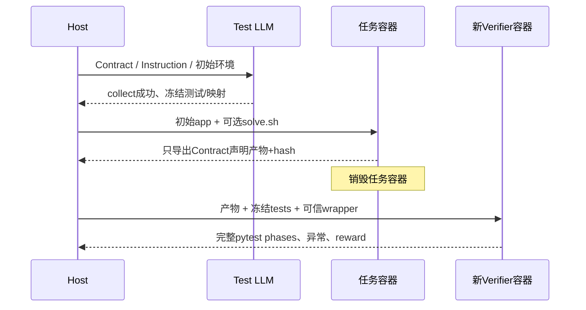
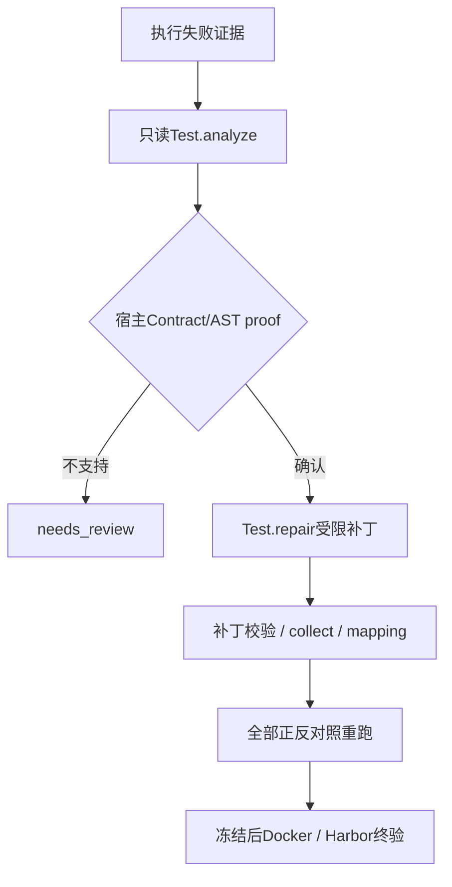

# 系统架构

角色共用Config和模型服务，但调用者分别构造fresh messages；宿主拥有调度、文件白名单、执行与最终接受权。

## 数据和生成

`validate_inputs(plan, contract)`检查支持域、必需文本、唯一requirement IDs、artifact路径和正整数limits。外部Plan表述方向；Contract表述完成真值，生成时appendix自动附在Instruction。`check_instruction`默认核对Contract附录一致性；CSV格式规则由Config.consistency_rules显式启用，不因文本出现CSV自动启用。

`SynthesisAgent._run`维护FileSet，工具read/write/delete/shell/self_check/finish；Dockerfile由可信模板写入。shell每次新容器、不持久化修改。self_check在初始与修复新容器执行生成者probe，要求初始至少一项assertion fail、修复全部pass、app修改在Contract范围内、原环境不变。成功绑定当前digest，状态candidate_generated，仅为候选。

CandidateTask.load核对metadata布局与完整manifest、draft不存在未列文件、Contract支持域。test_input只返回Contract、Instruction、初始环境，reference/probe不跨模型边界。

## 独立测试与评分

TestAgent只写根test_*.py/fixtures，收集工具运行固定pytest镜像wrapper --collect-only。finish校验当前digest、真实nodeids、Requirement Mapping；tests_generated不表示运行通过。

DockerTestRunner分别跑Oracle/Nop和正反对照，wrapper核对expected nodeids、setup/call/teardown和exit code。只有正常AssertionError/pytest.fail的任务失败可得reward0；skip/xfail、解码/fixture错误、不完整报告等为error/null。比对实现/产物转交/Verifier文件hash；solution安装日志私有。Verifier不是任意恶意测试的形式安全执行器。

## 修复权限和状态

普通test-only loop最多2次，诊断默认一次有效提交、最多2尝试、24576bytes请求、2000completion。Oracle-only failure=analysis_only不能改测试。repair_proofs注册有限Print-N stdout和JSON doubling适配器；不支持的Contract或测试形态在模型诊断前停止为needs_review，不能自动授权一般CSV修复。

RepairDispatcher是另一路径：RepairRequest绑定版本/问题/requirements/evidence/manifest/tests_digest/allowed_paths/remaining_budget；保存versions/repairs/history，统一调用/工具/修复上限，拒绝重复状态和无改动。static failure归Synthesis；普通测试缺陷需宿主确认；外部owner声明不授权。公开输入改动需重新生成Test。最后调用禁修复verify，离线重判重算原始证据与proof。

## Challenge与审查

ChallengeAgent可读冻结评分，只写solution，提交JSON witness；没有reference访问和test编辑。witness提供CLI argv/stdin/fixtures与固定观察断言。Reviewer新对话仅拿Contract+witness，去掉rationale，无scoring/Oracle结果/候选源码。宿主要求witness错解fail、Oracle和正确对照pass，再两次冻结评分均pass并审计hash/phase/产物一致，Controller才给tests补测授权。

增补只能新文件，旧文件逐字/nodeids不变；独立补丁review检查通用Contract行为。所有已确认错误候选（不只误通过者）与正对照重跑，再复验独立witness。Docker resolved_docker后仍需Harbor。模型Reviewer可错，搜索未找到漏洞不证明测试充分。当前算子含parsed_file(json/jsonl/csv)，不支持旧文档json_file。

普通all与Dispatcher repair互斥；不是一个统一循环。专用acceptance/robustness还提供fixture工作副本与UTF8输出边界的受限AST准备、真实搜索/补测和>=3轮冻结终验；历史panel不向模型反馈，adapter允许其残余漏检，因此adapter passed和原生Controller accept须分开。

## 最终验证与持久化

`verify`在holdout_started之后禁模型，执行final Docker与Harbor全部冻结对照。panel需要Contract-bound、独立审查且互异的feedback/holdout × correct/invalid四组；双后端对比tests/wrapper/artifact-policy/Contract/实现摘要、具体artifact与outcome。Controller纯规则返回accept/repair/needs_review/error/not_evaluated；finally先清零independent_validation，只有完整accept再置true。

Harbor0.25.0导出schema1.3和separate verifier，读取原生result、reward.txt、wrapper执行报告再分类。当前Harbor两环境public；原生Docker none。没有在本分支伪造严格no-network通过。

主要产物为synthesis/tests/execution/run_result/decision JSON、trace JSONL、versions/changes.patch、manifest与session context。API客户端记录每网络尝试阶段、异常链、已知usage和未知attempt；临时传输错误最多一次重试。日志脱敏和长字段摘要限制可重建程度；hash不替代签名，绝对路径迁移需重新绑定。

## 源码阅读顺序

1. `synthesis_agent/inputs.py → agent.py → files.py/sandbox.py/client.py`。
2. `independent_verification/candidate.py → agent.py → docker_test_runner.py/wrapper.py`。
3. `pipeline.py → controller.py/panel.py → test_repair_workflow.py/attribution.py/diagnosis.py`。
4. `repair.py → challenge.py/challenge_workflow.py → exporter.py/harbor.py`。
5. `acceptance.py/robustness.py`是通用验收适配层；`tests`中scripted客户端是测试设施，不是生产Agent。

## Candidate Orchestrator

`candidate_batch.orchestrator.CandidateOrchestrator`串联真实Synthesis与原生verify。
失败记abandoned，相邻两次同类失败暂停；resume校验输入、历史产物、源码指纹和累计预算，基础设施故障需免费预检。
PersistentBudget在调用计数和usage更新后持久化，Dispatcher分支也接收同一budget。
原生终验现将所有violation_status=confirmed的Challenge实现加入Harbor运行，另存challenge-harbor-trials.json；Docker也执行这些实现。
编排器没有另设接受标准；普通all与Dispatcher的修复路径边界保持原状。
