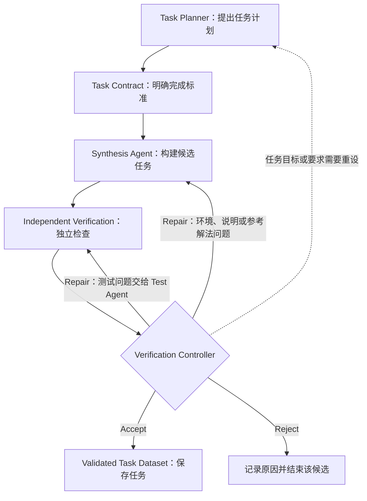
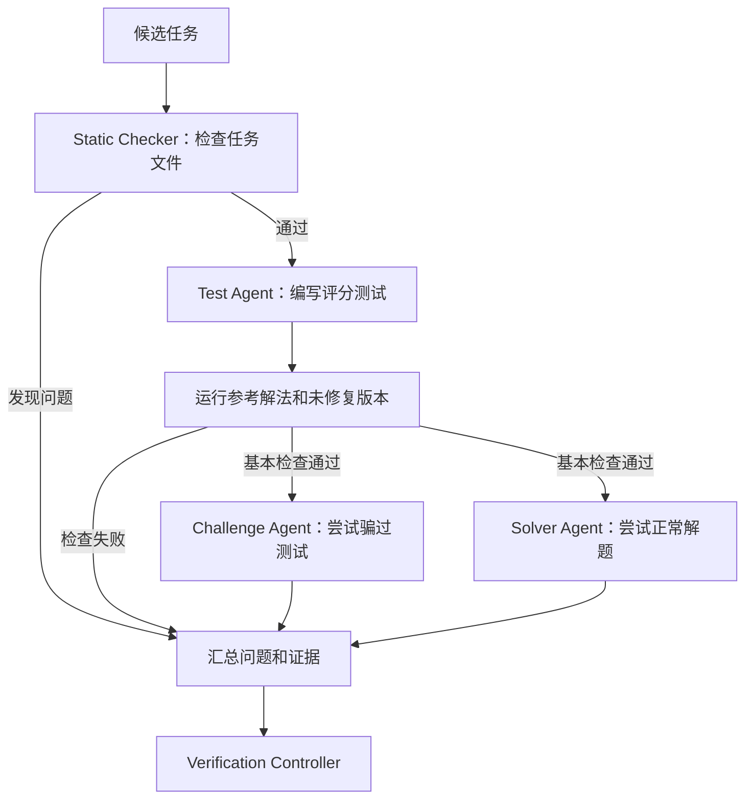

# Task Generation Agent 总体设计

> 本文描述设计目标，包含尚未实现的 Planner、Solver 等模块。当前实现及边界见 [系统架构](ARCHITECTURE.md) 和 [实现说明](IMPLEMENTATION.md)。

## 1. Task Requirements

一个 Terminal-Bench 任务通常包含任务说明（Instruction）、初始环境（Environment）、参考解法（Solution）、测试程序（Tests）和运行配置。解题 Agent 根据说明在给定环境中操作，最后由测试判断是否完成任务。

根据 [Terminal-Bench 官方任务指南](https://github.com/harbor-framework/terminal-bench/blob/main/docs/task-guidelines.md)，任务主要需要满足以下要求：

- **Verifiable（可验证）**：尽量通过可靠、高效的程序判断结果，避免主观评分；测试既不能放过错误结果，也不能误判正确结果。
- **Well-specified（要求明确）**：说明应交代目标、输入输出和必要限制。不能把解题者需要知道的要求藏在测试里，但也不必指定实现方法。
- **Solvable（确实可解）**：任务应有合理解法，必要的信息和资源能够获取；熟悉相关领域的人原则上能在几小时内完成。
- **Difficult（有实际难度）**：难度应来自技术推理和问题解决，而不是繁琐操作、刻意设陷阱或利用模型弱点。
- **Realistic, valuable, and interesting（真实且有价值）**：最好取材于真实技术场景，解决的问题应有实际意义。
- **Outcome-verified（验证结果，而非过程）**：只要最终满足要求，就应允许不同的正确实现。

### 1.2 Additional Criteria

自动生成任务时，我觉得还要额外关注四件事：

- **各部分是否一致**：Instruction、Environment、Solution 和 Tests 必须对应同一套要求。例如，说明要求保留旧接口，测试却只检查服务能否启动，就会漏掉关键问题；测试也不能偷偷增加要求。
- **测试有没有漏洞**：错误解法可能碰巧通过，正确解法也可能因为测试写得太死而失败。
- **环境是否可复现**：依赖版本、网络访问和构建残留可能改变结果。初始环境要能重新创建，参考解法和隐藏测试也不能泄漏给解题者。
- **难度和多样性**：需要区分真正的技术难点与说明含糊、环境损坏造成的失败；仅仅给同一种任务换个背景，也不能算有多少新内容。

## 2. Proposed Architecture

### 2.1 总体流程

我把任务生成分成六步：提出任务想法、写清完成标准、搭建任务、独立验证、决定是否修复，最后保存合格的任务。

这里的模块是职责划分，不一定每个都需要单独调用一个模型。比如 Contract 可以由 Planner 起草，Static Checker 和 Controller 的一部分可以先用脚本实现。

下面统一用一个假设例子说明：**修复本地库存查询服务**。解题者拿到一个有故障的 Python 项目和一份库存数据，需要让服务正常启动，并能按库存文件返回查询结果。这里只用它解释设计流程，不预设它已经达到 Terminal-Bench 的难度要求。

### 2.2 Task Planner：决定生成什么任务

**输入：** 目标能力、任务类别、预计难度、已有任务记录和可参考的技术材料。

Planner 负责提出任务方向，说明希望考察哪些能力、难点大概在哪里。这里借鉴 [CLI-Universe](https://arxiv.org/abs/2606.22883) 用能力分类和真实技术材料辅助选题的思路。

例如，要考察查看日志、理解配置和修复接口的能力，可以设计一个启动及查询逻辑都有问题的库存服务。解题者需要自己定位故障，修好后还得支持不同的库存文件。

**输出：** 任务计划、目标能力、材料来源和预期难点。此时还不用生成整个项目；难度也只是初步估计。

### 2.3 Task Contract：明确什么叫“完成任务”

**输入：** Planner 的任务计划。

Contract 把任务想法整理成可检查的要求，包括初始条件、输入输出、限制和成功标准。不一定需要复杂的数据格式，一份清晰的清单就够了。

以库存服务为例：

- 项目放在 `/app`，通过 `python app.py` 启动，监听 `127.0.0.1:8000`。
- 数据在 `/app/data/inventory.json`，格式如 `{"items":[{"id":"A01","stock":5},{"id":"B02","stock":0}]}`。商品 ID 是不重复的非空字母数字字符串，`stock` 为非负整数；运行期间文件不发生变化。
- `GET /health` 返回 HTTP 200，JSON 中包含 `"status":"ok"`。
- `GET /items/{id}` 对已有商品返回 HTTP 200，`id` 和 `stock` 与文件一致；不存在则返回 HTTP 404。
- 每次启动时读取当时的库存文件，不能只针对示例数据写死结果。
- 允许修改代码、配置和依赖，但不能修改库存文件；不限制修复方法。

**输出：** 一份完成标准，供 Synthesis Agent 和 Test Agent 使用。凡是解题者必须知道的条件，都要体现在正式 Instruction 中（写在内部 Contract 中没用）。

Contract 只规定**修好后应该怎样**，不提前指出故障位置。

### 2.4 Autonomous Synthesis Agent：构建可运行的任务

**输入：** 任务计划、Contract 和参考材料。

Synthesis Agent 在终端里创建项目、安装依赖、运行命令并根据报错修改环境，同时编写 Instruction 和 Reference Solution。这种实际执行、观察结果再调整的方式参考了 [Meta-Task](https://arxiv.org/abs/2607.27929)。

库存服务可以这样构建：

1. 生成 `app.py`、配置文件和库存数据。
2. 故意设置两个待修复的问题：启动代码读取的配置字段不对；查询代码仍读取旧字段 `quantity`，而数据里使用 `stock`。
3. 根据 Contract 编写任务说明，交代运行方式、接口行为和数据格式，不直接透露这两个故障。
4. 复制初始环境，在隔离副本中编写、运行参考解法，确认这两个问题可以被修好。
5. 分开保存**未修复的初始环境**和**参考解法**。

这里需要区分两种失败：容器缺少 Python、依赖无法安装，是任务生成过程中的问题，应该修好；服务因为预先设置的配置错误而启动失败，是留给解题者的任务，不能提前修掉。

**输出：** 初始环境、Instruction、Reference Solution、运行配置和构建记录。到这一步只能说明候选任务搭建出来了，还不能说明它符合要求。

### 2.5 Independent Verification System：独立检查任务是否合格

验证分成四部分，分别检查文件配置、评分程序、评分漏洞和实际可解性。

#### Static Checker：文件和配置有没有明显问题？

先用规则检查目录结构、路径、依赖声明、危险配置和明显的答案泄漏。例如 Reference Solution 被误放进解题者可访问的 `/app` 目录，就应该直接报出文件位置，退回修改。这个模块不负责判断业务逻辑是否正确。

#### Test Agent：怎样判断解题者是否完成了任务？

Test Agent 根据 Contract、Instruction 和初始环境编写评分测试。**第一版测试不看参考解法**，以免照着某个具体实现方式设计评分。

库存服务至少要测：

- **启动与基本接口**：服务能否启动，`/health` 的状态码和内容是否正确。
- **正常与边界输入**：A01 是否返回 `{"id":"A01","stock":5}`，库存为 0 的 B02 是否正常返回。
- **更换数据**：把文件换成 `{"items":[{"id":"C03","stock":9}]}` 后重启，查询 C03 应返回 `{"id":"C03","stock":9}`。
- **异常情况与限制**：查询 Z99 是否返回 404，库存文件是否被擅自修改。

除了测试代码，Test Agent 还要列出每条 Contract 要求对应的测试，方便查漏。

之后从干净的初始环境分别运行参考解法和未修复版本。前者应通过，后者不应完整通过；如果结果反常，再检查是任务包还是测试有问题。

#### Challenge Agent：错误解法能不能骗过测试？

Challenge Agent 与 Test Agent 的分工不同：前者**专门找能通过测试的错误实现**。它可以看到要求和测试，尝试利用其中的遗漏。

比如测试只查询 A01，Challenge 就可以实现一个永远返回 `A01=5` 的假服务。如果它也得了满分，就说明测试根本没验证“根据库存文件查询”。Challenge 需要提交错误实现、违反的要求以及通过测试的证据，再交给 Test Agent 补测。

#### Solver Agent：一个正常解题者能否完成任务？

Solver Agent 模拟真正接受评测的解题者，**只能看到 Instruction 和初始环境**，不能读取内部 Contract、隐藏测试和参考解法。

它需要自己查看报错、定位代码或配置问题并提交修复。系统记录它的操作、最终结果和运行条件，用来估计任务的可解性与难度。如果多个 Solver 都卡在说明中缺失的必要信息上，应该优先检查任务设计，而不是直接认定任务太难。

验证顺序如下。通过基础检查后，Challenge 和 Solver 可以分别运行：

流程图描述的是执行顺序，不代表模块之间共享全部信息；尤其是 Solver，始终按正式解题权限运行。

### 2.6 Verification Controller：决定接受、修复还是放弃

Controller 汇总检查结果和证据，决定下一步。初期可以用规则实现，不一定需要额外训练决策模型。

- **Accept**：参考解法能在重新创建的环境中通过测试，目前没有发现未解决的关键问题。
- **Repair**：能定位缺陷时，只退回相应模块修改。比如 Challenge 找到评分漏洞，就让 Test Agent 补测试，不能迎合原测试。
- **Reject**：任务目标不合理、反复修复无效，或超过运行预算，就结束这个候选并记录原因。

每次修复后都要重新检查受影响的部分，并在最终接受前再做一次完整验证。预算耗尽和确定存在严重缺陷应分开记录。

### 2.7 Validated Task Dataset：最终保存什么

保留完整任务包、材料来源、验证记录、模型及运行条件、修复历史和未解决的问题。具体目录可参考 [Harbor 任务格式](https://docs.harborframework.com/tasks/overview)。如果将来用任务训练 Agent，也可以另存成功 Solver 的轨迹并标注任务版本。

这里的“Validated”只是**通过当前检查**，不等于保证没有问题，后续仍需要抽样复核。

### 2.8 How the Architecture Addresses Task Requirements

回到第一章的标准，各部分大致对应如下：

- **要求明确、结果可验证**：Contract 明确验收条件；Test Agent 编写测试；Challenge Agent 检查测试漏洞。
- **可解、难度合理**：Reference Solution 提供一种可行解；Solver 的实际表现用于辅助判断难度，并排查说明和环境问题。
- **真实、有价值、可复现**：Planner 参考真实材料选题；Static Checker 和重复运行检查环境；任务价值仍需要人工抽查。

评分只看结果，不应限定某一种实现。上述检查能发现一些常见问题，但无法证明任务绝对正确。

## 3. Key Design Decisions

### 3.1 为什么先写 Task Contract

我的考虑是**先确定验收标准，再生成项目和测试**。否则，生成模块和评分模块容易各自理解任务，最后做出两套不完全一致的要求。

但 Contract 不是不能改。搭建环境时发现要求不合理，可以修改并同步更新 Instruction、Environment、Solution 和 Tests，同时记录原因。需要避免的是：仅因为参考解法没有通过测试，就放宽原本合理的标准。

### 3.2 为什么采用一个核心生成 Agent，再加独立验证

构建任务的过程需要不断操作文件、运行命令和调试。让同一个 Synthesis Agent 连续完成这些工作，可以保留上下文，不用每一步都重新理解项目。

验证则最好分开。生成 Agent 可能一开始就理解错了要求，如果参考解法和测试都由它自己写，两者即使相互匹配，也可能一起偏离目标。

这里的“独立”主要靠**信息隔离**：Test Agent 初次写测试不看参考解法；Solver 只看正式任务。信息隔离不能消除所有共同错误，所以还要保留反例和人工复核环节。

### 3.3 怎样判断验证是否可靠

我准备主要看三类问题：

1. **漏判**：未修复版本或故意遗漏部分功能的实现，是否还能通过测试。
2. **误判**：功能正确但实现不同的解法，是否被错误拒绝。例如 JSON 字段顺序不同，不应单凭字符串比较就判失败。
3. **复现性**：换一个干净环境重复运行，结果是否稳定。

参考解法通过测试只是最基本的检查，不能代替后两项。对于 Solver 的失败，也要先核查运行条件，避免把环境故障误当成任务难度。

### 3.4 怎样根据反馈修复问题

我希望反馈不仅包含“失败”，还包含**对应要求、复现方法和可能出错的模块**。例如测试失败是因为镜像里缺少依赖，就应先修环境；如果某个正确行为被测试错误拒绝，就应检查测试的断言。

定位到问题后优先做局部修改，但改完必须回归测试。如果改动涉及 Contract，还要同步检查说明、环境、解法和测试。

[FACET](https://arxiv.org/abs/2608.18580) 也采用按失败原因定向修复的思路。这里我还不确定 Controller 能否可靠地区分这些问题。如果分类不准，局部修复反而可能引入更多错误，需要在实验里专门检查。

## 4. 有待验证的问题与初步实验计划

目前只是架构设计，还没有验证各个模块是否真的有效。我打算先做一个小原型，范围限定在服务修复类任务，第一轮生成 5–10 个候选。重点是记录**失败发生在哪一步、额外的验证模块带来了什么改进**。

### 4.1 Task Contract 是否真的有必要？

Contract 可能减少要求不一致的问题，但也可能只是多了一份文档，并没有改善生成结果。

我准备检查每个任务的 Instruction 和 Tests 对 Contract 要求的覆盖情况，记录遗漏、冲突和含糊的地方；再与**直接根据任务计划生成、不单独写 Contract**的版本比较。这样才能判断多出的步骤值不值得。

### 4.2 独立 Test Agent 和 Challenge Agent 是否真的能提高测试质量？

这是我最想优先测试的问题。计划比较三种设置：

1. Synthesis Agent 自己写测试并自检。
2. 由独立 Test Agent 写测试。
3. 在第二种基础上加入 Challenge Agent。

对同一批任务，准备一组**额外构造、已知有缺陷的解法**，例如硬编码结果、只支持部分输入、忽略边界条件。比较三种设置能抓住多少错误，以及额外耗费多少次调用和运行时间。不能只拿验证系统自己发现的错误来评价它，否则容易高估效果。

如果 Challenge Agent 很少发现 Test Agent 漏掉的问题，就没有必要始终单独运行它。

### 4.3 Controller 能否正确定位问题并修复？

Controller 面临的不只是“发现失败”，还要判断该改哪里。比如参考解法没有通过，可能是解法本身错了，也可能是测试增加了说明中没有的要求。

每次失败都记录 Controller 的归因、选中的修复模块、修改前后结果，以及是否引入新问题。再比较**定向修复**与**直接重新生成**的成功率和成本。如果错误归因太多，应该先改进反馈和分类。

### 4.4 难度应该怎样判断？

Planner 的难度估计只能当作起点。实际测量时，我打算在排除已知任务缺陷后，让 Solver 在相同条件下多次尝试，记录成功率、耗时和失败类型；必要时再比较不同能力的 Solver。

第一轮样本少，不足以给难度做可靠分级，先看哪些因素导致失败、哪些任务值得继续测。

### 4.5 增加这些验证模块是否值得？

验证越多，成本也越高。我会记录各模块的调用次数、运行时间、模型开销和新增发现的问题，再看哪些步骤真正有用。

原型阶段先设置生成和修复次数上限。如果某个模块成本很高、却几乎没有额外发现，可以改为按需触发。无论怎么省成本，接受任务前的基本复核不能省。

第一轮结束后，再决定保留哪些模块，以及是否有一个值得进一步深入的研究问题。

## 5. Related Work & Comparison

### 5.1 三项工作的主要启发

**[CLI-Universe](https://arxiv.org/abs/2606.22883)**：用能力分类和真实技术材料辅助选题，并通过多阶段检查筛选任务。对应这里的 Planner 和初步筛选。

**[Meta-Task](https://arxiv.org/abs/2607.27929)**：让 Agent 在真实容器里构建任务、执行命令、观察反馈并修改。对应 Synthesis Agent 的工作方式。

**[FACET](https://arxiv.org/abs/2608.18580)**：关注任务原始意图，以及说明、解法和测试的一致性，并根据失败原因修复。与这里的 Contract 和 Controller 比较接近。

### 5.2 本方案的定位与下一步

目前，这个设计主要是对已有思路的组合：用 CLI-Universe 式的能力规划决定生成什么任务，借鉴 Meta-Task 的 Agent 执行循环来构建任务，再结合类似 FACET 的要求一致性检查和定向修复。

**我目前最想验证的是**：独立测试加上主动寻找错误解法，能否实际提高任务评分的可靠性，而且收益是否值得额外成本。

下一步先做小规模原型，收集具体的失败与修复案例，再用第四章的对照设置验证。如果能找到某个模块稳定解决、其他方法解决不了的问题，才有理由把它发展成更明确的研究方向。
